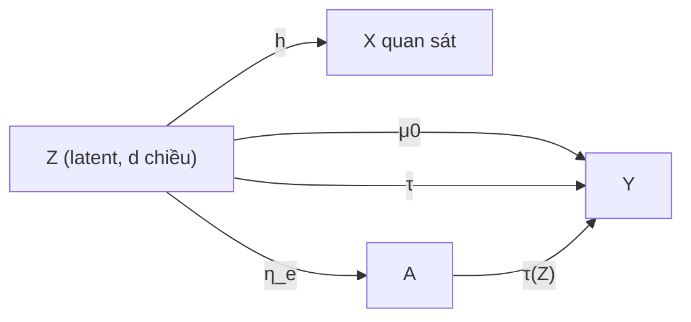

# Kịch bản sinh dữ liệu chung cho các phương pháp học máy (ML-DGP)

## Mục tiêu

`distribution_scenario/` và `variable_scenario/` dùng DGP tuyến tính với 2 confounder. Ở đó mô hình tham số **đúng dạng**, nên học máy không có gì để so sánh so với phương pháp thống kê. Nhóm kịch bản này cung cấp **một DGP chung có thể điều chỉnh** để so sánh IPTW, AIPW, TMLE, DML, Meta-learner và **Bayesian Causal Forest (BCF)** trong điều kiện mà văn liệu causal ML cho là có ý nghĩa:

1. Mô hình tham số **sai dạng** (phi tuyến, tương tác, ngưỡng) ở PS, ở outcome, hoặc cả hai
2. Hiệu ứng điều trị **không đồng nhất** $\tau(X)$, để đánh giá CATE
3. Overlap yếu và số chiều lớn (biến nhiễu thừa, sparsity)

Chú thích:


Ở đây chắc chắn bạn Giang sẽ thắc mắc vì sao ở dưới có biến Z trong khi mình đang dùng biến X đại diện cho confouding. Thật ra dữ liệu thật nhận được mấy cái biến nhiễu là mình chỉ nhìn được X thôi, Z là biến nội tại thật sự cần thiết lúc simulate. Ví dụ nhé:
- Đi tập gym = X (confouding đóng góp) -> đóng góp vô việc Giang có quyết định đi ngủ trước 22h hay không (treatment) -> Từ đó sức khỏe có cải thiện không(Kết quả Y)
- Cái mình thấy chỉ là biến đi tập gym, nhưng về bản chất tập gym sẽ là cơ thể hạ năng lương = Z1 + đẩy quá trình trao đổi chất = Z2, mấy cái này thực tế dữ liệu không có đo được mà biểu hiện qua X thôi. Còn simulate thì mình là chúa trời nên mình phải có nguyên tử Z để viết lên công thức hóa học X

Cái này mình ý tưởng từ bài báo  Kang, J. D. Y. & Schafer, J. L. (2007) - bài đầu trong danh sách tham khảo của mình
Bạn đọc phần 1.4 của nó.

---

## 1. Mô hình sinh dữ liệu



### 1.1 Biến nền

$$
Z \sim N_d(0, \Sigma), Corr(Zj,Zk) = \qquad \Sigma_{jk} = \rho^{|j-k|}, \qquad U_j = \Phi(Z_j) \in [0,1]
$$

Chỉ 5 tọa độ đầu $Z_1,\dots,Z_5$ tham gia vào $e$, $\mu_0$, $\tau$. Các tọa độ còn lại là **biến nhiễu thừa** (noise covariates) mà người phân tích không biết là thừa.

**Biến quan sát** $X = h(Z)$, hai chế độ:

- `identity`: $X = Z$. Tức là dữ liệu đo được nguyên tử Z thiệt luôn chứ không phải X thui
- `ks`: biến đổi Kang–Schafer (2007)(bài báo đầu), chỉ áp dụng cho 4 tọa độ đầu, còn lại giữ nguyên(ổng lấy sao t lấy v):

$$
X_1 = \exp(Z_1/2),\quad
X_2 = \frac{Z_2}{1+\exp(Z_1)} + 10,\quad
X_3 = \Big(\frac{Z_1 Z_3}{25} + 0.6\Big)^3,\quad
X_4 = (Z_2 + Z_4 + 20)^2
$$


### 1.2 Propensity score

$$
e(Z) = \sigma\big(\gamma_0 + \kappa\, \tilde\eta_e(Z)\big), \qquad A \sim \text{Bernoulli}(e(Z))
$$

$\tilde\eta_e$ là $\eta_e$ **đã chuẩn hóa về phương sai 1** trên mẫu tham chiếu $n = 10^6$. Hai dạng:

| Mã | $\eta_e(Z)$ | Ghi chú |
|---|---|---|
| `e-lin` | $Z_1 - 0.5 Z_2 + 0.25 Z_3 + 0.1 Z_4$ | Kang–Schafer (2007), **đã đổi dấu toàn bộ** (xem ghi chú) |
| `e-nl` | $Z_1 + 0.5\,Z_1 Z_2 + 0.5\,(Z_3^2 - 1) + \mathbb{1}\{Z_4 > 0\} - 0.5$ | tương tác, bậc hai, ngưỡng: ba kiểu phi tuyến mà logit bỏ sót |

- $\kappa$ điều khiển **overlap**: $\kappa = 1$ (chuẩn), $\kappa = 2$ (yếu). Báo cáo tỉ lệ $e \notin [0.05, 0.95]$ cho từng $\kappa$.
- $\gamma_0$ hiệu chỉnh để $P(A=1) \approx 0.5$, tính lại cho từng kịch bản.
- **Ghi chú về dấu của `e-lin`:** Kang–Schafer gốc dùng $-Z_1 + 0.5 Z_2 - 0.25 Z_3 - 0.1 Z_4$, cho $\mathrm{Cov}(\tilde\eta_e, \tilde\mu_0) < 0$ và naive bias **âm**, ngược chiều với `e-nl` và với hai nhóm kịch bản cũ. Ở đây nhân toàn bộ với $-1$ để naive bias dương ở mọi kịch bản. Độ lớn confounding không đổi ($|\mathrm{Cov}| = 0.63$ với `m-lin`, $0.32$ với `m-nl`), chỉ đổi hướng. L1 vì vậy là Kang–Schafer "đổi dấu", không phải bản sao nguyên văn.

### 1.3 Outcome

$$
Y = \tilde\mu_0(Z) + A\,\tau(Z) + \varepsilon, \qquad \varepsilon \sim N(0, \sigma^2),\ \sigma = 1
$$

$\tilde\mu_0$ chuẩn hóa về phương sai 1, nên $R^2$ (tỉ lệ phương sai của tín hiệu với nhiễu ) của phần baseline $\approx 0.5$.

| Mã | $\mu_0(Z)$ | Ghi chú |
|---|---|---|
| `m-lin` | $Z_1 + 0.5 Z_2 + 0.5 Z_3 + 0.5 Z_4$ | Kang–Schafer, hệ số chia cho 27.4 |
| `m-nl` | $\sin(\pi U_1 U_2) + 2(U_3 - 0.5)^2 + U_4 + 0.5\,U_5$ | hàm Friedman (1991); setup A của Nie–Wager (2021) |

| Mã | $\tau(Z)$ | Ghi chú |
|---|---|---|
| `t-const` | $1$ | ATE $= 1$; dùng cho so sánh IPTW/AIPW/TMLE/DML-PLR |
| `t-lin` | $1 + 0.5(Z_1 + Z_2)$ | setup A của Nie–Wager |
| `t-nl` | $1 + \max(Z_1 + Z_2 + Z_3, 0) - \max(Z_4 + Z_5, 0)$ | setup D của Nie–Wager; ReLU từng mảnh |

### 1.4 Estimand và giá trị thật

$$
\text{ATE} = E[\tau(Z)], \qquad \text{CATE}(x) = \tau(z) \text{ với } z = h^{-1}(x) 
\text{ (trả ngược lại hàm từ } X \text{ ra } Z\text{)}
$$

ATE lấy **dạng đóng**, không Monte Carlo: `t-const` và `t-lin` bằng đúng 1 (vì $E[Z_j]=0$); `t-nl` với $S_1 = Z_1+Z_2+Z_3 \sim N(0, v_1)$, $S_2 = Z_4+Z_5 \sim N(0, v_2)$ và $E[\max(S,0)] = \sqrt{v/2\pi}$:

$$
\text{ATE}_{\text{t-nl}} = 1 + \sqrt{\tfrac{v_1}{2\pi}} - \sqrt{\tfrac{v_2}{2\pi}},\qquad v_1 = 3 + 2(2\rho + \rho^2),\quad v_2 = 2 + 2\rho
$$

Với $\rho = 0.3$: $v_1 = 4.38$, $v_2 = 2.6$, ATE $= 1.1916$. CATE thật được lưu theo từng quan sát (`tau_i`) để tính PEHE (sai số giữa CATE ước lượng và CATE thật). Giả định: SUTVA, consistency, unconfoundedness , positivity (có chủ ý làm yếu ở $\kappa = 2$).

### 1.5 Tham số chung

| Tham số | Giá trị |
|---|---|
| $d$ | 10 (mặc định), 100 (kịch bản cao chiều) |
| $\rho$ | 0.3 |
| $\sigma$ | 1.0 |
| $n$ | {500, 1000, 2000, 5000} |
| Số lần lặp $R$ | 200; 500 |
| Cross-fitting | $K = 5$, cùng một phân hoạch cho mọi estimator trong một lần lặp |

---

## 2. Lưới kịch bản

Không chạy toàn bộ tổ hợp. Mỗi kịch bản trả lời một câu hỏi.

| Mã | $h$ | $\eta_e$ | $\mu_0$ | $\tau$ | $\kappa$ | $d$ | Câu hỏi |
|---|---|---|---|---|---|---|---|
| **L0** | identity | lin | lin | const | 1 | 10 | mốc: Mô hình dự đoán đúng dạng, ML mất bao nhiêu hiệu quả |
| **L1** | ks | lin | lin | const | 1 | 10 | Kang–Schafer: Mô hình dự doán sai dạng cả hai; ML + cross-fit có cứu được không |
| **N1** | identity | **nl** | lin | const | 1 | 10 | chỉ PS sai dạng: double robustness của AIPW/TMLE/DML |
| **N2** | identity | lin | **nl** | const | 1 | 10 | chỉ outcome sai dạng |
| **N3** | identity | **nl** | **nl** | const | 1 | 10 | cả hai phi tuyến: cần ML; so sánh có và không cross-fitting |
| **O1** | identity | nl | nl | const | **2** | 10 | overlap yếu: IPTW nổ, TMLE so với AIPW khi trọng số cực đoan |
| **H1** | identity | nl | nl | **lin** | 1 | 10 | CATE với $\tau$ đơn giản, $\mu_0$ phức tạp |
| **H2** | identity | nl | **lin** | **nl** | 1 | 10 | CATE với $\tau$ phức tạp, $\mu_0$ đơn giản |
| **H3** | identity | nl | nl | **nl** | 1 | 10 | cả hai phức tạp |
| **D1** | identity | nl | nl | lin | 1 | **100** | cao chiều, 95 biến thừa: sparsity, lasso/GBM, DML |

Tùy chọn mở rộng (không chạy ở vòng đầu): phương sai sai số phụ thuộc $Z$ (heteroscedastic), $\sigma = 2$ (signal-to-noise thấp), $P(A=1) = 0.1$ (mất cân bằng, X-learner của Künzel et al. 2019), ATT thay vì ATE.

---

## 3. Phương pháp và learner

### 3.1 Estimator

| Phương pháp | Nuisance | Estimand | Ghi chú |
|---|---|---|---|
| RA (g-computation) | $\hat\mu_a$ | ATE | $\frac1n\sum_i[\hat\mu_1(X_i) - \hat\mu_0(X_i)]$; SE bootstrap hoặc delta với `glm`. Với ML không có SE hợp lệ, chỉ báo bias/RMSE |
| IPTW (Hájek) | $\hat e$ | ATE | SE theo IF; trimming $\hat e \in [0.01, 0.99]$ |
| AIPW | $\hat e, \hat\mu_a$ | ATE | cross-fit; SE $= \mathrm{SD}(\hat\psi_i)/\sqrt n$ |
| TMLE | $\hat e, \hat\mu_a$ | ATE | CV-TMLE (cross-fit nuisance), bước targeting logistic trên clever covariate |
| DML-PLR | $\hat e, \hat m$ | ATE (khi $\tau$ const) | partially linear; với $\tau(X)$ không đồng nhất, PLR ước lượng trung bình có trọng số $\frac{E[e(1-e)\tau]}{E[e(1-e)]}$, **không phải ATE**, chỉ chạy ở `t-const` |
| DML-IRM | $\hat e, \hat\mu_a$ | ATE | trùng công thức AIPW cross-fit; dùng để kiểm tra chéo cài đặt |
| S / T / X-learner | $\hat\mu$ hoặc $\hat\mu_a$ (+ $\hat e$ với X) | CATE | Künzel et al. (2019) |
| R-learner | $\hat e, \hat m$ | CATE | Nie–Wager (2021) |
| DR-learner | $\hat e, \hat\mu_a$ | CATE | Kennedy (2023): hồi quy pseudo-outcome AIPW lên $X$ |
| Bayesian Causal Forest (BCF) | $\hat e$ | CATE (và ATE hậu nghiệm) | Hahn, Murray & Carvalho (2020): phân rã $\mathbb{E}[Y \mid X, A] = \mu(X, \hat e(X)) + \tau(X) \cdot A$ bằng hai rừng cây BART độc lập; đặt tiên nghiệm (prior) co cụm mạnh lên $\tau(X)$ để tránh thiên lệch điều chỉnh (regularization-induced confounding); suy luận khoảng tin cậy hậu nghiệm trực tiếp từ mẫu MCMC |

Hàm AIPW/IRM dùng chung:

$$
\hat\psi_i = \hat\mu_1(X_i) - \hat\mu_0(X_i) + \frac{A_i\,(Y_i - \hat\mu_1(X_i))}{\hat e(X_i)} - \frac{(1-A_i)\,(Y_i - \hat\mu_0(X_i))}{1-\hat e(X_i)}
$$

Cấu trúc mô hình Bayesian Causal Forest (BCF):

$$
Y_i = \mu\big(X_i, \hat e(X_i)\big) + \tau(X_i)\,A_i + \varepsilon_i, \qquad \varepsilon_i \sim N(0, \sigma^2)
$$

Trong đó $\mu(\cdot)$ sử dụng rừng cây BART tiêu chuẩn (nhiều cây, độ sâu linh hoạt) để hấp thụ cấu trúc phi tuyến của hàm kết quả nền và nhiễu thông qua điểm xu hướng $\hat e(X_i)$ dùng chung từ `learners.py`, còn $\tau(\cdot)$ sử dụng rừng cây BART độc lập với số lượng cây ít hơn, độ sâu nông và mức độ co cụm (shrinkage) mạnh để ước lượng CATE mượt mà, đồng thời tính ATE hậu nghiệm qua $\frac{1}{n}\sum_{i=1}^n \tau^{(m)}(X_i)$ tại mỗi bước lặp MCMC $m$.

### 3.2 Thư viện learner

Mọi estimator (và thành phần $\hat e(X)$ đầu vào cho BCF) chạy với **cùng** một danh sách learner cho nuisance:

| Mã | Learner | Vai trò |
|---|---|---|
| `glm` | logistic / OLS trên $X$ (main effects) | tham số, mốc sai dạng |
| `lasso` | logistic / OLS với $\ell_1$, CV | cao chiều (D1) |
| `rf` | random forest | phi tuyến, ít tuning |
| `gbm` | gradient boosting (LightGBM), tuning nhẹ bằng CV | phi tuyến, mạnh nhất kỳ vọng |
| `sl` | Super Learner xếp chồng 4 learner trên | mặc định của TMLE |
| `oracle` | $e$ và $\mu_a$ thật | cận trên hiệu năng |

Cross-fitting là bắt buộc cho `rf`, `gbm`, `sl` (Chernozhukov et al. 2018; Zivich & Breskin 2021). Kịch bản N3 chạy thêm biến thể **không cross-fit** để minh họa. Đối với BCF, bản thân bộ ước lượng là mô hình cây Bayes (BART) toàn cục nên không dùng cross-fitting trên $Y$, nhưng vẫn nhận $\hat e(X)$ đã được cross-fit từ danh sách learner trên (mặc định dùng `gbm` hoặc `sl`, kèm `oracle` để đối chiếu).

---

## 4. Chỉ số và định dạng kết quả

| Estimand | Chỉ số |
|---|---|
| ATE | bias, MC SE của bias, SD, mean SE (hoặc posterior SD với BCF), SE/SD, RMSE, coverage CI 95% (hoặc credible interval 95% với BCF), độ rộng CI |
| CATE | $\text{PEHE} = \sqrt{\tfrac1n\sum_i(\hat\tau(X_i) - \tau_i)^2}$ trên mẫu test độc lập $n_{test} = 2000$; bias của $\overline{\hat\tau}$ so với ATE; riêng BCF báo cáo thêm coverage của khoảng tin cậy hậu nghiệm 95% cho từng điểm $\tau(X_i)$ |
| Overlap | tỉ lệ $\hat e \notin [0.05, 0.95]$, max weight, ESS/n |
| Nuisance | RMSE của $\hat e$ và $\hat\mu_a$ so với giá trị thật (giải thích vì sao một estimator thắng/thua) |

Long format, một dòng cho mỗi (lặp, estimator, learner):

```
scenario | n | rep | estimator | learner | crossfit | estimand | est | se | truth | pehe | status
```

Lưu `results/<scenario>.csv`, tóm tắt sau.

---

## 5. Kỳ vọng (giả thuyết để kiểm chứng)

- **L0:** mọi phương pháp không chệch; ML có SD lớn hơn `glm` một chút. Mốc để đo hiệu năng của ML.
- **L1:** `glm` chệch ở IPTW và RA; AIPW-`glm` cũng chệch vì cả hai sai (Kang–Schafer). ML + cross-fit giảm chệch nhưng chưa chắc về 0 ở $n = 500$ vì $h$ khó học. BCF với $\hat e$ từ ML kỳ vọng giảm chệch tốt nhờ cấu trúc tách biệt $\mu(X, \hat e)$ và khả năng tự động tìm tương tác phi tuyến của BART.
- **N1, N2:** AIPW/TMLE/DML với `glm` vẫn không chệch nhờ double robustness; IPTW chệch ở N1, RA chệch ở N2. RA-`gbm` không cross-fit vẫn gần không chệch nhưng không có SE, đây là lý do cần AIPW/TMLE.
- **N3:** `glm` chệch ở mọi estimator. ML không cross-fit: coverage dưới 95% rõ rệt. ML cross-fit: gần không chệch, coverage phục hồi khi $n \ge 2000$ (điều kiện tốc độ $n^{-1/4}$).
- **O1:** IPTW có SD và max weight lớn; TMLE ổn định hơn AIPW vì ước lượng bị chặn trong miền của $Y$ (Ellul et al. 2025). BCF không chia cho $\hat e(X)$ nên tránh được hiện tượng nổ trọng số ở vùng overlap yếu.
- **H1 vs H2:** H1 ưu S-, R-, DR-learner và **BCF** (họ "mượn" độ mượt của $\tau$; đặc biệt BCF đặt prior co cụm mạnh lên $\tau(X)$ nên kỳ vọng đạt PEHE thấp nhất và coverage hậu nghiệm sát 95% ở H1); H2 ưu T-, X-learner, trong khi BCF vẫn giữ ổn định nhờ tách riêng cây cho $\mu_0$ đơn giản và cây cho $\tau$ phức tạp. Đây là kết quả chính của Künzel et al., Nie–Wager và Hahn et al.
- **D1:** `rf`/`gbm` chịu được biến thừa; `glm` mất hiệu quả; `lasso` tốt vì $\mu_0$, $\eta_e$ thưa trong $Z$. BCF sử dụng tiên nghiệm chọn biến thưa (Dirichlet splitting prior) của BART nên cũng chống chịu tốt trước 95 biến nhiễu thừa.

### 5.1 Pilot DGP (tham số đã khóa)

Từ `pilot_dgp.py`, $n = 10^6$ mỗi kịch bản, $\rho = 0.3$, $\sigma = 1$ (file `results/pilot_dgp.csv`).

| Mã | $\gamma_0$ | ATE | $P(A=1)$ | $e \notin [0.05, 0.95]$ | max weight | ESS/n | naive bias | Cov$(\tilde\eta_e, \tilde\mu_0)$ | $R^2_{\mu_0}$ |
|---|---|---|---|---|---|---|---|---|---|
| L0 | −0.003 | 1 | 0.500 | 0.3% | 43 | 0.76 | 0.52 | 0.63 | 0.50 |
| L1 | −0.003 | 1 | 0.500 | 0.3% | 43 | 0.76 | 0.52 | 0.63 | 0.50 |
| N1 | 0.031 | 1 | 0.499 | 1.2% | 164 | 0.72 | 0.52 | 0.66 | 0.50 |
| N2 | −0.003 | 1 | 0.500 | 0.3% | 43 | 0.76 | 0.27 | 0.33 | 0.50 |
| N3 | 0.031 | 1 | 0.499 | 1.2% | 164 | 0.72 | 0.47 | 0.55 | 0.50 |
| O1 | 0.123 | 1 | 0.498 | 11.9% | 3014 | 0.14 | 0.72 | 0.55 | 0.50 |
| H1 | 0.031 | 1.000 | 0.499 | 1.2% | 164 | 0.72 | 0.65 | 0.55 | 0.50 |
| H2 | 0.031 | 1.1916 | 0.499 | 1.2% | 164 | 0.72 | 0.75 | 0.66 | 0.50 |
| H3 | 0.031 | 1.1916 | 0.499 | 1.2% | 164 | 0.72 | 0.69 | 0.55 | 0.50 |
| D1 | 0.031 | 1.000 | 0.499 | 1.2% | 283 | 0.71 | 0.65 | 0.55 | 0.50 |

- Overlap: $\kappa = 1$ cho 0.3–1.2% quan sát có $e \notin [0.05, 0.95]$; $\kappa = 2$ (O1) cho 11.9%, ESS/n giảm còn 0.14.
- Mọi kịch bản có $|\text{naive bias}| \ge 0.2$; N2 thấp nhất (0.27) vì `m-nl` (Friedman) chỉ tương quan vừa với `e-lin`.
- ATE lấy dạng đóng (mục 1.4): `t-lin` bằng đúng 1, `t-nl` bằng $1 + \sqrt{4.38/2\pi} - \sqrt{2.6/2\pi} = 1.1916$; Monte Carlo $10^6$ chỉ dùng để kiểm tra chéo trong test.

---

## 6. Cấu trúc module

```
ml_scenario/
  dgp/
    covariates.py   # Z ~ N(0, Σ), h(Z): identity | ks
    nuisance.py     # η_e, μ0, τ theo mã; chuẩn hóa phương sai 1
    simulate.py     # ghép, hiệu chỉnh γ0, trả df + ate_true + tau_i
  learners.py       # wrapper sklearn + cross-fit K=5, trả ê, μ̂0, μ̂1 ngoài mẫu
  estimators/
    ra.py  iptw.py  aipw.py  tmle.py  dml.py  meta.py  bcf.py
  metrics.py        # bảng ATE, PEHE, overlap, nuisance RMSE
  run.py            # grid (scenario × n × learner) -> results/<scenario>.csv
```

`learners.py` tính nuisance **một lần** cho mỗi lần lặp, rồi mọi estimator (bao gồm `bcf.py` nhận $\hat e$ làm đầu vào) dùng chung $\hat e, \hat\mu_0, \hat\mu_1$. Nhờ vậy khác biệt giữa estimator không bị lẫn với khác biệt do learner.

---

## Tài liệu tham khảo

- Kang, J. D. Y. & Schafer, J. L. (2007). Demystifying double robustness. *Statistical Science* 22(4), 523–539. Biến đổi $h$, `e-lin`, `m-lin`. [pdf](https://www.stat.cmu.edu/~ryantibs/journalclub/kang_2007.pdf)
- Friedman, J. H. (1991). Multivariate adaptive regression splines. *Annals of Statistics* 19(1). Hàm `m-nl`.
- Nie, X. & Wager, S. (2021). Quasi-oracle estimation of heterogeneous treatment effects. *Biometrika* 108(2). Setup A, D; R-learner. [arXiv:1712.04912](https://arxiv.org/abs/1712.04912)
- Künzel, S. R. et al. (2019). Metalearners for estimating heterogeneous treatment effects using machine learning. *PNAS* 116(10). S/T/X-learner, thiết kế mất cân bằng.
- Kennedy, E. H. (2023). Towards optimal doubly robust estimation of heterogeneous causal effects. *EJS* 17(2). DR-learner. [arXiv:2004.14497](https://arxiv.org/abs/2004.14497)
- Hahn, P. R., Murray, J. S. & Carvalho, C. M. (2020). Bayesian regression tree models for causal inference: regularization, confounding, and heterogeneous effects. *Bayesian Analysis* 15(3), 965–1056. Bayesian Causal Forest (BCF). [arXiv:1706.09523](https://arxiv.org/abs/1706.09523)
- Chernozhukov, V. et al. (2018). Double/debiased machine learning for treatment and structural parameters. *Econometrics Journal* 21(1). DML-PLR/IRM, cross-fitting.
- van der Laan, M. J. & Rose, S. (2011). *Targeted Learning*. Springer. TMLE, Super Learner.
- Zivich, P. N. & Breskin, A. (2021). Machine learning for causal inference: on the use of cross-fit estimators. *Epidemiology* 32(3). Cross-fitting bắt buộc với ML.
- Naimi, A. I., Mishler, A. E. & Kennedy, E. H. (2023). Challenges in obtaining valid causal effect estimates with machine learning algorithms. *AJE* 192(9). Vì sao ML một bước thất bại.
- Ellul, S. et al. (2025). Causal machine learning methods and use of sample splitting in settings with high-dimensional confounding. TMLE so với AIPW. [arXiv:2405.15242](https://arxiv.org/abs/2405.15242)
- Bach, P. et al. (2024). Hyperparameter tuning for causal inference with double machine learning: a simulation study. DGP ACIC 2019, tuning. [arXiv:2402.04674](https://arxiv.org/abs/2402.04674)
- Curth, A. et al. (2021). Really doing great at estimating CATE? A critical look at ML benchmarking practices. *NeurIPS Datasets & Benchmarks*. Vì sao không dùng IHDP làm benchmark duy nhất.
- Dorie, V. et al. (2019). Automated versus do-it-yourself methods for causal inference: lessons from ACIC 2016. *Statistical Science* 34(1). [arXiv:1707.02641](https://arxiv.org/abs/1707.02641)
- Hahn, P. R., Dorie, V. & Murray, J. S. (2019). ACIC 2017 data analysis challenge. Targeted selection, DGP giấu kín. [arXiv:1905.09515](https://arxiv.org/abs/1905.09515)