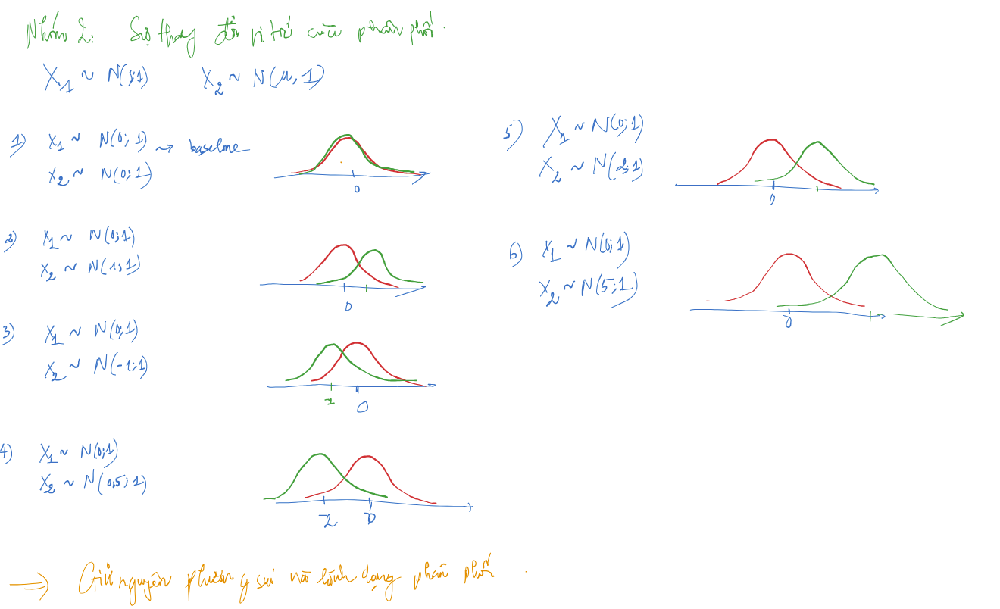
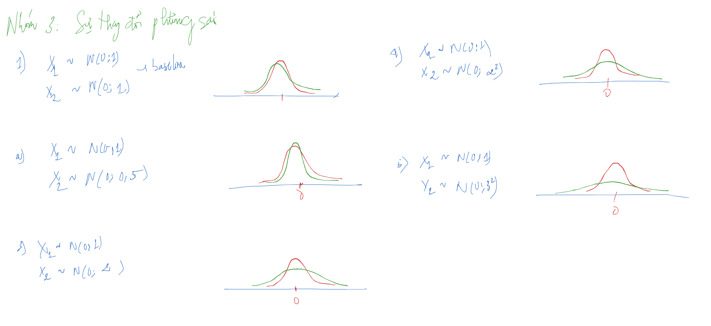

# Kịch bản 1: Kiểm tra sự thay đổi cấu trúc của covariates 

Nếu cấu trúc của covariates thay đổi, giá trị của các phương pháp ước lượng có ảnh hưởng như thế nào?

1. Thay đổi hình dạng phân phối của covariates: normal, skewed, bimonal, student's 
2. Thay đổi vị trí: mean khác nhau
3. Thay đổi độ phân tán: phương sai khác nhau
# Cấu trúc thư mục

# 1. Hình dạng phân phối
Liệu phân phối của biến nhiễu có ảnh hưởng đến chất lượng của ước lượng hay không?

## Baseline
|Tên biến       | Phân phối                                                              |
|---------------|------------------------------------------------------------------------|
|$X_1$          | $\sim N(0;1)$                                                          |
|$X_2$          | $\sim N(0;1)$                                                          |
|$A$            | $\sim \text{Bernoulli}(e(X))$                                          |
|$e(X)$         | $\mathbb{P}(A=1\mid X)=\sigma(\gamma_0 + \gamma_1X_1 + \gamma_2X_2)$   |
|$\tau(X)$      | $\tau_0$ (hiệu ứng đồng nhất, ATE $=\tau_0$)                           |
|$m(X)$         | $\beta_0 +\beta_1X_1 + \beta_2X_2$                                     |
|$Y_i$          | $A_i\,\tau(X_i) + m(X_i) + \varepsilon_i,\ \varepsilon_i\sim N(0,\sigma^2)$ |

**Quy ước**: $N(\mu;\sigma^2)$ với $\sigma^2$ là phương sai. Các tham số $\gamma,\beta,\tau_0,\sigma$ giữ cố định ở mọi kịch bản; chỉ phân phối của $X_1,X_2$ thay đổi. $\gamma_0$ được chọn để tỉ lệ treated xấp xỉ 50%.

## Phân tích chi tiết

1. **baseline**: $X_1 \sim N(0;1),\ X_2 \sim N(0;1)$
   - Quan tâm: Khi hai biến nhiễu đều chuẩn, các phương pháp ước lượng (OLS hiệu chỉnh, IPTW, AIPW, matching) hoạt động thế nào?
   - Mong đợi: Các phương pháp đều gần không chệch, đây là mốc so sánh.

2. **outlier / heavy_tail**: $X_1 \sim N(0;1),\ X_2 \sim t(df=2)$
   - Quan tâm: Đuôi dày (phương sai vô hạn) tạo các điểm cực đoan. Các điểm này làm $e(X)$ rất gần 0/1 và có leverage lớn trong mô hình outcome.
   - Mong đợi: IPTW không ổn định (vài quan sát chi phối), RMSE lớn và dao động mạnh giữa các lần lặp; OLS nhạy với điểm có leverage cao.
   - Cách xử lý: trimming, winsorize $X_2$, hồi quy robust, AIPW kèm clipping.

3. **skewed**: $X_1 \sim N(0;1),\ X_2 \sim Exp(1)-1$ (đã chuẩn hóa)
   - Quan tâm: Phân phối lệch phải nhưng đuôi nhẹ hơn $t$; $e(X)$ lệch và ít quan sát ở vùng đuôi phải.
   - Mong đợi: Ảnh hưởng nhẹ hơn kịch bản 3; thiếu overlap cục bộ ở đuôi phải khiến IPTW tăng phương sai.
   - Cách xử lý: trimming, biến đổi log/Box-Cox $X_2$ khi ước lượng PS.

4. **bimodal**: $X_1 \sim N(0;1),\ X_2 \sim 0.5N(-0.8;0.36)+0.5N(0.8;0.36)$ (trung bình 0, phương sai 1)
   - Quan tâm: Phân phối hai đỉnh (hai nhóm tiềm ẩn) có làm chất lượng ước lượng thay đổi so với baseline, khi phương sai đã được giữ nguyên?
   - Mong đợi: Với mô hình tham số đúng thì thay đổi nhỏ; có thể ảnh hưởng nếu dùng mô hình phi tham số hoặc matching (vùng thưa giữa hai đỉnh).

5. **skewed + outlier**: $X_1 \sim Exp(1)-1,\ X_2 \sim t(df=2)$
   - Quan tâm: Kết hợp độ lệch và đuôi dày thì sai số có cộng gộp hay tương tác?
   - Mong đợi: Kém nhất trong nhóm 4-6 đối với IPTW; cần trimming bắt buộc.

6. **skewed + bimodal**: $X_1 \sim Exp(1)-1,\ X_2 \sim 0.5N(-0.8;0.36)+0.5N(0.8;0.36)$
   - Quan tâm: Hai biến nhiễu có hình dạng lệch chuẩn khác nhau, $e(X)$ có cấu trúc phức tạp hơn.
   - Mong đợi: Chất lượng giảm nhẹ so với 4 và 5 riêng lẻ.

7. **outlier + bimodal**: $X_1 \sim t(df=2),\ X_2 \sim 0.5N(-0.8;0.36)+0.5N(0.8;0.36)$
   - Quan tâm: Đuôi dày kết hợp cấu trúc hai nhóm.
   - Mong đợi: Bất ổn do outlier là chủ yếu; bimodal làm khó việc chọn ngưỡng trimming.

**Chỉ số đánh giá:** bias, RMSE, độ phủ CI 95%, độ rộng CI, tỉ lệ $e(X)\notin[0.01;0.99]$, trọng số lớn nhất, ESS. Gợi ý $n\in\{500, 2000\}$, 1000 lần lặp mỗi kịch bản.

# 2. Vị trí phân phối
Mục tiêu: Vị trí kỳ vọng ($\mu$) phân phối của covariates quyết định khoảng giá trị tập trung của dữ liệu. Khi kỳ vọng của các biến nhiễu thay đổi (đặc biệt là sự khác biệt kỳ vọng giữa nhóm can thiệp và nhóm đối chứng), nó trực tiếp tạo ra sự mất cân bằng (imbalance) và làm thu hẹp vùng chồng lấp (lack of overlap). Mục tiêu là **đánh giá xem khoảng cách giữa các kỳ vọng (distance of means) càng lớn thì các phương pháp ước lượng có duy trì được tính không chệch (unbiasedness) và sự ổn định của phương sai hay không**.

## Baseline
|Tên biến       | Phân phối                                                              |
|---------------|------------------------------------------------------------------------|
|$X_1$          | $\sim N(0;1)$                                                          |
|$X_2$          | $\sim N(0;1)$                                                          |
|$A$            | $\sim \text{Bernoulli}(e(X))$                                          |
|$e(X)$         | $\mathbb{P}(A=1\mid X)=\sigma(\gamma_0 + \gamma_1X_1 + \gamma_2X_2)$   |
|$\tau(X)$      | $\tau_0$ (hiệu ứng đồng nhất, ATE $=\tau_0$)                           |
|$m(X)$         | $\beta_0 +\beta_1X_1 + \beta_2X_2$                                     |
|$Y_i$          | $A_i\,\tau(X_i) + m(X_i) + \varepsilon_i,\ \varepsilon_i\sim N(0,\sigma^2)$ |

**Quy ước**: $N(\mu;\sigma^2)$ với $\sigma^2$ là phương sai. Các tham số $\gamma,\beta,\tau_0,\sigma$ giữ cố định ở mọi kịch bản; chỉ phân phối của $X_1,X_2$ thay đổi. $\gamma_0$ được chọn để tỉ lệ treated xấp xỉ 50%.

## Phân tích chi tiết
1. **baseline:** $X_1 \sim N(0;1),\ X_2 \sim N(0;1)$
- Quan tâm: Khi hai biến nhiễu đều chuẩn và đồng nhất về kỳ vọng, các phương pháp ước lượng (OLS hiệu chỉnh, IPTW, AIPW, matching) hoạt động thế nào?
- Mong đợi: Các phương pháp đều gần không chệch (unbiased), phân phối Propensity Score (PS) của 2 nhóm chồng lấp hoàn hảo, trọng số ổn định. Đây là mốc cơ sở (baseline) để so sánh.
2. Khác biệt vừa, hướng dương: $X_1 \sim N(0;1),\ X_2 \sim N(1;1)$
- Quan tâm: Sự dịch chuyển nhẹ kỳ vọng của $X_2$ làm thay đổi phân phối của tổ hợp tuyến tính trong hàm logistic. Vùng chồng lấp bắt đầu thu hẹp nhẹ và xuất hiện sự mất cân bằng hiệp biến.
- Mong đợi: Hầu hết các phương pháp vẫn duy trì được tính không chệch. Tuy nhiên, IPTW có thể xuất hiện một số ít trọng số lớn, làm phương sai (SE) và RMSE nhích nhẹ lên. Độ phủ CI 95% dự kiến vẫn được đảm bảo.
3. Khác biệt vừa, hướng âm: $X_1 \sim N(0;1),\ X_2 \sim N(-1;1)$
- Quan tâm: Tương tự kịch bản 2 nhưng dịch chuyển theo hướng ngược lại, đẩy xác suất can thiệp $e(X)$ của một bộ phận dữ liệu về gần 0. Đánh giá tính đối xứng trong hiệu năng của estimator.
- Mong đợi: Hiệu suất tương đương kịch bản 2. Kích thước mẫu hiệu dụng (ESS) bắt đầu giảm nhẹ. Các phương pháp Doubly Robust (AIPW) vẫn hoạt động cực kỳ ổn định.
4. Khác biệt lớn, hướng âm: $X_1 \sim N(0;1),\ X_2 \sim N(-2;1)$
- Quan tâm: Mức độ mất cân bằng gia tăng mạnh. Tỉ lệ quan sát có Propensity Score rớt ra ngoài vùng an toàn $e(X) \notin [0.01; 0.99]$ bắt đầu đáng kể, đe dọa giả định Positivity.
- Mong đợi: Trọng số nghịch đảo (IPW) bắt đầu bùng nổ do xuất hiện các mẫu có $e(X)$ rất gần 0. Độ rộng CI của IPTW sẽ phình to, RMSE tăng vọt và ESS giảm mạnh. Phương pháp Matching có thể bỏ đi (discard) nhiều quan sát do không tìm được đối sánh. Đòi hỏi phải dùng đến các kỹ thuật như Trimming, Clipping hoặc Overlap Weighting.
5. Khác biệt lớn, hướng dương: $X_1 \sim N(0;1),\ X_2 \sim N(2;1)$
- Quan tâm: Vùng chồng lấp bị bào mòn nghiêm trọng, đẩy PS của nhóm đối chứng về sát biên 1. Kiểm tra sự bùng nổ phương sai ở nhóm đối chứng.
- Mong đợi: Tương đương Kịch bản 4. Tính chất bất ổn định của bộ ước lượng Horvitz-Thompson lộ rõ. Các phương pháp Doubly Robust như AIPW có thể vẫn bảo vệ được Bias nhờ mô hình Outcome $m(X)$, nhưng Phương sai (SE) chắc chắn bị ảnh hưởng lớn.
6. Khác biệt rất lớn: $X_1 \sim N(0;1),\ X_2 \sim N(5;1)$
- Quan tâm: Vi phạm giả định Positivity một cách nghiêm trọng (Extreme Lack of Overlap / Disjoint distributions). Nhóm can thiệp và nhóm đối chứng gần như bị phân tách hoàn toàn trên không gian của $X_2$.
- Mong đợi: Hầu hết các phương pháp dựa trên PS truyền thống sẽ thất bại (bias lớn, CI coverage rớt thảm hại dưới mức danh nghĩa 95%, ESS tiến sát về 0, trọng số max khổng lồ). Phương pháp OLS hồi quy tuyến tính sẽ phải nội suy (extrapolation) rất xa ngoài vùng dữ liệu thực. Chỉ có các phương pháp thay đổi Estimand (như chuyển từ ATE sang ATO - Average Treatment Effect on the Overlap) mới đưa ra được các kết luận có ý nghĩa thống kê.

**Chỉ số đánh giá:** bias, RMSE, độ phủ CI 95%, độ rộng CI, tỉ lệ $e(X)\notin[0.01;0.99]$, trọng số lớn nhất, ESS. Gợi ý $n\in\{500, 2000\}$, 1000 lần lặp mỗi kịch bản.

# 3. Mức độ phân tán
Mục tiêu: Kiểm tra mức độ phân tán của dữ liệu ảnh hưởng như thế nào đến giá trị ước lượng

## Baseline
|Tên biến       | Phân phối                                                              |
|---------------|------------------------------------------------------------------------|
|$X_1$          | $\sim N(0;1)$                                                          |
|$X_2$          | $\sim N(0;1)$                                                          |
|$A$            | $\sim \text{Bernoulli}(e(X))$                                          |
|$e(X)$         | $\mathbb{P}(A=1\mid X)=\sigma(\gamma_0 + \gamma_1X_1 + \gamma_2X_2)$   |
|$\tau(X)$      | $\tau_0$ (hiệu ứng đồng nhất, ATE $=\tau_0$)                           |
|$m(X)$         | $\beta_0 +\beta_1X_1 + \beta_2X_2$                                     |
|$Y_i$          | $A_i\,\tau(X_i) + m(X_i) + \varepsilon_i,\ \varepsilon_i\sim N(0,\sigma^2)$ |

Quy ước: $N(\mu;\sigma^2)$ với $\sigma^2$ là phương sai. Các tham số $\gamma,\beta,\tau_0,\sigma$ (phương sai của nhiễu $\varepsilon_i$) được giữ cố định ở mọi kịch bản; chỉ độ lệch chuẩn/phương sai của biến nhiễu $X_2$ thay đổi. $\gamma_0$ được tinh chỉnh liên tục trong từng kịch bản để đảm bảo tỉ lệ treated ($A=1$) luôn xấp xỉ 50%.

## Phân tích chi tiết
1. **Baseline:** $X_1 \sim N(0;1),\ X_2 \sim N(0;1)$
- Quan tâm: Khi dữ liệu có độ phân tán chuẩn, không có nhiều giá trị ngoại lai, các phương pháp ước lượng hoạt động ra sao?
- Mong đợi: Trọng số IPW không bị bùng nổ. Các phương pháp (IPTW, AIPW, Matching, OLS) đều cho ước lượng không chệch, phương sai (SE) nhỏ và độ phủ CI đạt chuẩn 95%.
2. **Phân tán thấp (Độ bẹt giảm, đỉnh nhọn):** $X_1 \sim N(0;1),\ X_2 \sim N(0;0.5)$
- Quan tâm: Dữ liệu co cụm chặt chẽ quanh giá trị trung tâm, gần như triệt tiêu hoàn toàn các giá trị cực đoan ở vùng đuôi.
- Mong đợi: Vùng chồng lấp (Overlap) cực kỳ lý tưởng. Xác suất $e(X)$ phần lớn tụt vào vùng an toàn (ví dụ $[0.2; 0.8]$). Kích thước mẫu hiệu dụng (ESS) đạt mức tối đa. Tất cả các estimator đều tối ưu được SE và RMSE.
3. **Phân tán cao vừa:** $X_1 \sim N(0;1),\ X_2 \sim N(0;1.5^2)$
- Quan tâm: Đường cong phân phối bắt đầu bẹt ra, làm tăng số lượng các quan sát ở vùng đuôi (đuôi dài hơn).
- Mong đợi: Một bộ phận nhỏ dữ liệu bắt đầu sinh ra Propensity Score $e(X)$ lệch về phía 0 hoặc 1. Trọng số IPW lớn nhất (max weight) bắt đầu tăng nhẹ. Phương pháp IPTW có thể ghi nhận RMSE tăng nhẹ do SE nhích lên, nhưng Bias vẫn được kiểm soát tốt.
4. **Phân tán lớn (Xuất hiện nhiều Outliers):** $X_1 \sim N(0;1),\ X_2 \sim N(0;4)$
- Quan tâm: Dữ liệu bị dàn trải trên một phổ rất rộng. Các giá trị ngoại lai (outliers) xuất hiện thường xuyên, đẩy các giá trị của tổ hợp tuyến tính $\gamma_0 + \gamma_1X_1 + \gamma_2X_2$ đi rất xa khỏi mức 0.
- Mong đợi: Tỉ lệ quan sát rơi vào vùng nguy hiểm $e(X) \notin [0.01; 0.99]$ tăng lên rõ rệt. Phương pháp IPTW bắt đầu suy giảm hiệu năng nghiêm trọng (CI phình to, RMSE bùng nổ do trọng số cực đoan). Kỹ thuật AIPW vẫn có thể bám trụ nhờ tính Doubly Robust (nếu hàm $m(X)$ thiết lập chuẩn).
5. **Phân tán rất lớn (Extreme Spread):** $X_1 \sim N(0;1),\ X_2 \sim N(0;9)$
- Quan tâm: Kiểm tra giới hạn chịu đựng (stress-test) của các mô hình khi hiệp biến chứa các giá trị cực kỳ lớn, gây ra sự phân tán xác suất can thiệp hoàn toàn về 2 thái cực 0 và 1.
- Mong đợi: Giả định Positivity bị vi phạm nặng nề không phải do chênh lệch kỳ vọng mà do độ bẹt của phân phối. ESS sụp đổ. Hầu hết các phương pháp dùng trọng số nghịch đảo (nếu không kết hợp Trimming/Clipping/Overlap Weighting) sẽ thất bại, kéo theo độ phủ CI 95% mất ý nghĩa hoàn toàn.

**Chỉ số đánh giá:** Bias, RMSE, độ phủ CI 95% (Coverage), độ rộng CI (CI Width), tỉ lệ $e(X) \notin [0.01; 0.99]$, trọng số lớn nhất (Max Weight), Kích thước mẫu hiệu dụng (ESS).Đề xuất cấu hình: $n \in \{500, 2000\}$, lặp Monte Carlo 1000 lần mỗi kịch bản. Theo dõi chặt chẽ sự gia tăng của Max Weight tỷ lệ thuận với mức tăng phương sai của $X_2$.