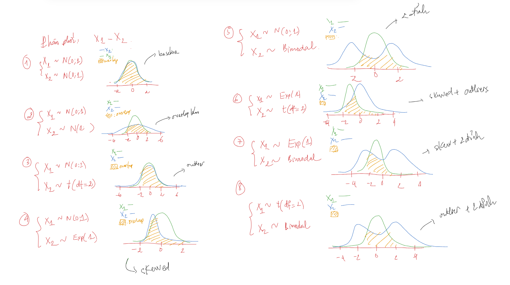

# Mục tiêu: 
Mô phỏng dữ liệu cho nhóm kịch bản thay đổi phân phối của biến nhiễu. Liệu phân phối của biến nhiễu có ảnh hưởng đến chất lượng của ước lượng hay không?

# Baseline
|Tên biến       | Phân phối                                                              |
|---------------|------------------------------------------------------------------------|
|$X_1$          | $\sim N(0;1)$                                                          |
|$X_2$          | $\sim N(0;1)$                                                          |
|$A$            | $\sim \text{Bernoulli}(e(X))$                                          |
|$e(X)$         | $\mathbb{P}(A=1\mid X)=\sigma(\gamma_0 + \gamma_1X_1 + \gamma_2X_2)$   |
|$\tau(X)$      | $\tau_0$ (hiệu ứng đồng nhất, ATE $=\tau_0$)                           |
|$m(X)$         | $\beta_0 +\beta_1X_1 + \beta_2X_2$                                     |
|$Y_i$          | $A_i\,\tau(X_i) + m(X_i) + \varepsilon_i,\ \varepsilon_i\sim N(0,\sigma^2)$ |

**Quy ước**: $N(\mu;\sigma^2)$ với $\sigma^2$ là phương sai. Các tham số $\gamma,\beta,\tau_0,\sigma$ giữ cố định ở mọi kịch bản; chỉ phân phối của $X_1,X_2$ thay đổi. $\gamma_0$ được chọn để tỉ lệ treated xấp xỉ 50%.

# Phân tích chi tiết

1. **baseline**: $X_1 \sim N(0;1),\ X_2 \sim N(0;1)$
   - Quan tâm: Khi hai biến nhiễu đều chuẩn, các phương pháp ước lượng (OLS hiệu chỉnh, IPTW, AIPW, matching) hoạt động thế nào?
   - Mong đợi: Các phương pháp đều gần không chệch, đây là mốc so sánh.

2. **weak_overlap**: $X_1 \sim N(0;1),\ X_2 \sim N(0;9)$
   - Quan tâm: Cùng là phân phối chuẩn nhưng phương sai lớn làm $e(X)$ dồn về 0/1, overlap kém thì sao?
   - Mong đợi: IPTW có trọng số cực đoan, phương sai lớn, CI phủ kém. OLS/AIPW ít bị ảnh hưởng hơn nếu mô hình đúng.
   - Cách xử lý: trimming/truncation $e(X)$, stabilized weights, matching, overlap weights.

3. **outlier / heavy_tail**: $X_1 \sim N(0;1),\ X_2 \sim t(df=2)$
   - Quan tâm: Đuôi dày (phương sai vô hạn) tạo các điểm cực đoan. Các điểm này làm $e(X)$ rất gần 0/1 và có leverage lớn trong mô hình outcome.
   - Mong đợi: IPTW không ổn định (vài quan sát chi phối), RMSE lớn và dao động mạnh giữa các lần lặp; OLS nhạy với điểm có leverage cao.
   - Cách xử lý: trimming, winsorize $X_2$, hồi quy robust, AIPW kèm clipping.

4. **skewed**: $X_1 \sim N(0;1),\ X_2 \sim Exp(1)-1$ (đã chuẩn hóa)
   - Quan tâm: Phân phối lệch phải nhưng đuôi nhẹ hơn $t$; $e(X)$ lệch và ít quan sát ở vùng đuôi phải.
   - Mong đợi: Ảnh hưởng nhẹ hơn kịch bản 3; thiếu overlap cục bộ ở đuôi phải khiến IPTW tăng phương sai.
   - Cách xử lý: trimming, biến đổi log/Box-Cox $X_2$ khi ước lượng PS.

5. **bimodal**: $X_1 \sim N(0;1),\ X_2 \sim 0.5N(-0.8;0.36)+0.5N(0.8;0.36)$ (trung bình 0, phương sai 1)
   - Quan tâm: Phân phối hai đỉnh (hai nhóm tiềm ẩn) có làm chất lượng ước lượng thay đổi so với baseline, khi phương sai đã được giữ nguyên?
   - Mong đợi: Với mô hình tham số đúng thì thay đổi nhỏ; có thể ảnh hưởng nếu dùng mô hình phi tham số hoặc matching (vùng thưa giữa hai đỉnh).

6. **skewed + outlier**: $X_1 \sim Exp(1)-1,\ X_2 \sim t(df=2)$
   - Quan tâm: Kết hợp độ lệch và đuôi dày thì sai số có cộng gộp hay tương tác?
   - Mong đợi: Kém nhất trong nhóm 4-6 đối với IPTW; cần trimming bắt buộc.

7. **skewed + bimodal**: $X_1 \sim Exp(1)-1,\ X_2 \sim 0.5N(-0.8;0.36)+0.5N(0.8;0.36)$
   - Quan tâm: Hai biến nhiễu có hình dạng lệch chuẩn khác nhau, $e(X)$ có cấu trúc phức tạp hơn.
   - Mong đợi: Chất lượng giảm nhẹ so với 4 và 5 riêng lẻ.

8. **outlier + bimodal**: $X_1 \sim t(df=2),\ X_2 \sim 0.5N(-0.8;0.36)+0.5N(0.8;0.36)$
   - Quan tâm: Đuôi dày kết hợp cấu trúc hai nhóm.
   - Mong đợi: Bất ổn do outlier là chủ yếu; bimodal làm khó việc chọn ngưỡng trimming.

**Chỉ số đánh giá:** bias, RMSE, độ phủ CI 95%, độ rộng CI, tỉ lệ $e(X)\notin[0.01;0.99]$, trọng số lớn nhất, ESS. Gợi ý $n\in\{500, 2000\}$, 1000 lần lặp mỗi kịch bản.