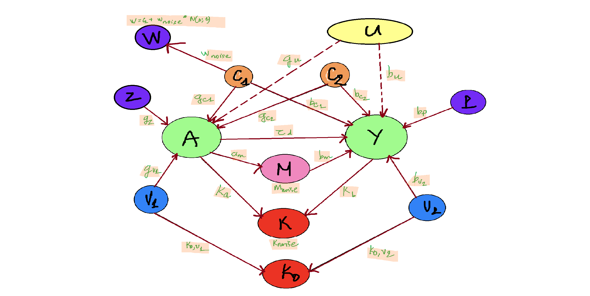

# Ý tưởng và mục đích
Trong [tài liệu][what_if_url]  về Causal Inference: What If bởi Miguel A. Hernán, James M. Robins, ở chương 6, chúng ta biết rằng những biến vai trò nào nên hiệu chỉnh, hiệu chỉnh như thế nào và những biến vai trò nào không nên hiệu chỉnh, nguyên nhân (ví dụ: confounders - phải hiệu chỉnh, collider - không được hiệu chỉnh,...). Ta có thể dùng kiến thức chuyên môn, xác định DAG, xác định vai trò của các biến và chọn tập biến hiệu chỉnh chính xác. Tuy nhiên, thực tế không phải lúc nào chúng ta cũng có thể chắc chắn rằng chúng ta xác định chính xác và đo được đầy đủ các biến có tác động/ ảnh hưởng đến biến kết quả hoặc biến điều trị.

Kịch bản này đặt câu hỏi: **"Khi tập biến hiệu chỉnh sai so với cấu trúc nhân quả thật, hiệu chỉnh thừa (thêm biến không nên hiệu chỉnh) và hiệu chỉnh thiếu (bỏ sót hoặc đo sai biến cần hiệu chỉnh) thì các phương pháp ước lượng về xác suất nhận điều trị, hiệu ứng tác động (ATE/ CATE) sẽ bị ảnh hưởng như thế nào được đo bằng bias, RMSE, CI và ESS theo độ mạnh của lỗi và cỡ mẫu. Liệu các phương pháp ước lượng có còn tính bền vững hay không?"**

# Các kịch bản 
Bao gồm 9 kịch bản với các mức tham số: $0.5 \rightarrow 1.0 \rightarrow 1.5$ thể hiện tầm ảnh hưởng từ nhẹ $\rightarrow$ mạnh $\rightarrow$ mạnh hơn. 
|STT| Tên kịch bản | Tham số | Biến trong mô hình |
|---| -------------|---------|---------|
|0	|confounder|	$g_{c_1}=1, b_{c_1}=1$| $A, Y, C_1$ | 
|1	|instrument|	$g_{c_1}=1, b_{c_1}=1, g_z=1.5$| $A, Y, C_1, Z$	|
|2	|precision|	$g_{c_1}=1, b_{c_1}=1, b_p=1.5$|$A, Y, C_1, P$|
|3	|mediator|	$g_{c_1}=1, b_{c_1}=1, \tau_d=1, a_m=1, b_m=1$|	$A, Y, C_1, M$ |
|4	|collider|	$g_{c_1}=1, b_{c_1}=1, k_a=1, k_y=1$|	$A, Y, C_1, K$|
|5	|m_bias|	$g_{v_1}=1, b_{v_2}=1, k0_{v_1}=1, k0_{v_2}=1 $| $A, Y, V_1, V_2, K_0$|
|6|	amplification|	$g_z=1.5, g_u=0.5, b_u=1$ |$A, Y, U, Z$|
|7|	proxy|	$g_{c_1}=1, b_{c_1}=1, w_{noise}=1$|	$A, Y, C_1, W$|
|8	|all|	$g_{c_1}=0.7, b_{c_1}=0.7, g_{c_2}=0.5, b_{c_2}=0.5, g_z=0.8, b_p=1, \tau_d=1, a_m=b_m=1, k_a=k_y=1, g_{v_1}=b_{v_2}=0.5, k_0=0.8$ - giảm hệ số để ESS cao hơn|$A, Y, C_1, C_2, Z, P, M, V_1, V_2, K_0, K$|

|Tham số|Giai thích tham số|
|-------|------------------|
| $\tau_d$ | Hiệu ứng trực tiếp của A lên Y |
| $\sigma$ | Độ lệch chuẩn nhiễu outcome |
| $g_0$ | hệ số chặn $\gamma$ của logit $e(X)$, nếu $g_0=0 \Rightarrow P(A=1)=50\%$|
| $g_{c_1}$ | hệ số $\gamma$ của $C_1$ với $C_1$ là confounder 1: $C_1 \rightarrow A$|
| $g_{c_2}$ | hệ số $\gamma$ của $C_2$ với $C_2$ là confounder 1: $C_2 \rightarrow A$|
| $g_{z}$ | hệ số $\gamma$ của $Z$ với $Z$ là instrumental variable: $Z \rightarrow A$|
| $g_{u}$ | hệ số $\gamma$ của $U$ với $U$ là confounder ẩn: $U \rightarrow A$|
| $g_{v_1}$ | hệ số $\gamma$ của $V_1$ với $V_1$ là biến trong quan hệ M-bias: $V_1 \rightarrow A$|
| $b_{c_1}$ | hệ số $\beta$ của $C_1$ với $C_1$ là confounder 1: $C_1 \rightarrow Y$|
| $b_{c_2}$ | hệ số $\beta$ của $C_2$ với $C_2$ là confounder 2: $C_2 \rightarrow Y$|
| $b_{p}$ | hệ số $\beta$ của $P$ với $P$ là precision: $P \rightarrow Y$|
| $b_{u}$ | hệ số $\beta$ của $U$ với $U$ là confounder ẩn: $U \rightarrow Y$|
| $b_{v_2}$ | hệ số $\beta$ của $V_2$ với $V_2$ là biến trong quan hệ M-bias: $V_2 \rightarrow Y$|
| $b_{m}$ | hệ số của $M$ với $M$ là mediator: $M \rightarrow Y$|
| $a_{m}$ | hệ số của $M$ với $M$ là mediator: $A \rightarrow M$|
| $k_{0,v_1}$ | hệ số của $V_1$ lên biến $K_0$: $V_1 \rightarrow K_0$|
| $k_{0, v_2}$ | hệ số của $V_2$ lên biến $K_0$: $V_2 \rightarrow K_0$|
| $k_{a}$ | hệ số của $K$ với $K$ là collider: $A \rightarrow K$|
| $k_{y}$ | hệ số $K$ với $K$ là collider: $Y \rightarrow K$|
| $m_{noise}$ | hệ số nhiễu của mediator M|
| $k_{noise}$ | hệ số nhiễu của collider K|
| $w_{noise}$ | hệ số nhiễu của proxy W với $W= C_1 + w_{noise}*N(0,1)$|

# Các phương pháp ước lượng
1. Naive 
2. OLS
3. IPTW
4. AIPW
# Một số hàm bổ trợ
## Influence function
- Vị trí: Được xây dựng trong file utilies.py 
- Mục đích: Chứa các estimating function của từng quan sát để thực hiện phép tính ma trận M-estimation với công thức toán học:
$
\psi_i= 
\begin{bmatrix} 
    \frac{A_i}{e_i}(Y_i-\hat{\mu}_1)\\[5pt] 
    \frac{1-A_i}{1-e_i}(Y_i-\hat{\mu}_0)\\[5pt]
    X_i(A_i-e_i)
\end{bmatrix}
$.
Bao gồm:
    - estimating function của $\hat{u_1}$
    - estimating function của $\hat{u_2}$
    - Score của hệ số intercept
	- Score của hệ số X1
	- Score của hệ số X2
## Ma trận Jacobian của hệ phương trình ước lượng
- Vị trí: Được xây dựng trong file utilies.py 
- Công thức: $B= \dfrac{1}{n} \sum_{i=1}^n \dfrac{\partial \psi_i(\theta)}{\partial \theta^T}, \quad B= 
\begin{bmatrix} 
B_{11}&0&B_{1\gamma}\\ 
0&B_{22}&B_{2\gamma}\\
0&0&B_{\gamma\gamma}
\end{bmatrix} $
- Cụ thể:
1. Đạo hàm theo $\hat{u_1}, \hat{u_0}$:

Ta có: $ \frac{\partial}{\partial\mu_1} \left[\frac{A_i}{e_i}(Y_i-\mu_1) \right] = -\frac{A_i}{e_i} $

Lấy trung bình:  $B_{11}=-\frac{1}{n}\sum_i\frac{A_i}{e_i}$

Tương tự: $B_{22}=-\frac{1}{n} \sum_i\frac{1-A_i}{1-e_i}$

2. Đạo hàm treatment theo hệ số của PS

Ta bắt đầu từ: $\psi_{i,1}= \frac{A_i}{e_i}(Y_i-\mu_1)$

Đạo hàm theo $\gamma$: $\frac{\partial e_i}{\partial\gamma} =e_i(1-e_i)X_i $

Suy ra: $\frac{\partial\psi_{i,1}}{\partial\gamma} = -\frac{A_i(1-e_i)}{e_i} (Y_i-\mu_1)X_i$

Lấy trung bình: $B_{1\gamma} = -\frac{1}{n}\sum_i \frac{A_i(1-e_i)}{e_i} (Y_i-\mu_1)X_i $

3. Đạo hàm control theo hệ số của PS

Bắt đầu từ: $\psi_{i,2}= \frac{1-A_i}{1-e_i}(Y_i-\mu_0) $

Đạo hàm theo $\gamma$: $ \frac{\partial\psi_{i,2}}{\partial\gamma} = \frac{(1-A_i)e_i}{1-e_i} (Y_i-\mu_0)X_i $

Lấy trung bình: $ B_{2\gamma} = \frac{1}{n}\sum_i \frac{(1-A_i)e_i}{1-e_i} (Y_i-\mu_0)X_i $

4. Đạo hàm của Logistic Score theo hệ số PS

Phương trình score: $ \psi_{i,\gamma}=X_i(A_i-e_i) $

Đạo hàm theo $\gamma$: $ \frac{\partial\psi_{i,\gamma}} {\partial\gamma^\top} = -e_i(1-e_i)X_iX_i^\top $

Do đó: $ B_{\gamma\gamma} = -\frac{1}{n}\sum_i e_i(1-e_i)X_iX_i$

=> Phương pháp M-estimation (tham khảo thêm ở Notion: [M-estimation in IPTW, AIPTW, OW (overlap weightings)][m_estimation_url])

# Tài liệu tham khảo
1. Cinelli, C., Forney, A., Pearl, J. (2024). *A Crash Course in Good and Bad Controls*. Sociological Methods & Research, 53(3), 1071–1104.
2. Pearl, J. (2009). *Causality: Models, Reasoning and Inference* (2nd ed.). Cambridge University Press.
3. Hernán, M.A., Robins, J.M. (2020). *Causal Inference: What If*. Chapman & Hall/CRC.
4. Greenland, S., Pearl, J., Robins, J.M. (1999). Causal diagrams for epidemiologic research. Epidemiology, 10(1), 37–48.
5. Brookhart, M.A. et al. (2006). Variable selection for propensity score models. American Journal of Epidemiology, 163(12), 1149–1156.
6. Myers, J.A. et al. (2011). Effects of adjusting for instrumental variables on bias and precision of effect estimates. American Journal of Epidemiology, 174(11), 1213–1222.
7. Ding, P., VanderWeele, T.J., Robins, J.M. (2017). Instrumental variables as bias amplifiers with general outcome and confounding. Biometrika, 104(2), 291–302.
8. Rosenbaum, P.R. (1984). The consequences of adjustment for a concomitant variable that has been affected by the treatment. JRSS Series A, 147(5), 656–666.
9. Schisterman, E.F., Cole, S.R., Platt, R.W. (2009). Overadjustment bias and unnecessary adjustment in epidemiologic studies. Epidemiology, 20(4), 488–496.
10. Elwert, F., Winship, C. (2014). Endogenous selection bias: the problem of conditioning on a collider variable. Annual Review of Sociology, 40, 31–53.
11. Ding, P., Miratrix, L.W. (2015). To adjust or not to adjust? Sensitivity analysis of M-bias and butterfly-bias. Journal of Causal Inference, 3(1), 41–57.
12. Fewell, Z., Davey Smith, G., Sterne, J.A.C. (2007). The impact of residual and unmeasured confounding in epidemiologic studies: a simulation study. American Journal of Epidemiology, 166(6), 646–655.
13. VanderWeele, T.J. (2019). Principles of confounder selection. European Journal of Epidemiology, 34, 211–219.
14. Robins, J.M., Rotnitzky, A., Zhao, L.P. (1994). Estimation of regression coefficients when some regressors are not always observed. JASA, 89, 846–866; Bang, H., Robins, J.M. (2005). Doubly robust estimation in missing data and causal inference models. Biometrics, 61, 962–973.
15. Lunceford, J.K., Davidian, M. (2004). Stratification and weighting via the propensity score in estimation of causal treatment effects: a comparative study. Statistics in Medicine, 23, 2937–2960.
16. Austin, P.C. (2009). Balance diagnostics for comparing the distribution of baseline covariates between treatment groups in propensity-score matched samples. Statistics in Medicine, 28, 3083–3107.
17. Morris, T.P., White, I.R., Crowther, M.J. (2019). Using simulation studies to evaluate statistical methods. Statistics in Medicine, 38, 2074–2102.
18. VanderWeele, T.J., Ding, P. (2017). Sensitivity analysis in observational research: introducing the E-value. Annals of Internal Medicine, 167(4), 268–274.

[what_if_url]: https://c3po.media.mit.edu/wp-content/uploads/sites/45/2015/12/hernanrobins_v1.10.30.pdf
[m_estimation_url]: https://app.notion.com/p/M-estimation-in-IPTW-AIPTW-OW-overlap-weightings-4202a9d2c2d68074b338c1e02a636103?source=copy_link