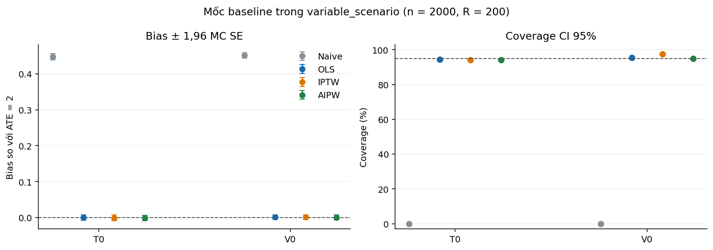
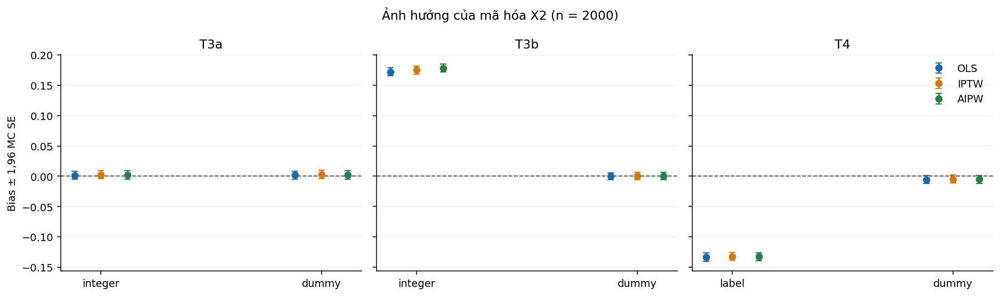
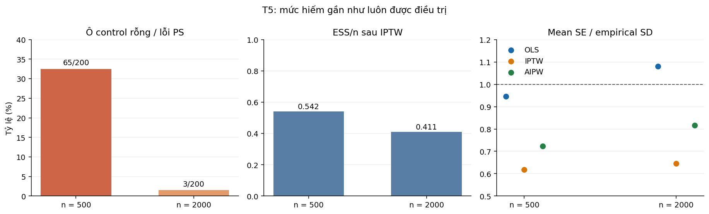
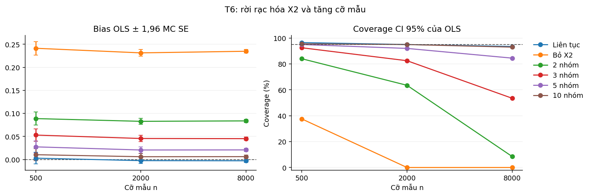
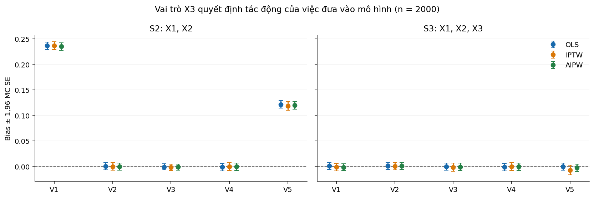
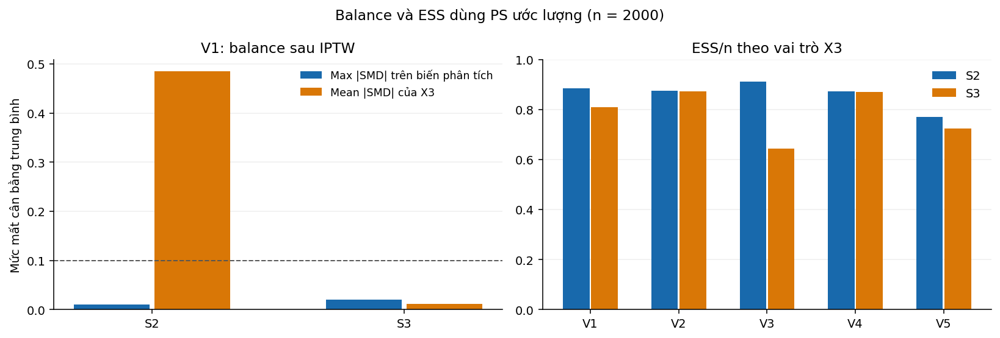
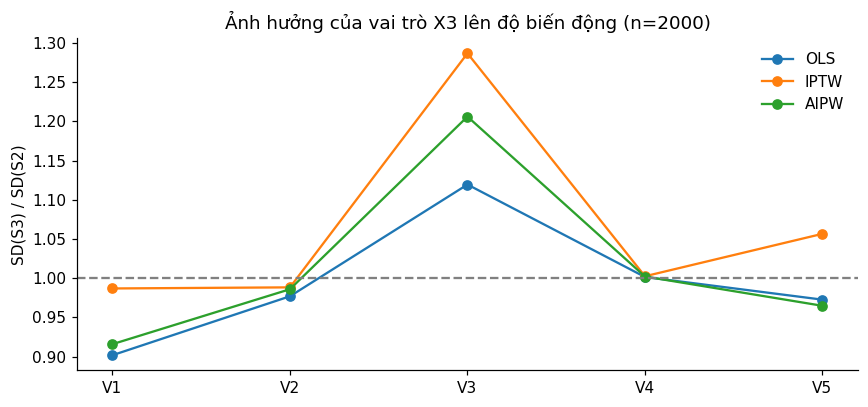

# Báo cáo tổng hợp kết quả mô phỏng variable_scenario

**Phạm vi:** chỉ `ra_causal/scenario/variable_scenario`, gồm phần A (T0–T6, có T3a/T3b) và phần B (V0–V5). Báo cáo không tổng hợp nhóm `distribution_scenario`.

**Dữ liệu báo cáo:** kết quả đã chạy với R = 200 lần lặp, seed = 20261012; n = 500 và 2000, riêng T6 có thêm n = 8000. ATE thật bằng 2,0 trong mọi kịch bản đã chạy. Đây là bản thử nghiệm theo thiết kế; chưa chạy R = 1000. T7, V7 và phần C là tùy chọn chưa thực hiện.

## 1. Các phát hiện chính

Kết quả trả lời hai câu hỏi của thiết kế. Với biến định tính, **cách mã hóa và dạng hiệu ứng** quyết định khả năng điều chỉnh confounding. T3a có hiệu ứng tuyến tính nên integer và dummy cho kết quả gần nhau. T3b có hiệu ứng phi tuyến: OLS dùng integer có bias 0,1725 và coverage chỉ 7,0%; dùng dummy đưa bias về gần 0 và coverage lên 97,0%. T4 dùng label cũng chệch rõ rệt.

Với biến liên tục bị chia nhóm ở T6, **tăng số nhóm làm giảm bias nhưng tăng cỡ mẫu không xóa bias còn sót**. Với 2 nhóm, bias OLS gần 0,083 ở n = 2000 và 8000; coverage giảm từ 63,5% xuống 8,5% khi cỡ mẫu tăng.

Với biến thêm vào, **vai trò X3 trong DGP quan trọng hơn số lượng biến**. V1 bỏ một confounder cho bias OLS 0,2364 dù balance trên các biến phân tích rất tốt. V3 thêm biến chỉ tác động lên A làm SD OLS tăng khoảng 12%, SD IPTW tăng khoảng 29% và ESS/n giảm rõ rệt. Biến tiên lượng Y ở V2 có lợi ích nhỏ trong bản chạy này; biến noise ở V4 gần như không làm thay đổi kết quả.

T5 cho thấy **bias nhỏ không đủ để đánh giá một phương pháp**. Ở n = 500, IPTW/AIPW không cho ước lượng trong 65/200 lần lặp; ngay trên các lần thành công, SE/SD và coverage vẫn thấp.

## 2. Thiết kế và cách đọc chỉ số

DGP chung có PS logistic và outcome tuyến tính theo phần đóng góp của các biến:

```text
e(X) = sigmoid(gamma0 + 0.5 X1 + contribution_A(X2) + gamma3 X3)
mu0(X) = 0.5 X1 + contribution_Y(X2) + beta3 X3
A ~ Bernoulli(e(X))
Y = mu0(X) + 2 A + epsilon, epsilon ~ N(0,1)
```

X1 luôn liên tục N(0,1). Phần A thay đổi kiểu dữ liệu hoặc phép đo X2; phần B giữ X1/X2 liên tục và thay đổi vai trò X3. Ngoại trừ T5 cố ý tạo overlap kém, hiệu ứng định tính được tâm hóa và chuẩn hóa sao cho phương sai phần đóng góp bằng 0,25. Gamma0 được hiệu chỉnh trên mẫu tham chiếu 200.000 quan sát độc lập để tỷ lệ điều trị trung bình gần 50%.

| Phương pháp | Cách ước lượng | SE trong mô phỏng |
| --- | --- | --- |
| Naive | Chênh lệch trung bình Y giữa A=1 và A=0 | Welch |
| OLS | Hệ số A, điều chỉnh bằng ma trận thiết kế đã chọn | HC1 |
| IPTW | Trung bình có trọng số theo dạng Hájek | Influence function có hiệu chỉnh việc ước lượng PS |
| AIPW | PS logistic và outcome OLS riêng từng nhóm | SD của pseudo-outcome / sqrt(n) |

PS trong estimator, balance và ESS đều là **PS ước lượng**. Không clip PS hay regularize logistic âm thầm. Trong cùng một lần lặp, các analysis của một kịch bản dùng cùng bộ dữ liệu; Naive không thay đổi theo cách chọn biến.

| Chỉ số | Cách hiểu |
| --- | --- |
| Bias | Trung bình ước lượng trừ ATE thật; gần 0 là tốt |
| MC SE bias | Mức bất định do số lần lặp hữu hạn, bằng SD / sqrt(số lần thành công) |
| SD | Độ dao động của ước lượng giữa các bộ dữ liệu mô phỏng |
| Mean SE / SD | Gần 1 khi SE phản ánh đúng dao động thực nghiệm |
| RMSE | Gộp độ chệch và độ biến động; thấp hơn là tốt |
| Coverage | Tỷ lệ CI 95% chứa ATE thật; mốc so sánh là 95% |
| ESS/n | Tỷ lệ cỡ mẫu hiệu dụng sau weighting; thấp cho thấy trọng số làm mất nhiều thông tin |
| SMD | Mức mất cân bằng; 0,1 là mốc chẩn đoán, không bảo đảm hết confounding |

Các thanh sai số ở biểu đồ bias là **±1,96 MC SE của bias**, thể hiện bất định Monte Carlo; chúng khác CI 95% của từng ước lượng trên một bộ dữ liệu. Với 200 lần lặp thành công, MC SE của coverage quanh 95% xấp xỉ 1,54 điểm phần trăm. Vì vậy, chênh lệch vài điểm phần trăm hoặc thay đổi SD rất nhỏ cần được diễn giải thận trọng.

Nếu fit thất bại, rep vẫn có dòng CSV với status và est/se = NaN. Bias, SD, SE, RMSE và coverage được tính trên **các lần thành công**, nên phải đọc cùng số rep hợp lệ và failure rate. Riêng T5, coverage là coverage có điều kiện.

## 3. Baseline T0 và V0

T0/V0 đều dùng hai confounder liên tục, cùng hệ số, không có X3. Hai mã kịch bản dùng các luồng seed khác nhau nên kết quả không trùng tuyệt đối.



*Hình 1. Baseline tại n = 2000. Naive chệch rõ rệt; ba phương pháp điều chỉnh có bias nhỏ và coverage gần mốc 95%.*

| Kịch bản | Phân tích | Phương pháp | Bias | MC SE bias | SD | RMSE | Coverage |
| --- | --- | --- | --- | --- | --- | --- | --- |
| T0 | continuous | Naive | 0.4471 | 0.0043 | 0.0610 | 0.4512 | 0.0% |
| T0 | continuous | OLS | -0.0002 | 0.0038 | 0.0533 | 0.0532 | 94.5% |
| T0 | continuous | IPTW | -0.0006 | 0.0039 | 0.0548 | 0.0547 | 94.0% |
| T0 | continuous | AIPW | -0.0010 | 0.0037 | 0.0530 | 0.0529 | 94.0% |
| V0 | S2 | Naive | 0.4511 | 0.0036 | 0.0516 | 0.4540 | 0.0% |
| V0 | S2 | OLS | 0.0008 | 0.0032 | 0.0456 | 0.0455 | 95.5% |
| V0 | S2 | IPTW | 0.0014 | 0.0034 | 0.0478 | 0.0477 | 97.5% |
| V0 | S2 | AIPW | 0.0005 | 0.0033 | 0.0470 | 0.0469 | 95.0% |

Naive có bias khoảng 0,447 ở T0 và 0,451 ở V0, cho thấy việc bỏ điều chỉnh confounding dẫn đến sai lệch có hệ thống. Coverage Naive bằng 0% ở cả hai baseline tại n = 2000. OLS/IPTW/AIPW có bias nhỏ so với MC SE, xác nhận estimator hoạt động đúng trong DGP tuyến tính đủ biến.

Các kiểm tra baseline cũng đạt tại n = 500. Với R = 200, không nên dùng chênh lệch SD giữa T0 và V0, hoặc thứ hạng nhỏ giữa các phương pháp ở baseline, để kết luận về ưu thế ổn định. Hai baseline có cùng DGP và khác bộ số ngẫu nhiên.

## 4. Phần A: kiểu dữ liệu và mã hóa X2

### 4.1. Tổng quan OLS tại n = 2000

| Kịch bản | Phân tích | Bias | MC SE bias | SD | Coverage |
| --- | --- | --- | --- | --- | --- |
| T0 | continuous | -0.0002 | 0.0038 | 0.0533 | 94.5% |
| T1 | binary | 0.0038 | 0.0032 | 0.0453 | 97.0% |
| T2 | binary | 0.0029 | 0.0030 | 0.0428 | 97.0% |
| T3a | integer | 0.0017 | 0.0034 | 0.0483 | 93.5% |
| T3a | dummy | 0.0018 | 0.0034 | 0.0484 | 93.5% |
| T3b | integer | 0.1725 | 0.0034 | 0.0481 | 7.0% |
| T3b | dummy | 0.0000 | 0.0031 | 0.0442 | 97.0% |
| T4 | dummy | -0.0055 | 0.0034 | 0.0487 | 94.0% |
| T4 | label | -0.1333 | 0.0035 | 0.0500 | 22.5% |
| T5 | dummy | 0.0008 | 0.0032 | 0.0448 | 96.5% |
| T6 | continuous | -0.0024 | 0.0033 | 0.0471 | 95.0% |
| T6 | omit_X2 | 0.2313 | 0.0036 | 0.0511 | 0.0% |
| T6 | binned_2 | 0.0828 | 0.0035 | 0.0492 | 63.5% |
| T6 | binned_3 | 0.0456 | 0.0034 | 0.0486 | 82.5% |
| T6 | binned_5 | 0.0206 | 0.0034 | 0.0487 | 92.0% |
| T6 | binned_10 | 0.0060 | 0.0034 | 0.0482 | 95.0% |

Bảng này là bản đồ nhanh của phần A. Các so sánh quan trọng giữa OLS/IPTW/AIPW được trình bày bên dưới; bảng chỉ OLS không thay cho việc đánh giá SE, failure và weighting.

### 4.2. T1 và T2: nhị phân cân bằng và mức hiếm

**Kỳ vọng.** Nếu dùng đúng mã 0/1 và giữ độ mạnh phần đóng góp tương đương, việc X2 là nhị phân không tự tạo bias. Mức hiếm ở T2 có thể làm IPTW/AIPW biến động hơn, đặc biệt khi n nhỏ.

**Kết quả.** T1 dùng Bernoulli(0,5); T2 dùng Bernoulli(0,1), với chênh lệch hiệu ứng giữa hai mức lần lượt bằng 1 và khoảng 1,667. Ở n = 2000, các phương pháp điều chỉnh có bias nhỏ và coverage từ 96% đến 97% ở T1/T2. Không có ô rỗng hoặc fit thất bại trong các lần chạy T1/T2.

Ở n = 500, SD IPTW tăng từ 0,0962 ở T1 lên 0,1062 ở T2, khoảng 10,4%; SD AIPW tăng từ 0,0948 lên 0,0974, khoảng 2,7%. Coverage IPTW ở T2 là 93%, OLS 94%, AIPW 95%. Chênh lệch coverage này vẫn nhỏ so với bất định Monte Carlo.

**Giải thích.** Mã 0/1 biểu diễn đúng hiệu ứng của biến nhị phân. Mức hiếm làm số quan sát theo tầng ít hơn và một số trọng số lớn hơn, nhưng trong cấu hình đã chạy chưa đủ để gây ô rỗng như T5. Kết quả hỗ trợ việc điều chỉnh được biến nhị phân; chưa cho phép kết luận rằng mọi mức hiếm đều ổn định.

### 4.3. T3a, T3b, T4: hiệu ứng tuyến tính, phi tuyến và danh nghĩa



*Hình 2. Cả OLS, IPTW và AIPW phản ứng tương tự với lỗi mã hóa. T3a gần không chệch ở cả hai analysis; T3b/T4 cần biểu diễn hiệu ứng theo mức.*

| Kịch bản | Phân tích | Phương pháp | Bias | MC SE bias | SD | RMSE | Coverage |
| --- | --- | --- | --- | --- | --- | --- | --- |
| T3a | integer | OLS | 0.0017 | 0.0034 | 0.0483 | 0.0482 | 93.5% |
| T3a | integer | IPTW | 0.0025 | 0.0035 | 0.0493 | 0.0493 | 95.5% |
| T3a | integer | AIPW | 0.0022 | 0.0035 | 0.0491 | 0.0490 | 94.5% |
| T3a | dummy | OLS | 0.0018 | 0.0034 | 0.0484 | 0.0484 | 93.5% |
| T3a | dummy | IPTW | 0.0028 | 0.0035 | 0.0499 | 0.0498 | 94.5% |
| T3a | dummy | AIPW | 0.0023 | 0.0035 | 0.0494 | 0.0493 | 94.0% |
| T3b | integer | OLS | 0.1725 | 0.0034 | 0.0481 | 0.1790 | 7.0% |
| T3b | integer | IPTW | 0.1755 | 0.0034 | 0.0480 | 0.1819 | 5.0% |
| T3b | integer | AIPW | 0.1784 | 0.0034 | 0.0484 | 0.1848 | 5.0% |
| T3b | dummy | OLS | 0.0000 | 0.0031 | 0.0442 | 0.0441 | 97.0% |
| T3b | dummy | IPTW | 0.0007 | 0.0032 | 0.0453 | 0.0452 | 97.5% |
| T3b | dummy | AIPW | 0.0006 | 0.0031 | 0.0441 | 0.0440 | 97.0% |
| T4 | dummy | OLS | -0.0055 | 0.0034 | 0.0487 | 0.0489 | 94.0% |
| T4 | dummy | IPTW | -0.0045 | 0.0034 | 0.0486 | 0.0487 | 94.0% |
| T4 | dummy | AIPW | -0.0053 | 0.0034 | 0.0485 | 0.0486 | 93.5% |
| T4 | label | OLS | -0.1333 | 0.0035 | 0.0500 | 0.1424 | 22.5% |
| T4 | label | IPTW | -0.1322 | 0.0035 | 0.0495 | 0.1411 | 22.5% |
| T4 | label | AIPW | -0.1328 | 0.0035 | 0.0498 | 0.1418 | 23.0% |

**T3a — hiệu ứng tuyến tính theo mức.** Integer và dummy cùng có bias nhỏ. SD OLS lần lượt là 0,0483 và 0,0484; coverage cùng 93,5%. Dummy thêm tham số nhưng trong bản chạy này chi phí hiệu quả rất nhỏ. Với DGP tuyến tính theo thứ bậc, một hệ số trên mã integer đủ biểu diễn hiệu ứng.

**T3b — hiệu ứng phi tuyến theo mức.** Dùng integer tạo bias khoảng 0,172–0,178 ở cả ba phương pháp; coverage chỉ 5–7%. Dùng dummy đưa bias về gần 0, coverage 97–97,5%. AIPW cũng chệch khi dùng integer vì cả PS và outcome đều dùng biểu diễn sai dạng; tính doubly robust đòi hỏi ít nhất một trong hai mô hình nuisance phù hợp.

**T4 — biến danh nghĩa với hiệu ứng khác nhau lên A và Y.** Dummy cho bias nhỏ; label tạo bias khoảng -0,133 ở cả ba phương pháp, coverage khoảng 22,5–23%. Thứ tự nhãn 0/1/2/3 áp đặt quan hệ tuyến tính không có trong vector hiệu ứng. Trong DGP cụ thể này, bias tuyệt đối của OLS-label còn lớn hơn bias Naive: 0,133 so với 0,074. Điều chỉnh sai dạng có thể làm kết quả xấu đi; đây là quan sát của cấu hình đang xét, không phải kết luận áp dụng cho mọi biến danh nghĩa.

Balance hỗ trợ cách giải thích trên: tại n = 2000, trung bình max |SMD| sau IPTW là 0,314 ở T3b-integer so với 0,014 ở dummy; T4-label là 0,393 so với 0,011 ở dummy. Bảng balance kiểm tra từng mức của X2, kể cả khi mô hình dùng integer/label. ESS cao hơn ở mô hình sai dạng không chứng minh rằng mô hình tốt hơn.

### 4.4. T5: mức hiếm gần vi phạm positivity

**Thiết kế.** X2 có ba mức với xác suất (0,45; 0,45; 0,10). Hiệu ứng PS mức hiếm được hiệu chỉnh để xác suất điều trị trung bình trong mức này đạt 0,98, đồng thời toàn mẫu đạt 0,50. T5 chủ đích không giữ phương sai phần đóng góp PS bằng 0,25 như các kịch bản so sánh kiểu dữ liệu thông thường.



*Hình 3. Tăng n giảm tỷ lệ ô rỗng, nhưng chưa làm SE IPTW/AIPW phản ánh đủ dao động thực nghiệm. ESS/n và SE/SD tính trên các lần mô hình tương ứng thành công.*

| n | Phương pháp | Rep hợp lệ | Rep lỗi | Tỷ lệ lỗi | Bias | SD | SE/SD | Coverage có điều kiện |
| --- | --- | --- | --- | --- | --- | --- | --- | --- |
| 500 | OLS | 200 | 0 | 0.0% | -0.0012 | 0.1023 | 0.9463 | 93.0% |
| 500 | IPTW | 135 | 65 | 32.5% | 0.0027 | 0.1656 | 0.6185 | 80.0% |
| 500 | AIPW | 135 | 65 | 32.5% | -0.0009 | 0.1340 | 0.7229 | 83.0% |
| 2000 | OLS | 200 | 0 | 0.0% | 0.0008 | 0.0448 | 1.0797 | 96.5% |
| 2000 | IPTW | 197 | 3 | 1.5% | 0.0069 | 0.1058 | 0.6463 | 85.3% |
| 2000 | AIPW | 197 | 3 | 1.5% | 0.0070 | 0.0761 | 0.8159 | 87.8% |

| n | Rep ô rỗng | Rep PS hợp lệ | ESS/n toàn mẫu | ESS/n control | Trọng số lớn nhất trung bình |
| --- | --- | --- | --- | --- | --- |
| 500 | 65 | 135 | 0.5417 | 0.4189 | 41.8219 |
| 2000 | 3 | 197 | 0.4110 | 0.2843 | 96.0852 |

Ở n = 500, 65/200 lần không có control trong mức hiếm, trùng với số lần PS không ước lượng được. Ở n = 2000 còn 3/200 lần. OLS vẫn cho kết quả ở toàn bộ rep vì mức hiếm hiện diện trong toàn mẫu và mô hình outcome chung có giả định hiệu ứng điều trị đồng nhất. AIPW dùng outcome riêng từng nhóm cần thận trọng khi một nhóm không có mức đó; pipeline không âm thầm thay thế hệ số không xác định.

Trên những rep thành công, coverage IPTW chỉ 80,0% ở n = 500 và 85,3% ở n = 2000; AIPW lần lượt 83,0% và 87,8%. SE/SD dưới 1 cho thấy SE quá nhỏ so với dao động thực nghiệm trong cấu hình hữu hạn mẫu này. OLS ổn định hơn, nhưng kết quả còn phụ thuộc mạnh vào giả định outcome tuyến tính và treatment effect đồng nhất.

Trọng số lớn nhất **trung bình giữa các rep PS thành công** tăng từ khoảng 41,8 lên 96,1. ESS/n toàn mẫu giảm từ 0,542 xuống 0,411. Hai đại lượng này không phải xu hướng dân số được chứng minh: ở n nhỏ, nhiều mẫu khó đã bị loại khỏi phần tổng hợp vì PS thất bại; ở n lớn, nhiều mẫu có rất ít control mức hiếm được giữ lại và tạo trọng số lớn. Không nên diễn giải việc ESS/n giảm là bằng chứng rằng tăng n tự làm positivity xấu đi.

### 4.5. T6: rời rạc hóa biến liên tục

**Thiết kế.** DGP vẫn dùng X2 liên tục N(0,1). Người phân tích dùng dummy của 2/3/5/10 nhóm theo phân vị tổng thể cố định; hai mốc tham chiếu là giữ liên tục và bỏ X2.



*Hình 4. OLS dùng 2 nhóm hoặc bỏ X2 giữ bias rõ rệt khi n tăng. CI hẹp hơn làm coverage giảm quanh một ước lượng vẫn chệch.*

| Phân tích | n | Bias OLS | MC SE bias | Coverage |
| --- | --- | --- | --- | --- |
| continuous | 500 | 0.0029 | 0.0064 | 96.5% |
| omit_X2 | 500 | 0.2413 | 0.0074 | 37.5% |
| binned_2 | 500 | 0.0888 | 0.0072 | 84.0% |
| binned_3 | 500 | 0.0530 | 0.0069 | 92.5% |
| binned_5 | 500 | 0.0274 | 0.0066 | 95.0% |
| binned_10 | 500 | 0.0104 | 0.0066 | 95.5% |
| continuous | 2000 | -0.0024 | 0.0033 | 95.0% |
| omit_X2 | 2000 | 0.2313 | 0.0036 | 0.0% |
| binned_2 | 2000 | 0.0828 | 0.0035 | 63.5% |
| binned_3 | 2000 | 0.0456 | 0.0034 | 82.5% |
| binned_5 | 2000 | 0.0206 | 0.0034 | 92.0% |
| binned_10 | 2000 | 0.0060 | 0.0034 | 95.0% |
| continuous | 8000 | -0.0027 | 0.0017 | 93.5% |
| omit_X2 | 8000 | 0.2348 | 0.0018 | 0.0% |
| binned_2 | 8000 | 0.0838 | 0.0018 | 8.5% |
| binned_3 | 8000 | 0.0452 | 0.0018 | 53.5% |
| binned_5 | 8000 | 0.0208 | 0.0018 | 84.5% |
| binned_10 | 8000 | 0.0062 | 0.0018 | 93.0% |

Tại n = 2000, bỏ X2 có bias 0,2313; chia 2 nhóm giảm còn 0,0828; 3 nhóm còn 0,0456; 5 nhóm còn 0,0206; 10 nhóm còn 0,0060. Tính theo bias so với bỏ X2 trong cùng các rep, mức giảm tương ứng khoảng 64,2%, 80,3%, 91,1% và 97,4%. Các tỷ lệ này là kết quả Monte Carlo của OLS trong DGP đang xét, không phải hằng số chung cho mọi phép chia nhóm.

Tăng n lên 8000 gần như giữ bias 2 nhóm ở 0,0838, nhưng coverage giảm còn 8,5%. Với 5 nhóm, bias khoảng 0,0208 và coverage còn 84,5%. 10 nhóm có bias nhỏ hơn và coverage 93% ở n = 8000, vẫn cần theo dõi khi cỡ mẫu lớn hơn nữa.

**Giải thích.** Những người trong cùng nhóm X2 vẫn có X2 liên tục khác nhau. Do xác suất điều trị và outcome cùng phụ thuộc vào phần khác biệt đó, confounding còn sót sau khi điều chỉnh bằng nhóm. Tăng n làm giảm phương sai lấy mẫu, nhưng không khôi phục thông tin đã mất do phép đo.

Một biểu hiện khác là balance trên biến nhóm rất tốt nhưng không bảo đảm balance trên X2 liên tục. Với 2 nhóm ở n = 2000, trung bình max |SMD| sau IPTW trên các biến phân tích chỉ khoảng 0,0085; SMD X2 liên tục còn khoảng 0,1761. Cột chẩn đoán liên tục này chỉ có vì nghiên cứu mô phỏng giữ được biến gốc; nó không được đưa vào estimator dùng nhóm.

## 5. Phần B: thêm X3 theo vai trò trong DGP

Trong phần B, X1/X2/X3 đều liên tục. S2 = {X1, X2}; S3 = {X1, X2, X3}. X3 được đưa đồng thời vào PS và outcome ở S3. V0 không có X3 nên chỉ có S2.

| Kịch bản | Vai trò X3 | gamma3 | beta3 | Đặc điểm |
| --- | --- | --- | --- | --- |
| V1 | Confounder | 0,5 | 0,5 | Tác động cả A và Y |
| V2 | Biến tiên lượng Y | 0 | 0,5 | Độc lập cơ chế điều trị |
| V3 | Chỉ tác động A | 1 | 0 | Tăng khả năng dự đoán A, không giải thích Y |
| V4 | Noise | 0 | 0 | Không tác động A hoặc Y |
| V5 | Confounder tương quan X1 | 0,5 | 0,5 | X3 = 0,7 X1 + sqrt(1 - 0,7²) Z |



*Hình 5. Bỏ X3 chỉ tạo bias rõ rệt ở những kịch bản X3 là confounder: V1 và V5. Đưa đủ biến vào mô hình đưa bias về gần 0 trong các DGP đã chạy.*

Bảng OLS tại n = 2000:

| Kịch bản | Phân tích | Bias | MC SE bias | SD | RMSE | Coverage |
| --- | --- | --- | --- | --- | --- | --- |
| V0 | S2 | 0.0008 | 0.0032 | 0.0456 | 0.0455 | 95.5% |
| V1 | S2 | 0.2364 | 0.0037 | 0.0520 | 0.2420 | 2.0% |
| V1 | S3 | 0.0006 | 0.0033 | 0.0469 | 0.0468 | 94.5% |
| V2 | S2 | -0.0001 | 0.0036 | 0.0507 | 0.0506 | 97.0% |
| V2 | S3 | 0.0008 | 0.0035 | 0.0495 | 0.0494 | 94.5% |
| V3 | S2 | -0.0010 | 0.0031 | 0.0436 | 0.0435 | 98.5% |
| V3 | S3 | -0.0006 | 0.0035 | 0.0488 | 0.0487 | 96.0% |
| V4 | S2 | -0.0015 | 0.0037 | 0.0527 | 0.0525 | 92.0% |
| V4 | S3 | -0.0015 | 0.0037 | 0.0527 | 0.0526 | 91.5% |
| V5 | S2 | 0.1214 | 0.0037 | 0.0524 | 0.1322 | 33.0% |
| V5 | S3 | -0.0008 | 0.0036 | 0.0510 | 0.0509 | 96.5% |

### 5.1. V1: confounder bị bỏ sót và giới hạn của balance

Với S2, OLS/IPTW/AIPW cùng có bias khoảng 0,235–0,236 và coverage chỉ 2% ở n = 2000. Với S3, bias cả ba gần 0 và coverage 94–96,5%. Vấn đề là thiếu thông tin để điều chỉnh confounding; chỉ đổi estimator không giải quyết được.

Trung bình max |SMD| sau IPTW trên các biến S2 là 0,0108, rất thấp. Tuy nhiên, SMD X3 bị bỏ sót vẫn lớn: trung bình có dấu khoảng 0,4850. Đây là ví dụ cụ thể cho việc balance tốt trên biến quan sát không xác nhận giả định không còn confounder chưa quan sát.



*Hình 6. Bên trái: max |SMD| trung bình trên tập biến phân tích so với mean |SMD| riêng X3 ở V1. Mean |SMD| X3 được tính từ raw diagnostics từng rep, tránh việc các dấu đối nhau triệt tiêu khi lấy trung bình. Bên phải: ESS/n trung bình cho S2/S3 ở từng vai trò X3.*

X3 trong các diagnostics khi phân tích S2 chỉ là thông tin nghiên cứu mô phỏng. Nếu X3 thực sự không quan sát trong dữ liệu thực, người phân tích không có bảng này để phát hiện vấn đề.

### 5.2. V2: biến chỉ tác động Y

Các phương pháp điều chỉnh gần không chệch ở cả S2 và S3. Ở n = 2000, thêm X3 giảm SD OLS từ 0,0507 xuống 0,0495, khoảng 2,3%; IPTW giảm khoảng 1,2%; AIPW giảm khoảng 1,4%. SD thực nghiệm giảm ít hơn kỳ vọng pilot của thiết kế.

Mean SE OLS lại giảm từ 0,0527 xuống 0,0471, khoảng 10,5%; độ rộng CI trung bình giảm từ 0,2064 xuống 0,1848. Cần phân biệt SE mà mô hình báo cáo với SD thực nghiệm của 200 lần lặp. Sự khác nhau giữa hai mức giảm nhắc rằng bản thử nghiệm còn dao động Monte Carlo; chưa nên chốt mức cải thiện chính xác chỉ từ R = 200.

X3 giải thích một phần biến động Y nhưng không tạo confounding với A. Vì vậy việc thêm vào không có mục tiêu loại bias; lợi ích được kỳ vọng ở độ chính xác của mô hình outcome.

### 5.3. V3: biến chỉ tác động A

S2/S3 đều có bias nhỏ, nhưng S3 có SD lớn hơn: OLS tăng khoảng 12%, IPTW 29%, AIPW 21%. ESS/n giảm từ 0,911 xuống 0,644; trọng số lớn nhất trung bình tăng từ 7,15 lên 26,76.

X3 làm PS dự đoán A mạnh hơn, tạo nhiều trọng số cực đoan hơn mà không giải thích phần baseline outcome. Trong OLS, phần biến thiên của A còn lại sau khi điều chỉnh X3 cũng giảm, làm hệ số treatment khó ước lượng chính xác hơn. Đây là chi phí đưa biến chỉ tác động A vào cấu hình đang xét; kết quả không có nghĩa rằng biến này là confounder cần điều chỉnh.

### 5.4. V4: biến noise

SD S3/S2 xấp xỉ 1 cho cả ba phương pháp; bias vẫn nhỏ. Chi phí của một biến noise rất nhỏ ở n = 2000 trong bản chạy này. Coverage OLS ở S2/S3 lần lượt 92% và 91,5%; hai mức này không đủ để khẳng định việc thêm X3 làm coverage giảm có hệ thống khi chỉ có 200 rep.

### 5.5. V5: confounder tương quan với X1

Bỏ X3 có bias OLS 0,1214, khoảng một nửa V1; IPTW/AIPW có bias khoảng 0,119–0,120. X1 mang một phần thông tin X3 nhờ tương quan 0,7, nhưng chưa đủ để điều chỉnh hết confounding. S3 đưa bias về gần 0.

SD IPTW tăng khoảng 5,7% khi thêm X3, trong khi SD OLS/AIPW giảm nhẹ. Dù SD tăng, RMSE IPTW giảm từ khoảng 0,1343 xuống 0,0668 vì bias được loại bỏ phần lớn. Do đó, chỉ so SD có thể dẫn đến quyết định sai: phải cân nhắc cả bias và RMSE. ESS/n cũng giảm từ 0,770 xuống 0,725 khi S3 điều chỉnh đầy đủ hơn.

### 5.6. Tổng hợp thay đổi độ biến động và overlap

Tỷ lệ SD(S3) / SD(S2), tại n = 2000; nhỏ hơn 1 nghĩa là SD giảm. Naive không dùng X nên giống nhau giữa S2/S3 và được bỏ khỏi bảng tỷ lệ này.

| Kịch bản | Phương pháp | SD S2 | SD S3 | SD S3 / SD S2 |
| --- | --- | --- | --- | --- |
| V1 | AIPW | 0.0529 | 0.0485 | 0.9159 |
| V1 | IPTW | 0.0545 | 0.0538 | 0.9870 |
| V1 | OLS | 0.0520 | 0.0469 | 0.9018 |
| V2 | AIPW | 0.0509 | 0.0502 | 0.9860 |
| V2 | IPTW | 0.0527 | 0.0520 | 0.9884 |
| V2 | OLS | 0.0507 | 0.0495 | 0.9770 |
| V3 | AIPW | 0.0438 | 0.0529 | 1.2062 |
| V3 | IPTW | 0.0451 | 0.0580 | 1.2869 |
| V3 | OLS | 0.0436 | 0.0488 | 1.1195 |
| V4 | AIPW | 0.0528 | 0.0529 | 1.0022 |
| V4 | IPTW | 0.0546 | 0.0547 | 1.0025 |
| V4 | OLS | 0.0527 | 0.0527 | 1.0016 |
| V5 | AIPW | 0.0557 | 0.0537 | 0.9648 |
| V5 | IPTW | 0.0630 | 0.0666 | 1.0567 |
| V5 | OLS | 0.0524 | 0.0510 | 0.9727 |



*Hình 7. Biểu đồ từ lần chạy notebook. Các điểm gần 1 ở V2/V4 cần xác nhận bằng số lần lặp lớn hơn; V3 thể hiện chi phí phương sai rõ hơn.*

Một số diagnostics tại n = 2000:

| Kịch bản | Phân tích | ESS/n | Trọng số lớn nhất trung bình | Max |SMD| trung bình | SMD X3 trung bình có dấu |
| --- | --- | --- | --- | --- | --- |
| V1 | S2 | 0.8844 | 8.7309 | 0.0108 | 0.4850 |
| V1 | S3 | 0.8093 | 13.6228 | 0.0204 | -0.0007 |
| V3 | S2 | 0.9112 | 7.1474 | 0.0089 | 0.9103 |
| V3 | S3 | 0.6440 | 26.7601 | 0.0403 | 0.0060 |
| V5 | S2 | 0.7701 | 16.6578 | 0.0247 | 0.2621 |
| V5 | S3 | 0.7251 | 20.6878 | 0.0346 | -0.0024 |

Các trị số SMD X3 trong bảng là trung bình **có dấu** từ summary hiện có. Chúng khác mean |SMD| ở Hình 6; trung bình có dấu gần 0 không đủ để kết luận mọi rep đều cân bằng.

## 6. Đối chiếu kỳ vọng và kết quả

| Giả thuyết trong thiết kế | Kết quả bản chạy R = 200 | Cách diễn giải |
| --- | --- | --- |
| T1 gần baseline khi chuẩn hóa độ mạnh đóng góp | Bias nhỏ, coverage tốt | Hỗ trợ giả thuyết; không xếp hạng SD từ các luồng seed khác nhau |
| T2 có thể bất ổn vì mức hiếm | Không có ô rỗng; SD IPTW tăng ở n = 500 | Tác động vừa phải trong cấu hình này, không suy rộng sang mọi mức hiếm |
| T3a integer đủ nếu hiệu ứng tuyến tính | Integer/dummy gần nhau | Hỗ trợ giả thuyết; chi phí dummy nhỏ |
| T3b/T4 mã hóa sai gây bias | Bias và mất coverage rõ ở cả ba phương pháp | Hỗ trợ mạnh trong các DGP đã xét |
| T5 giảm overlap làm IPTW/AIPW bất ổn | Failure, SE/SD thấp và coverage thấp | Đọc đồng thời failure rate, không chỉ bias |
| T6 thêm nhóm giảm residual confounding; tăng n không xóa bias | Bias giảm theo k, coverage giảm khi n tăng với k nhỏ | Hỗ trợ rõ giả thuyết |
| V1 bỏ confounder gây bias dù balance tốt | Bias ≈0,236, balance S2 tốt | Hỗ trợ rõ; balance chỉ phản ánh biến được kiểm tra |
| V2 thêm biến tiên lượng Y giảm SD | SD giảm nhẹ, ít hơn pilot | Chiều phù hợp; độ lớn cần kiểm chứng R = 1000 |
| V3 thêm biến chỉ tác động A tăng phương sai | SD tăng, ESS giảm | Hỗ trợ rõ trong cấu hình này |
| V4 noise có chi phí nhỏ | SD gần như không đổi | Chưa thấy lợi ích; chênh lệch rất nhỏ |
| V5 tương quan làm bias bỏ sót nhỏ hơn V1 | Bias S2 khoảng 0,121 | Hỗ trợ giả thuyết; vẫn cần X3 để loại bias |

## 7. Kết luận và giới hạn của báo cáo

**Câu hỏi về kiểu dữ liệu.** Biến nhị phân hoặc nhiều mức có thể điều chỉnh confounding tốt khi mô hình biểu diễn đúng hiệu ứng. Sự sai dạng do integer/label ở T3b/T4 và thông tin mất đi do chia nhóm ở T6 mới là các nguồn bias rõ rệt trong mô phỏng. Các ô thưa còn có thể gây thất bại mô hình và sai lệch SE, như T5.

**Câu hỏi về số lượng biến.** Đưa thêm biến không có lợi ích giống nhau trong mọi DAG. Confounder cần được điều chỉnh để giảm bias; biến tiên lượng Y có thể cải thiện độ chính xác; biến chỉ tác động A làm tăng phương sai trong các phương pháp đã xét; một biến noise thêm vào có chi phí nhỏ ở cỡ mẫu đang dùng. Khi loại bias phải trả thêm phương sai, RMSE là thước đo hữu ích hơn việc chỉ xem SD, như V5-IPTW.

Những kết luận này áp dụng cho DGP đã mô tả, treatment effect đồng nhất và các mô hình logistic/OLS tham số. R = 200 là mức thử nghiệm, chưa phải lần chạy đầy đủ R = 1000. Những khác biệt nhỏ về SD và coverage cần kiểm chứng thêm. Không có kết quả cho mediator V7, T7 hay phần C trong báo cáo này.

Coverage T5 chỉ tính trên rep thành công; một phương pháp không tạo được CI trong nhiều rep không thể được đánh giá bằng coverage có điều kiện đơn lẻ. Diagnostics sau weighting được tổng hợp trên rep PS thành công; treated rate và số ô rỗng dùng toàn bộ rep. Cả ESS trung bình cao lẫn SMD trung bình thấp đều không thay thế giả định causal và kiểm tra từng biến/phân tầng.

## 8. Nguồn dữ liệu và kiểm tra

Tổng cộng 48.000 dòng ước lượng và 12.000 dòng diagnostics của chính variable_scenario đã được lưu. Báo cáo này được tổng hợp từ CSV sẵn có, **không chạy thêm mô phỏng**. Bảng và biểu đồ làm tròn số để đọc; CSV giữ độ chính xác đầy đủ.

- [Thiết kế kịch bản](README.md).
- [Notebook phần A](variable_type.ipynb) và [notebook phần B](add_variable.ipynb).
- [Bảng estimator phần A](results/part_A_summary.csv) và [phần B](results/part_B_summary.csv).
- [Diagnostics phần A](results/part_A_diagnostic_summary.csv) và [phần B](results/part_B_diagnostic_summary.csv).
- [Metadata phần A](results/part_A_metadata.json) và [phần B](results/part_B_metadata.json).
- CSV raw từng kịch bản và hướng dẫn chạy lại: [results/README.md](results/README.md).

Các notebook đã được kiểm tra tính tái lập seed thường/seed con, consistency, chuẩn hóa phương sai đóng góp, calibration PS, HC1, SMD nhị phân và dummy khi vắng mức. SE IPTW được đối chiếu độc lập với sandwich của hệ estimating equations bằng đạo hàm số. CSV đã được kiểm tra khóa duy nhất, đủ method/rep và số lần fit thất bại; bias và MC SE bias được tính lại để đối chiếu.
