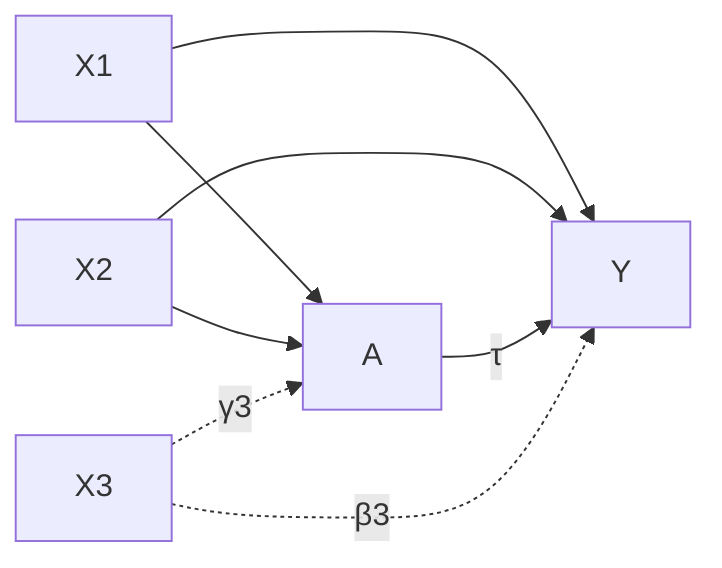

# Kịch bản thay đổi kiểu dữ liệu và số lượng biến gây nhiễu

## Mục tiêu

Nhóm kịch bản này trả lời hai câu hỏi:

1. **Kiểu dữ liệu (phần A):** khi biến gây nhiễu (confounder) là biến **định tính** thay vì định lượng, chất lượng ước lượng ATE thay đổi ra sao? Cách mã hóa biến (nhị phân, thứ bậc, danh nghĩa) và việc rời rạc hóa một biến liên tục ảnh hưởng thế nào?
2. **Số lượng biến (phần B):** khi thêm một biến $X_3$, kết quả thay đổi ra sao? Câu trả lời phụ thuộc vào **vai trò** của $X_3$ trong DAG (gây nhiễu, chỉ tác động lên Y, chỉ tác động lên A, hay không tác động gì), và vào việc ta **có đưa** $X_3$ vào mô hình hay không.

Nhóm này chạy song song với `distribution_scenario/` (thay đổi phân phối của biến gây nhiễu). Hai nhóm dùng chung tham số và chung bộ phương pháp để so sánh được với nhau.

> **Phạm vi hiện tại:** làm cơ bản trong notebook, các hàm định nghĩa ngay trong cell (giống `baseline.ipynb`), **chưa module hóa**. Khi kết quả ổn định mới tách ra module.

---

## Mô hình sinh dữ liệu (DGP) chung



$$
e(X) = P(A=1 \mid X) = \sigma\big(\gamma_0 + \gamma_1 X_1 + \gamma_2\, g(X_2) + \gamma_3 X_3\big), \qquad A \sim \text{Bernoulli}(e(X))
$$

$$
\mu_0(X) = \beta_0 + \beta_1 X_1 + \beta_2\, h(X_2) + \beta_3 X_3, \qquad Y = \mu_0(X) + \tau A + \varepsilon,\ \ \varepsilon \sim N(0, \sigma^2)
$$

- $g(\cdot)$, $h(\cdot)$ là cách biến $X_2$ tác động lên A và Y. Với biến liên tục thì $g(x) = h(x) = x$. Với biến định tính thì đây là một **hệ số riêng cho từng mức** (xem phần A).
- $X_3$ chỉ xuất hiện ở phần B. Ở phần A đặt $\gamma_3 = \beta_3 = 0$.
- Ký hiệu $\mu_0(X) = E[Y(0) \mid X]$ (baseline outcome). Không dùng $m(X)$ để tránh nhầm với $m(x) = E[Y \mid X = x]$ trong văn liệu causal ML.

**Estimand:** ATE $= E[Y(1) - Y(0)] = \tau$. Vì $\tau$ đồng nhất nên ATE bằng $\tau$ trong mọi kịch bản (trừ kịch bản tùy chọn **V7**, xem bên dưới).

**Giả định:** consistency, SUTVA, unconfoundedness (đúng theo cách xây dựng khi mọi biến gây nhiễu được quan sát), positivity. Riêng phần B có kịch bản cố ý vi phạm unconfoundedness bằng cách **không đưa** $X_3$ vào phân tích.

### Tham số (dùng chung với `distribution_scenario`)

| Tham số | Giá trị | Ghi chú |
|---|---|---|
| $\tau$ | 2.0 | ATE thật |
| $(\beta_0, \beta_1, \beta_2)$ | (0, 0.5, 0.5) | |
| $(\gamma_1, \gamma_2)$ | (0.5, 0.5) | |
| $\gamma_0$ | hiệu chỉnh | chọn để tỉ lệ treated ≈ 50% trên mẫu tham chiếu lớn, **tính lại cho từng kịch bản** |
| $\sigma$ | 1.0 | |
| $X_1$ | $N(0, 1)$ | giữ liên tục ở mọi kịch bản |
| $n$ | {250, 500, 1000, 2000, 4000, 8000} | lưới chung của mọi kịch bản |
| Số lần lặp $R$ | 1000 (thử nghiệm nhanh: 200) | |

### Nguyên tắc giữ độ mạnh confounding tương đương

Khi đổi $X_2$ từ liên tục sang định tính, nếu giữ nguyên hệ số 0.5 thì độ mạnh confounding sẽ thay đổi theo, và không còn so sánh được với baseline. Quy tắc: **chọn hệ số sao cho phương sai phần đóng góp bằng baseline**

$$
\mathrm{Var}\big(\gamma_2\, g(X_2)\big) = \mathrm{Var}\big(\beta_2\, h(X_2)\big) = 0.5^2 \cdot \mathrm{Var}(N(0,1)) = 0.25
$$

Ví dụ: $X_2 \sim \text{Bernoulli}(0.5)$ có phương sai 0.25, nên hệ số là 1.0. Pilot với $n = 2 \times 10^6$ cho naive bias 0.456, gần như trùng baseline (0.450), xác nhận quy tắc này giữ được độ mạnh confounding.

Với biến nhiều mức: chọn vector hiệu ứng thô theo từng mức (ví dụ $(0, 1, -1, 2)$), tâm hóa theo xác suất các mức, rồi nhân với hằng số để phương sai bằng 0.25.

**Lưu ý với biến nhiều mức:** chuẩn hóa $\mathrm{Var}(g)=\mathrm{Var}(h)=0.25$ chỉ giữ độ mạnh của từng hệ số. Độ mạnh confounding thực sự do $\mathrm{Cov}(g,h)$ quyết định (baseline và T1, T3b: $0.25$). Nếu $g$ và $h$ lệch pha thì confounding của $X_2$ có thể triệt tiêu hoặc ngược dấu với $X_1$, naive bias co lại và so sánh với baseline mất ý nghĩa. Ở T4, $h=(0,-0.5,1,1.5)$ cho $\mathrm{Cov}(g,h)=-0.159$ và naive bias chỉ 0.086; đã đổi sang $h=(0,0.5,-0.5,1.5)$ ($\mathrm{Cov}=0.187$, naive bias $\approx 0.39$). Nên kiểm tra $\mathrm{Cov}(g,h)$ và naive bias ở mẫu lớn cho mỗi kịch bản mới.

---

## Phương pháp và cách báo cáo

### Bốn phương pháp ước lượng (giống `distribution_scenario`)

| Phương pháp | Ước lượng | SE |
|---|---|---|
| Naive | $\bar Y_1 - \bar Y_0$ | Welch |
| OLS | hệ số của A trong $Y \sim 1 + A + \text{design}(X)$ | HC1 (robust) |
| IPTW (Hájek) | trọng số $A/\hat e + (1-A)/(1-\hat e)$ | influence function **có hiệu chỉnh cho việc ước lượng $\hat e$** (lấy từ `est_iptw` trong `baseline.ipynb`) |
| AIPW | mô hình outcome OLS riêng cho từng nhóm + $\hat e$ | $\mathrm{SD}(\psi_i)/\sqrt{n}$ |

- **Propensity score luôn dùng $\hat e$ ước lượng** bằng logistic, ở mọi bước (balance, ESS, ước lượng). Không trộn $e$ thật với $\hat e$ trong cùng một bảng.
- Mọi phương pháp nhận cùng một **ma trận thiết kế** do hàm `make_design(df, spec)` tạo ra. `spec` quyết định biến nào được đưa vào và mã hóa thế nào. Đây là "núm vặn" chính của nhóm kịch bản này.

### Chỉ số đánh giá

| Nhóm | Chỉ số |
|---|---|
| Chất lượng ước lượng | bias, **MC SE của bias**, SD thực nghiệm, mean SE, SE/SD, RMSE, **coverage CI 95%**, độ rộng CI |
| Overlap | tỉ lệ treated, min/max $\hat e$, tỉ lệ $\hat e \notin [0.01; 0.99]$, trọng số lớn nhất, ESS/n |
| Balance | max \|SMD\| trước và sau IPTW (dùng **SMD cho biến nhị phân/dummy**, xem dưới) |
| Riêng biến định tính | bảng chéo A × mức của $X_2$ (số quan sát mỗi ô), số lần lặp có ô rỗng |

**SMD cho biến nhị phân** (và cho từng dummy của biến nhiều mức):

$$
\text{SMD} = \frac{\hat p_1 - \hat p_0}{\sqrt{\big(\hat p_1(1-\hat p_1) + \hat p_0(1-\hat p_0)\big)/2}}
$$

VR (tỉ số phương sai) **không dùng** cho biến nhị phân, vì phương sai đã bị xác định bởi tỉ lệ $p$.

### Định dạng kết quả

Mỗi lần lặp ghi một dòng cho mỗi phương pháp, dạng long format:

```
scenario | analysis | n | rep | method | est | se | truth | status
```

`analysis` là cách phân tích (ví dụ `dummy`, `integer`, `S2`, `S3`). Lưu ra `results/<tên_kịch_bản>.csv`, sau đó mới tóm tắt. Như vậy có thể tính lại chỉ số mà không phải chạy lại mô phỏng.

---

## Phần A. Thay đổi kiểu dữ liệu của $X_2$

Có hai tình huống khác nhau về bản chất, cần tách riêng:

- **A.1 Biến vốn là định tính** (trong DGP): ví dụ giới tính, nhóm máu, vùng miền. Nếu mã hóa đúng thì mô hình vẫn đúng dạng, câu hỏi là mã hóa sai và ô thưa ảnh hưởng thế nào.
- **A.2 Biến liên tục bị rời rạc hóa khi phân tích**: ví dụ tuổi được ghi thành nhóm tuổi. DGP dùng $X_2$ liên tục nhưng người phân tích chỉ thấy bản đã chia nhóm, dẫn tới **confounding còn sót** (residual confounding).

### Các kịch bản

| Mã | DGP của $X_2$ | Cách phân tích (`analysis`) | Câu hỏi |
|---|---|---|---|
| **T0** | $N(0,1)$ (baseline) | liên tục | mốc so sánh |
| **T1** | Bernoulli(0.5), hệ số 1.0 | 0/1 | biến nhị phân cân bằng có khác biến liên tục không? |
| **T2** | Bernoulli(0.1), hệ số $0.5/0.3 \approx 1.67$ | 0/1 | mức hiếm: ô (A=1, X₂=1) nhỏ có làm SE và coverage xấu đi? |
| **T3a** | thứ bậc 5 mức $\{0,\dots,4\}$, xác suất (0.1, 0.2, 0.4, 0.2, 0.1), hiệu ứng **tuyến tính** theo mức | `integer` / `dummy` | mã hóa số nguyên có đủ khi hiệu ứng tuyến tính? `dummy` mất bao nhiêu hiệu quả? |
| **T3b** | như T3a nhưng hiệu ứng **phi tuyến** theo mức, ví dụ $(0, 1, 1, 0, -1)$ đã chuẩn hóa | `integer` / `dummy` | mã hóa số nguyên khi hiệu ứng không tuyến tính thì chệch bao nhiêu? |
| **T4** | danh nghĩa 4 mức, xác suất (0.4, 0.3, 0.2, 0.1), hiệu ứng khác nhau cho e và $\mu_0$, ví dụ $g = (0, 1, -1, 0.5)$, $h = (0, 0.5, -0.5, 1.5)$ đã chuẩn hóa (chọn sao cho $\mathrm{Cov}(g,h) \approx 0.19$, cùng dấu với baseline, xem lưu ý bên dưới) | `dummy` / `label` (mã 0,1,2,3 như số) | lỗi "label encoding" một biến danh nghĩa |
| **T5** | danh nghĩa 3 mức; mức hiếm (xác suất 0.1) có $\gamma$ lớn sao cho $e \approx 0.98$ | `dummy` | gần vi phạm positivity theo tầng: trong một mức gần như ai cũng được điều trị |
| **T6** | $N(0,1)$ nhưng chỉ quan sát bản chia nhóm theo phân vị, $k \in \{2, 3, 5, 10\}$ | `dummy` của nhóm; tham chiếu: liên tục; tham chiếu: bỏ hẳn $X_2$ | residual confounding giảm thế nào theo số nhóm? có giảm khi tăng $n$ không? |
| **T7** *(tùy chọn)* | cả $X_1$, $X_2$ đều nhị phân | `dummy` + ước lượng theo tầng (stratification) | khi mọi biến đều định tính, ước lượng theo tầng chính xác so với 4 phương pháp |

### Kỳ vọng

Các con số dưới đây lấy từ một pilot nhỏ (một lần sinh $n = 2 \times 10^6$ cho bias; 400 lần lặp với $n = 2000$ cho SD; chỉ OLS). Đây là **giả thuyết để kiểm chứng**, không phải kết quả.

- **T1:** gần như giống baseline. Nhị phân hay liên tục không quan trọng khi mô hình đúng và độ mạnh confounding được giữ nguyên.
- **T2:** không chệch, nhưng SE của IPTW và AIPW lớn hơn, coverage có thể thấp hơn ở $n = 500$ do ô nhỏ. Với AIPW (OLS riêng từng nhóm), nếu một lần lặp có ô rỗng thì hệ số của dummy không xác định được, nên **cần đếm và báo cáo** số lần xảy ra.
- **T3a:** `integer` và `dummy` đều không chệch; `dummy` có SD lớn hơn một chút (thêm 3 tham số).
- **T3b:** `integer` chệch (mô hình sai dạng), `dummy` không chệch. AIPW với `integer` vẫn có thể gần không chệch **nếu** mô hình PS đúng; ở đây cả PS và outcome đều dùng `integer` nên cả hai cùng sai, AIPW cũng chệch.
- **T4:** tương tự T3b, vì thứ tự 0, 1, 2, 3 không có ý nghĩa. Mức nặng hay nhẹ so với T3b phụ thuộc vào $\mathrm{Cov}(g,h)$ (xem lưu ý dưới), không suy ra được chỉ từ việc dùng label.
- **T5:** IPTW có trọng số cực đoan ở nhóm control của mức hiếm, ESS giảm mạnh. OLS và AIPW ổn định hơn vì $\tau$ đồng nhất. Trimming theo $\hat e$ ở đây không đổi estimand (τ đồng nhất) và là một cách xử lý hợp lệ.
- **T6 (pilot, OLS):**

  | Cách phân tích | Tỉ lệ phương sai $X_2$ được giải thích ($R^2$) | Bias OLS | Coverage ước tính ở $n = 2000$ |
  |---|---|---|---|
  | bỏ hẳn $X_2$ | 0 | 0.237 | ≈ 0 |
  | 2 nhóm (trung vị) | 0.64 | 0.087 | ≈ 0.55 |
  | 3 nhóm | 0.79 | 0.049 | ≈ 0.83 |
  | 5 nhóm | 0.90 | 0.024 | ≈ 0.92 |
  | 10 nhóm | 0.96 | 0.009 | ≈ 0.95 |
  | liên tục | 1 | 0 | 0.95 |

  Bias còn sót xấp xỉ $(1 - R^2) \times$ bias khi bỏ hẳn biến, khớp với kết quả kinh điển của Cochran (1968): chia 5 nhóm loại được khoảng 90% độ chệch. Điểm quan trọng: **bias này không giảm khi tăng $n$**, nên coverage càng tệ khi $n$ càng lớn. Đó là lý do lưới $n$ đi tới 8000.

---

## Phần B. Thêm biến $X_3$

Trong mọi kịch bản phần B: $X_1, X_2 \sim N(0,1)$ liên tục như baseline, $X_3 \sim N(0, 1)$ liên tục, để chỉ **vai trò** của $X_3$ thay đổi. $\gamma_0$ được hiệu chỉnh lại cho từng kịch bản để tỉ lệ treated ≈ 50%.

Mỗi kịch bản phân tích với hai tập biến:

- **S2** = $\{X_1, X_2\}$ (không đưa $X_3$ vào)
- **S3** = $\{X_1, X_2, X_3\}$ (đưa $X_3$ vào cả mô hình PS và mô hình outcome)

### Các kịch bản

| Mã | Vai trò của $X_3$ | $\gamma_3$ | $\beta_3$ | Câu hỏi |
|---|---|---|---|---|
| **V0** | không có $X_3$ | – | – | mốc so sánh |
| **V1** | **confounder** | 0.5 | 0.5 | bỏ sót một confounder (S2) chệch bao nhiêu? |
| **V2** | **chỉ tác động lên Y** (prognostic) | 0 | 0.5 | đưa vào có giúp giảm phương sai? |
| **V3** | **chỉ tác động lên A** (giống instrument) | 1.0 | 0 | đưa vào có hại? |
| **V4** | **không tác động gì** (noise) | 0 | 0 | chi phí của việc thêm một biến thừa |
| **V5** | confounder **tương quan với $X_1$**: $X_3 = \rho X_1 + \sqrt{1-\rho^2}\, Z$, $\rho = 0.7$ | 0.5 | 0.5 | bỏ sót khi $X_3$ tương quan với biến đã có; đưa vào thì cộng tuyến |
| **V7** *(tùy chọn)* | **mediator** (biến sau điều trị): $X_3 = \delta A + Z$, $\delta = 1$ | – | 0.5 | đưa biến hậu điều trị vào mô hình ("bad control") |

Ghi chú:

- **V1 với S2** cũng chính là kịch bản **confounder không quan sát được**. Điểm cần nhấn mạnh trong notebook: balance trên $X_1, X_2$ sau IPTW trông vẫn hoàn hảo (SMD < 0.1), nhưng ước lượng vẫn chệch. Kiểm tra balance không phát hiện được biến bị thiếu.
- **V7:** $X_3$ chịu tác động của A nên không được đưa vào mô hình PS. ATE (hiệu ứng toàn phần) $= \tau + \beta_3 \delta = 2.5$. Phân tích S3 đưa $X_3$ vào mô hình outcome sẽ ước lượng hiệu ứng trực tiếp $\tau = 2$, chệch $-0.5$ so với ATE. Đây là kịch bản duy nhất mà truth khác $\tau$.

### Kỳ vọng (pilot, chỉ OLS, $n = 2000$)

Đây là giả thuyết để kiểm chứng; kết quả xem mục [Kết quả phần B](#kết-quả-phần-b).

| Kịch bản | Naive bias | Bias OLS với S2 | SD OLS: S2 → S3 | Ghi chú |
|---|---|---|---|---|
| **V0** | 0.45 | 0 | 0.048 | |
| **V1** | 0.64 | **0.237** | – | S3 không chệch; S2 có coverage ≈ 0 |
| **V2** | 0.45 | 0 | 0.053 → **0.046** | đưa vào **giảm** SD khoảng 12% (phần phương sai của Y do $X_3$ được giải thích) |
| **V3** | – | 0 | 0.047 → **0.054** | đưa vào **tăng** SD khoảng 15%; ESS/n của IPTW giảm từ 0.88 xuống 0.64 |
| **V4** | 0.45 | 0 | gần như không đổi | chi phí rất nhỏ ở $n = 2000$, có thể thấy rõ hơn ở $n = 500$ |
| **V5** | 0.90 | **0.124** | – | bỏ sót vẫn chệch nhưng chỉ khoảng một nửa V1, vì $X_1$ "gánh" một phần thông tin của $X_3$ |

Bài học dự kiến cho phần B: **thêm biến không phải lúc nào cũng tốt**. Nên đưa vào biến gây nhiễu và biến chỉ tác động lên Y; không nên đưa biến chỉ tác động lên A (với IPTW thì càng hại); tuyệt đối không đưa biến hậu điều trị.

---

## Phần C *(tùy chọn)*. Kết hợp: $X_3$ là confounder định tính

$X_3$ danh nghĩa 3 mức, là confounder (hiệu ứng theo mức, đã chuẩn hóa phương sai 0.25 như phần A). Phân tích:

- `dummy`: đúng
- `label`: mã 0, 1, 2 như số
- `omit`: không đưa vào

Câu hỏi: lỗi mã hóa (label) có tệ bằng việc bỏ sót hẳn biến không?

---

## Cấu trúc thư mục và notebook

```
scenario/variable_scenario/
├── README.md              # file này
├── variable_type.ipynb    # phần A (+ phần C nếu làm)
├── add_variable.ipynb     # phần B
├── ols_unfavorable.ipynb  # phần D
└── results/               # csv kết quả Monte Carlo dạng long format, hình trong figures_A/B/D
```

[variable_type.ipynb](variable_type.ipynb) theo khung dưới đây. [add_variable.ipynb](add_variable.ipynb) và [ols_unfavorable.ipynb](ols_unfavorable.ipynb) dùng khung khác: mục 0 chứa phần dùng chung, sau đó mỗi kịch bản là một phần tự chứa với hàm `dgp_<mã>` riêng thay cho `dict` cấu hình (xem mô tả ở phần B và phần D bên dưới).

Khung của phần A. Các hàm định nghĩa trong cell, có thể bắt đầu bằng cách copy các hàm ước lượng từ `baseline.ipynb` (đã có SE cho cả 4 phương pháp) rồi sửa để nhận ma trận thiết kế.

1. **Tham số** – cell hằng số (bảng tham số ở trên).
2. **Sinh dữ liệu** – một hàm `simulate(n, scenario, seed)` dùng `dict` cấu hình cho từng kịch bản, ví dụ:

   ```python
   SCENARIOS = {
       "T1": dict(x2="binary", p=0.5, coef=1.0),
       "T3b": dict(x2="ordinal", probs=[.1, .2, .4, .2, .1], effect=[0, 1, 1, 0, -1]),
       "V1": dict(g3=0.5, b3=0.5),
       ...
   }
   ```

   Trong hàm có bước hiệu chỉnh $\gamma_0$ (chia đôi trên mẫu tham chiếu lớn, như `_calibrate_gamma0` của `distribution_scenario`) và bước chuẩn hóa hệ số theo quy tắc phương sai 0.25.
3. **`make_design(df, spec)`** – trả về ma trận thiết kế (có cột chặn) theo cách mã hóa: `continuous`, `integer`, `dummy` (`pd.get_dummies(drop_first=True)`), `label`, `binned_k`, hoặc bỏ biến.
4. **Estimator** – 4 hàm nhận `(Y, A, design)` và trả về `(est, se)`.
5. **Kiểm tra một lần chạy** cho từng kịch bản – bảng chéo A × mức, phân phối $\hat e$ theo nhóm, bảng balance (SMD nhị phân), ESS, ước lượng của 4 phương pháp.
6. **Monte Carlo** – seed bằng `np.random.SeedSequence(seed).spawn(R)` và **truyền seed con vào `simulate`** (tránh lỗi seed không có tác dụng của `baseline.ipynb`). Ghi kết quả long format.
7. **Tóm tắt** – bảng chỉ số cho từng (kịch bản, cách phân tích, n, phương pháp), kèm MC SE.
8. **Nhận xét cho từng kịch bản** theo khung **Kỳ vọng → Kết quả → Giải thích**, đối chiếu với phần Kỳ vọng của README này.
9. **Kết luận** – trả lời hai câu hỏi ở phần Mục tiêu.

---

## Các bước thực hiện

- [x] Thống nhất tham số với nhóm `distribution_scenario` (τ, β, γ, σ, n, R)
- [x] Viết `simulate`, `make_design`, 4 estimator có SE; kiểm tra trên **T0** và **V0**: bias ≈ 0, SE/SD ≈ 1, coverage ≈ 0.95
- [x] Phần A: **T1** → **T6** (ưu tiên **T6**, **T3b**, **T4** vì có hiệu ứng rõ nhất)
- [x] Phần B: **V1** → **V5**
- [x] Viết nhận xét từng kịch bản và kết luận
- [ ] Tùy chọn: **T7**, **V7**, phần C
- [ ] Sau khi kết quả ổn định: tách `simulate`, `make_design`, estimator thành module

## Trạng thái triển khai (02/11/2026)

Đã tạo và chạy [variable_type.ipynb](variable_type.ipynb) cho T0–T6 (gồm T3a/T3b),
[add_variable.ipynb](add_variable.ipynb) cho V0–V5 và
[ols_unfavorable.ipynb](ols_unfavorable.ipynb) cho H0–H3, M1a–M1c. Các hàm nằm ngay
trong cell, chưa tách module. T7, V7 và phần C vẫn là tùy chọn chưa triển khai.

Kết quả hiện tại dùng mức đầy đủ **R = 1000**, seed 20261021 và cùng lưới
n = 250/500/1000/2000/4000/8000 ở cả ba phần. Phần A và B có 648.000 dòng ước lượng
và 162.000 dòng diagnostics trong `results/`; phần D có thêm 240.000 và 48.000 dòng.
Hình theo n nằm trong `results/figures_A/`, `results/figures_B/`, `results/figures_D/`.
Xem [hướng dẫn và kết quả chạy](results/README.md), cùng hai bảng tổng hợp
[phần A](results/part_A_summary.csv) và [phần B](results/part_B_summary.csv).
Để chạy thử, đặt `RA_VARIABLE_REPS=200` trước khi khởi động kernel; đổi lưới n bằng
`RA_VARIABLE_N`; đặt `RA_VARIABLE_RUN_MC=0` để chỉ đọc lại CSV. Lần chạy mới ghi lại
CSV của các kịch bản tương ứng; cần sao lưu `results/` nếu muốn giữ cả hai lần chạy.

Tham số khớp mặc định trong `distribution_scenario/distribution.py`: τ = 2,
β = (0, 0.5, 0.5), γ = (0.5, 0.5), σ = 1. `baseline.ipynb` cũ dùng τ = 3 nên
chỉ tham khảo công thức estimator/SE, không dùng lại hằng số đó.

Baseline **OLS/IPTW/AIPW** của T0/V0 đạt kiểm tra bias trong 3 MC SE và SE/SD trên
toàn lưới n. Coverage trong 3 MC SE quanh 0.95 đạt ở V0 (18/18) và T0 (17/18; ngoại
lệ là AIPW ở n = 250 với 0.927). Naive vẫn chệch theo đúng DGP có confounding. Kiểm
tra độc lập SE IPTW bằng sandwich của hệ estimating equations chung, seed con,
calibration, consistency, HC1, SMD nhị phân, dummy khi vắng mức và tính đầy đủ của
CSV đều đạt. **V0** tái lập đúng ước lượng và SE của **T0** phần A trên 400 rep.

Hai lựa chọn cụ thể hóa thiết kế:

- **T5:** xác suất các mức là (0.45, 0.45, 0.10), hiệu ứng outcome thô là
  (-1, 0, 1) và chuẩn hóa phương sai 0.25. Hiệu ứng PS mức hiếm được hiệu chỉnh
  để xác suất điều trị trung bình trong mức này đạt 0.98, đồng thời toàn mẫu
  đạt 0.50; đây là ngoại lệ có chủ đích của quy tắc phương sai PS 0.25.
- **T6:** chia nhóm theo ngưỡng phân vị **tổng thể N(0,1)** cố định. DGP vẫn
  dùng X2 liên tục; các estimator chỉ nhận đúng biến/mã hóa trong `spec`.

Không clip PS hoặc regularize logistic âm thầm. Lần fit thất bại vẫn có dòng
CSV với `status` và giá trị NaN. Metrics chất lượng tính trên các lần thành công,
nên coverage phải đọc cùng `valid_reps`/`failure_rate`. Diagnostics overlap/balance
sau IPTW được tổng hợp trên các lần PS thành công (`ps_valid_reps`); số ô rỗng và
tỷ lệ treated dùng tất cả các lần lặp. Chẩn đoán X3 bị bỏ sót hoặc X2 liên tục
trong T6 chỉ phục vụ mô phỏng, không được dùng làm đầu vào estimator.

---

## Kết quả phần B

Notebook: [add_variable.ipynb](add_variable.ipynb). Mỗi kịch bản là một phần tự chứa, gồm: công thức DGP, hàm `dgp_<mã>` với chú thích `# KHÁC V0`, bảng so sánh với mốc, một mẫu n = 2·10⁶ phân tích bằng cả S2 và S3, Monte Carlo, nhận xét. Vẫn dùng bốn estimator, không thêm RA vì τ hằng số. Kết quả nằm trong `results/V*.csv`, `results/part_B_*`, hình trong `results/figures_B/`.

| Mã | Vai trò của X3 | Giới hạn bias OLS: S2 / S3 | Coverage OLS (n = 8000): S2 / S3 | SD S3/S2 (n = 8000): OLS / IPTW / AIPW | ESS/n (n = 8000): S2 → S3 | n* |
|---|---|---|---|---|---|---|
| **V0** | không có X3 | +0.000 / không có S3 | 0.946 / không có S3 | không có S3 | 0.875 (chỉ có S2) | không có S3 |
| **V1** | confounder | **+0.236** / +0.000 | **0.000** / 0.944 | 0.920 / 0.976 / 0.937 | 0.888 → 0.814 | 250 |
| **V2** | chỉ tác động lên Y | +0.001 / +0.002 | 0.950 / 0.949 | **0.886 / 0.895 / 0.891** | 0.875 → 0.875 | 250 |
| **V3** | chỉ tác động lên A | −0.002 / −0.002 | 0.950 / 0.954 | **1.089 / 1.273 / 1.162** | 0.913 → **0.643** | không có |
| **V4** | noise | +0.002 / +0.002 | 0.946 / 0.945 | 1.001 / 1.000 / 1.000 | 0.875 → 0.875 | không có |
| **V5** | confounder, ρ = 0.7 | **+0.123** / −0.001 | **0.003** / 0.933 | 0.966 / 1.052 / 0.992 | 0.774 → 0.731 | 250 |

n* = n nhỏ nhất mà từ đó trở đi S3 có RMSE thấp hơn S2; OLS, IPTW và AIPW cho cùng kết quả; "không có" nghĩa là không có n nào như vậy trên lưới. Tóm tắt:

- Bỏ sót confounder gây bias không giảm theo n, ở cả ba estimator (**V1**, **V5**). Balance không phát hiện được: ở **V1**, max |SMD| trên X1, X2 sau IPTW chỉ 0.006–0.034, trong khi SMD của X3 khoảng 0.49.
- Biến tiên lượng Y nên đưa vào: SD giảm khoảng 10% ở cả ba estimator, không mất ESS (**V2**).
- Biến chỉ tác động lên A không nên đưa vào: không lợi về bias, SD tăng khoảng 9–14% (OLS), 16–25% (AIPW), 27–31% (IPTW) (**V3**).
- Một biến thừa gần như miễn phí, tối đa 0.7% SD ở n = 250 (**V4**). Cộng tuyến ρ = 0.7 không phải lý do để bỏ biến: S3 vẫn thắng về RMSE ở mọi n (**V5**).
- Công thức Frisch–Waugh–Lovell giải thích các khác biệt của OLS qua hai kênh σ_res và SD(Ã), dự đoán đúng bias (**V1** +0.236, **V5** +0.123) và tỉ số SD (**V2** 0.895, **V3** 1.091).

So với pilot ở phần Kỳ vọng, các bias đều khớp. Mức thay đổi SD thấp hơn pilot: **V2** giảm khoảng 10.5% (pilot 12%), **V3** tăng khoảng 9% (pilot 15%).

---

## Phần D. Khi OLS không còn lợi thế

Notebook: [ols_unfavorable.ipynb](ols_unfavorable.ipynb). Mỗi kịch bản là một phần tự chứa, gồm: công thức DGP, hàm `dgp_<mã>` với chú thích `# KHÁC T0`, bảng so sánh với T0, một mẫu n = 2·10⁶, Monte Carlo, nhận xét.
Thêm estimator **RA** (g-computation từ hai OLS riêng từng nhóm, SE từ IF). Kết quả nằm trong `results/D_*.csv`, `results/part_D_*`, hình trong `results/figures_D/`.

Ở phần A, OLS thắng vì τ đồng nhất, μ0 tuyến tính đúng dạng, và PS với γ = 0.5 gần tuyến tính (OLS gần như double robust). Phần D phá từng điều kiện đó:

| Mã | Thay đổi so với T0 | Giới hạn bias OLS | RA | AIPW | Coverage OLS (n = 8000) | n* AIPW |
|---|---|---|---|---|---|---|
| **H0** | P(A=1) = 0.2 | +0.002 | +0.001 | +0.001 | 0.948 | — |
| **H1a** | τ = 2 + 0.5·X2 | +0.000 | +0.000 | +0.000 | 0.950 | — |
| **H1b** | τ = 2 + 0.5·X2, P(A=1) = 0.2 | **+0.141** | +0.001 | +0.001 | 0.007 | 250 |
| **H2** | X2 3 mức, mức hiếm e ≈ 0.9 và τ = 3.8 | **−0.121** | +0.002 | +0.002 | 0.002 | 250 |
| **H3** | τ = 2 + (X2² − 1)/√2 | **−0.071** | **−0.071** | +0.001 | 0.288 | 500 |
| **M1a** | μ0 + He3(X2), γ = 0.5 | −0.018 | −0.018 | +0.001 | 0.911 | — |
| **M1b** | như M1a, γ = 1.0 | **−0.091** | **−0.091** | −0.001 | 0.242 | 8000 |
| **M1c** | như M1a, γ = 1.5 | **−0.187** | **−0.187** | +0.009 | 0.002 | 4000 |

n* = n nhỏ nhất mà từ đó trở đi AIPW có RMSE thấp hơn OLS. Tóm tắt:

- OLS chỉ chệch khi heterogeneity *và* trọng số e(1−e) lệch cùng lúc (**H1b**, **H2**, **H3**).
- Thêm tương tác (RA) sửa được khi τ(X) tuyến tính theo design (**H1b**, **H2**).
- AIPW có giá trị riêng khi outcome sai dạng mà PS đúng (**H3**, **M1**).
- Khi selection mạnh, IPTW/AIPW có SE/SD 0.5–0.9 và chỉ thắng OLS về RMSE ở n lớn (**M1b/c**).

Các hằng số δ, Δ, κ là bản thử; bias OLS tỉ lệ tuyến tính với chúng.

---

## Tài liệu tham khảo

- Angrist, J. D. (1998). Estimating the labor market impact of voluntary military service using social security data on military applicants. *Econometrica*, 66(2), 249–288.
- Lin, W. (2013). Agnostic notes on regression adjustments to experimental data: Reexamining Freedman's critique. *Annals of Applied Statistics*, 7(1), 295–318.
- Słoczyński, T. (2022). Interpreting OLS estimands when treatment effects are heterogeneous. *Review of Economics and Statistics*, 104(3), 501–509.

- Cochran, W. G. (1968). The effectiveness of adjustment by subclassification in removing bias in observational studies. *Biometrics*, 24(2), 295–313.
- Brookhart, M. A. et al. (2006). Variable selection for propensity score models. *American Journal of Epidemiology*, 163(12), 1149–1156.
- Austin, P. C. (2009). Balance diagnostics for comparing the distribution of baseline covariates between treatment groups in propensity-score matched samples. *Statistics in Medicine*, 28(25), 3083–3107.
- Cinelli, C., Forney, A., & Pearl, J. (2022). A crash course in good and bad controls. *Sociological Methods & Research*.
