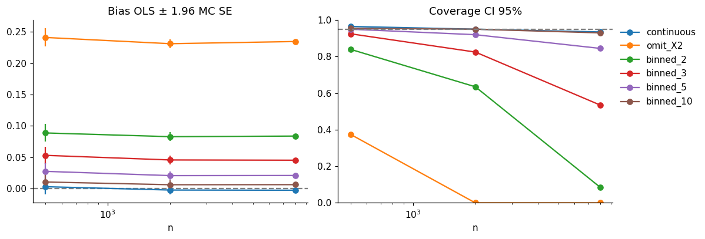
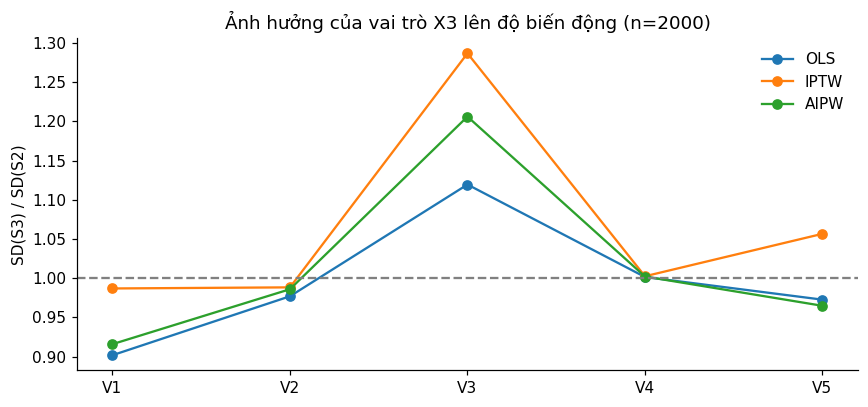

# Kết quả mô phỏng variable_scenario

Hai notebook đã chạy đầy đủ các kịch bản bắt buộc, với **R=200** (bản thử nghiệm),
seed 20261012, n=500/2000; T6 thêm n=8000. ATE thật=2.0 trong mọi kịch bản đã chạy.
Có 48.000 dòng ước lượng (30.400 phần A, 17.600 phần B), 12.000 dòng diagnostics.
T7, V7 và phần C chưa triển khai. Chưa chạy mức đầy đủ R=1000.

## Đọc và tái lập kết quả

- [variable_type.ipynb](../variable_type.ipynb): DGP T0–T6, estimator/SE, kiểm tra,
  diagnostics, Monte Carlo, nhận xét từng kịch bản và kết luận.
- [add_variable.ipynb](../add_variable.ipynb): cùng khung cho V0–V5.
- `<scenario>.csv`: long format, khóa scenario/analysis/n/rep/method, est, se, truth,
  status. `ok` là fit thành công; lỗi giữ dòng với est/se=NaN.
- `<scenario>_diagnostics.csv`: một dòng/analysis/rep; tất cả overlap/balance/ESS dùng
  PS ước lượng. `cell_counts` là bảng A × mức X2 dạng JSON; `has_empty_cell` và
  `empty_cells` tính trên đủ mức cấu hình.
- `part_A_summary.csv`, `part_B_summary.csv`: bias, MC SE bias, empirical SD,
  mean SE, SE/SD, RMSE, coverage, MC SE coverage, độ rộng CI và failure rate.
- `part_A_diagnostic_summary.csv`, `part_B_diagnostic_summary.csv`: trung bình
  diagnostics; `ps_valid_reps`, `ps_failed_reps`, `empty_cell_reps` cho biết mẫu số.
- `part_A_metadata.json`, `part_B_metadata.json`: tham số, seed, gamma0, cấu hình
  calibration, mức R và phiên bản thư viện.
- `part_A_conclusions.md`, `part_B_conclusions.md`: kết luận được sinh trực tiếp
  từ bảng kết quả; `T6_bias_coverage.png`, `X3_sd_ratio.png`: biểu đồ xuất độc lập.

Mở notebook và Run All từ thư mục variable_scenario, gốc ra_causal hoặc Seminar.
Các thư viện cần thiết được liệt kê trong cell đầu; chúng đã có trong môi trường
hiện tại. Mỗi notebook tự định nghĩa toàn bộ hàm, không phụ thuộc module mô phỏng mới.
Để chạy **R=1000**, đổi R trong cell tham số, hoặc đặt `RA_VARIABLE_REPS=1000`
trước khi khởi động kernel. Run All ghi lại CSV; sao lưu thư mục này nếu cần giữ
kết quả R=200. Cell tổng hợp có thể chạy lại chỉ từ các CSV sẵn có sau khi chạy
các cell định nghĩa hàm, không cần gọi `run_mc`.

## Kiểm tra baseline

Naive vẫn chệch do confounding; các kiểm tra gần không chệch áp dụng cho
OLS/IPTW/AIPW. Các baseline bên dưới đạt kiểm tra bias trong 3 MC SE, coverage
trong 3 MC SE quanh 0.95 và SE/SD trong [0.8, 1.2]. Dao động SD/coverage ở R=200
không được xem là bằng chứng về khác biệt nhỏ giữa các phương pháp.

| scenario | analysis | n | method | bias | mc_se_bias | se_sd_ratio | coverage |
| --- | --- | --- | --- | --- | --- | --- | --- |
| T0 | continuous | 500 | OLS | 0.0094 | 0.0061 | 1.0975 | 0.9600 |
| T0 | continuous | 500 | IPTW | 0.0083 | 0.0064 | 1.0812 | 0.9600 |
| T0 | continuous | 500 | AIPW | 0.0072 | 0.0062 | 1.0882 | 0.9550 |
| T0 | continuous | 2000 | OLS | -0.0002 | 0.0038 | 0.8846 | 0.9450 |
| T0 | continuous | 2000 | IPTW | -0.0006 | 0.0039 | 0.8900 | 0.9400 |
| T0 | continuous | 2000 | AIPW | -0.0010 | 0.0037 | 0.9007 | 0.9400 |
| V0 | S2 | 500 | OLS | 0.0118 | 0.0068 | 0.9832 | 0.9300 |
| V0 | S2 | 500 | IPTW | 0.0141 | 0.0071 | 0.9690 | 0.9300 |
| V0 | S2 | 500 | AIPW | 0.0124 | 0.0071 | 0.9608 | 0.9300 |
| V0 | S2 | 2000 | OLS | 0.0008 | 0.0032 | 1.0351 | 0.9550 |
| V0 | S2 | 2000 | IPTW | 0.0014 | 0.0034 | 1.0204 | 0.9750 |
| V0 | S2 | 2000 | AIPW | 0.0005 | 0.0033 | 1.0149 | 0.9500 |

## Phần A: kết quả và giải thích

OLS tại n=2000 (tất cả có 200 lần thành công):

| scenario | analysis | bias | mc_se_bias | emp_sd | coverage |
| --- | --- | --- | --- | --- | --- |
| T0 | continuous | -0.0002 | 0.0038 | 0.0533 | 0.9450 |
| T1 | binary | 0.0038 | 0.0032 | 0.0453 | 0.9700 |
| T2 | binary | 0.0029 | 0.0030 | 0.0428 | 0.9700 |
| T3a | integer | 0.0017 | 0.0034 | 0.0483 | 0.9350 |
| T3a | dummy | 0.0018 | 0.0034 | 0.0484 | 0.9350 |
| T3b | integer | 0.1725 | 0.0034 | 0.0481 | 0.0700 |
| T3b | dummy | 0.0000 | 0.0031 | 0.0442 | 0.9700 |
| T4 | dummy | -0.0055 | 0.0034 | 0.0487 | 0.9400 |
| T4 | label | -0.1333 | 0.0035 | 0.0500 | 0.2250 |
| T5 | dummy | 0.0008 | 0.0032 | 0.0448 | 0.9650 |
| T6 | continuous | -0.0024 | 0.0033 | 0.0471 | 0.9500 |
| T6 | omit_X2 | 0.2313 | 0.0036 | 0.0511 | 0.0000 |
| T6 | binned_2 | 0.0828 | 0.0035 | 0.0492 | 0.6350 |
| T6 | binned_3 | 0.0456 | 0.0034 | 0.0486 | 0.8250 |
| T6 | binned_5 | 0.0206 | 0.0034 | 0.0487 | 0.9200 |
| T6 | binned_10 | 0.0060 | 0.0034 | 0.0482 | 0.9500 |

- **T1/T2:** bias nhỏ so với MC SE khi mã hóa 0/1 đúng. T2 không có lần ô rỗng
  trong bản chạy này; chưa có bằng chứng ô thưa làm OLS mất coverage ở các n đã xét.
  Cần đọc bảng của từng phương pháp khi so sánh mức biến động IPTW/AIPW.
- **T3a:** integer và dummy cho kết quả gần nhau; tăng SD do dummy rất nhỏ trong
  bản thử nghiệm, phù hợp với hiệu ứng tuyến tính theo mức.
- **T3b:** integer bias khoảng 0.172, dummy gần 0; cả hai nuisance models dùng
  integer đều sai dạng nên double robustness không loại được bias đó.
- **T4:** label bias khoảng -0.133, dummy khoảng -0.006; dấu/độ lớn phụ thuộc
  vector hiệu ứng riêng của PS và outcome. Thứ tự nhãn không thể thay hiệu ứng theo mức.
- **T5:** giảm overlap có chủ đích; xác suất mức hiếm=0.1, marginal PS mức này=0.98.
  Có 65/200 ô control rỗng ở n=500 và 3/200 ở n=2000. Logistic không hội tụ hoặc
  có ma trận suy biến trong những rep này; IPTW/AIPW ghi nhận thất bại. OLS dùng
  mô hình outcome chung vẫn chạy được, vì mức hiếm hiện diện trong toàn mẫu.
  SE/SD và coverage có điều kiện của IPTW/AIPW thấp, cho thấy SE chưa phản ánh
  hết dao động hữu hạn mẫu khi chỉ có rất ít control ở mức hiếm.

| n | method | valid_reps | failed_reps | failure_rate | se_sd_ratio | coverage |
| --- | --- | --- | --- | --- | --- | --- |
| 500 | IPTW | 135 | 65 | 0.3250 | 0.6185 | 0.8000 |
| 500 | AIPW | 135 | 65 | 0.3250 | 0.7229 | 0.8296 |
| 2000 | IPTW | 197 | 3 | 0.0150 | 0.6463 | 0.8528 |
| 2000 | AIPW | 197 | 3 | 0.0150 | 0.8159 | 0.8782 |

**T6:** bias tăng khi giảm số nhóm; tăng n từ 2000 lên 8000 không xóa bias do mất
thông tin X2. Với 2 nhóm, bias OLS gần 0.083 ở cả hai n, nhưng coverage giảm từ
0.635 xuống 0.085. Với 5 nhóm bias còn khoảng 0.021, coverage giảm từ 0.920 xuống
0.845. Tăng n làm CI hẹp hơn quanh một ước lượng vẫn chệch.

| analysis | n | bias | mc_se_bias | coverage |
| --- | --- | --- | --- | --- |
| continuous | 500 | 0.0029 | 0.0064 | 0.9650 |
| omit_X2 | 500 | 0.2413 | 0.0074 | 0.3750 |
| binned_2 | 500 | 0.0888 | 0.0072 | 0.8400 |
| binned_3 | 500 | 0.0530 | 0.0069 | 0.9250 |
| binned_5 | 500 | 0.0274 | 0.0066 | 0.9500 |
| binned_10 | 500 | 0.0104 | 0.0066 | 0.9550 |
| continuous | 2000 | -0.0024 | 0.0033 | 0.9500 |
| omit_X2 | 2000 | 0.2313 | 0.0036 | 0.0000 |
| binned_2 | 2000 | 0.0828 | 0.0035 | 0.6350 |
| binned_3 | 2000 | 0.0456 | 0.0034 | 0.8250 |
| binned_5 | 2000 | 0.0206 | 0.0034 | 0.9200 |
| binned_10 | 2000 | 0.0060 | 0.0034 | 0.9500 |
| continuous | 8000 | -0.0027 | 0.0017 | 0.9350 |
| omit_X2 | 8000 | 0.2348 | 0.0018 | 0.0000 |
| binned_2 | 8000 | 0.0838 | 0.0018 | 0.0850 |
| binned_3 | 8000 | 0.0452 | 0.0018 | 0.5350 |
| binned_5 | 8000 | 0.0208 | 0.0018 | 0.8450 |
| binned_10 | 8000 | 0.0062 | 0.0018 | 0.9300 |

## Phần B: kết quả và giải thích

OLS tại n=2000:

| scenario | analysis | bias | mc_se_bias | emp_sd | coverage |
| --- | --- | --- | --- | --- | --- |
| V0 | S2 | 0.0008 | 0.0032 | 0.0456 | 0.9550 |
| V1 | S2 | 0.2364 | 0.0037 | 0.0520 | 0.0200 |
| V1 | S3 | 0.0006 | 0.0033 | 0.0469 | 0.9450 |
| V2 | S2 | -0.0001 | 0.0036 | 0.0507 | 0.9700 |
| V2 | S3 | 0.0008 | 0.0035 | 0.0495 | 0.9450 |
| V3 | S2 | -0.0010 | 0.0031 | 0.0436 | 0.9850 |
| V3 | S3 | -0.0006 | 0.0035 | 0.0488 | 0.9600 |
| V4 | S2 | -0.0015 | 0.0037 | 0.0527 | 0.9200 |
| V4 | S3 | -0.0015 | 0.0037 | 0.0527 | 0.9150 |
| V5 | S2 | 0.1214 | 0.0037 | 0.0524 | 0.3300 |
| V5 | S3 | -0.0008 | 0.0036 | 0.0510 | 0.9650 |

- **V1:** bỏ X3 tạo bias OLS khoảng 0.236; S3 gần 0. Max |SMD| trung bình sau
  IPTW trên S2 chỉ khoảng 0.011, trong khi SMD X3 bị bỏ sót khoảng 0.485.
  Balance trên biến đã đưa vào mô hình không phát hiện confounder bị bỏ sót.
- **V2:** thêm biến tiên lượng Y giảm SD OLS khoảng 2.3% trong bản chạy này,
  nhỏ hơn mức giảm 12% của pilot README. Không chép kỳ vọng pilot thành kết quả;
  mức lợi ích chính xác cần kiểm chứng bằng R=1000.
- **V3:** SD OLS tăng khoảng 12%, SD IPTW tăng khoảng 29%. ESS/n giảm từ khoảng
  0.911 xuống 0.644. Thêm biến chỉ tác động A làm PS cực đoan hơn mà không giải
  thích thêm Y.
- **V4:** tỷ lệ SD OLS S3/S2 gần 1; chi phí biến noise rất nhỏ trong bản chạy này.
- **V5:** bỏ X3 có bias OLS khoảng 0.121, nhỏ hơn V1; S3 gần 0. X1 tương quan
  với X3 nên mang một phần thông tin, nhưng chưa đủ để loại hết confounding.

Tỷ lệ SD S3/S2 cho từng phương pháp, n=2000:

| scenario | method | S2 | S3 | SD_S3_over_S2 |
| --- | --- | --- | --- | --- |
| V1 | AIPW | 0.0529 | 0.0485 | 0.9159 |
| V1 | IPTW | 0.0545 | 0.0538 | 0.9870 |
| V1 | Naive | 0.0572 | 0.0572 | 1.0000 |
| V1 | OLS | 0.0520 | 0.0469 | 0.9018 |
| V2 | AIPW | 0.0509 | 0.0502 | 0.9860 |
| V2 | IPTW | 0.0527 | 0.0520 | 0.9884 |
| V2 | Naive | 0.0557 | 0.0557 | 1.0000 |
| V2 | OLS | 0.0507 | 0.0495 | 0.9770 |
| V3 | AIPW | 0.0438 | 0.0529 | 1.2062 |
| V3 | IPTW | 0.0451 | 0.0580 | 1.2869 |
| V3 | Naive | 0.0539 | 0.0539 | 1.0000 |
| V3 | OLS | 0.0436 | 0.0488 | 1.1195 |
| V4 | AIPW | 0.0528 | 0.0529 | 1.0022 |
| V4 | IPTW | 0.0546 | 0.0547 | 1.0025 |
| V4 | Naive | 0.0593 | 0.0593 | 1.0000 |
| V4 | OLS | 0.0527 | 0.0527 | 1.0016 |
| V5 | AIPW | 0.0557 | 0.0537 | 0.9648 |
| V5 | IPTW | 0.0630 | 0.0666 | 1.0567 |
| V5 | Naive | 0.0615 | 0.0615 | 1.0000 |
| V5 | OLS | 0.0524 | 0.0510 | 0.9727 |

## Mẫu số và giới hạn diễn giải

Bias, empirical SD, SE, RMSE và coverage tính trên **các lần fit thành công**;
`valid_reps`, `failed_reps`, `failure_rate` đi kèm từng nhóm. Đặc biệt, coverage
T5 là coverage có điều kiện, không đại diện cho một thủ tục luôn cho ra CI.
Diagnostics PS/balance/ESS cũng dùng các rep PS thành công; treated rate và số
lần ô rỗng dùng toàn bộ R rep. Naive/OLS được tính ngay cả khi PS không fit được.

Không clip PS, không regularize và không thay pseudoinverse cho outcome thiếu mức
một cách âm thầm. Các chẩn đoán `x3_smd_after` khi analysis bỏ X3 và
`x2_continuous_smd_after` trong T6 chỉ dùng thông tin sẵn có ở mô phỏng; chúng
không đi vào estimator và không thể quan sát trong bài toán thực nếu biến bị thiếu.

Đã kiểm tra seed thường/seed con, consistency, phương sai đóng góp 0.25,
calibration treated=0.50 và mức hiếm T5=0.98, HC1, SMD nhị phân, dummy vắng mức,
AIPW khi ô rỗng; SE IPTW được đối chiếu độc lập với sandwich của hệ estimating
equations dùng đạo hàm số. Hai notebook có đầy đủ outputs/biểu đồ và không có
cell lỗi. CSV đủ khóa/method/rep; bias và MC SE được tính lại độc lập để đối chiếu.
