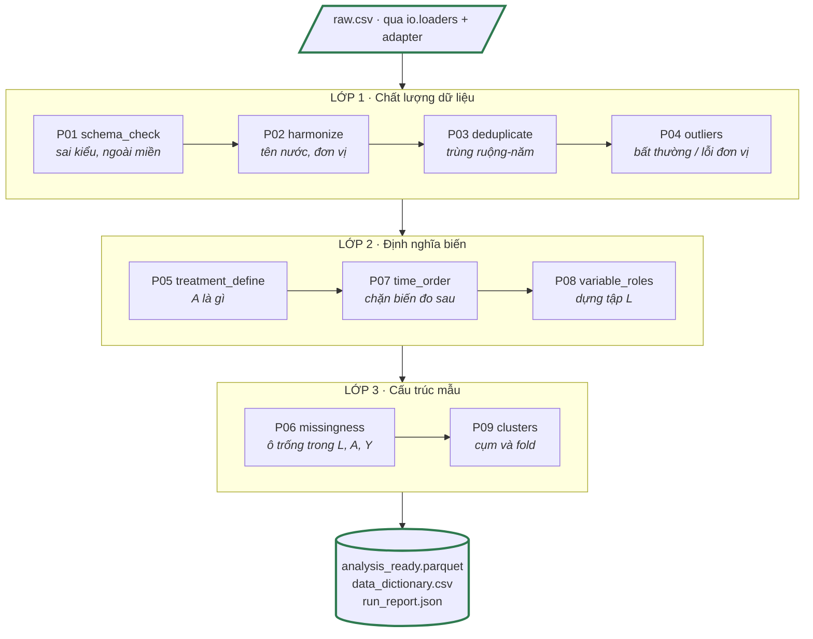

# Khối tiền xử lý (`preprocess`) — P01 → P09

> Biến **dữ liệu khảo sát thô** thành **`analysis_ready`**: dữ liệu sạch theo schema chuẩn, kèm định nghĩa biến can thiệp, tập biến điều chỉnh **L**, thông tin cụm, cờ quan sát được của outcome, và một báo cáo ghi lại **mọi** quyết định đã đưa ra.
>
> Bản thiết kế gốc: [`docs/SPEC_preprocessing.md`](../../../docs/SPEC_preprocessing.md). Tài liệu này mô tả **những gì đang có trong code** (đã kiểm chứng bằng cách chạy, không phải suy đoán): [§9](#9-bất-biến-được-test-canh-giữ) là các bất biến mà bộ test canh giữ, [§10](#10-hạn-chế-đã-biết) là những gì còn nợ và những chỗ cần người quyết định.

---

## 1. Khối này nằm ở đâu

```
dữ liệu thô  →  io.loaders + adapter  →  [ preprocess: P01…P09 ]  →  analysis_ready
                                                                      ↓
                                              process (K01–K10) · estimate · evaluate   ← chưa làm
```

Tiền xử lý **không** chứa bất kỳ phương pháp nhân quả nào (không propensity score, không trọng số, không ước lượng). Nó chỉ trả lời hai câu hỏi: *dữ liệu có đọc được không* và *ta đang đo cái gì, được phép điều chỉnh theo cái gì*.

---

## 2. Giả định về dữ liệu đầu vào

### 2.1 Đơn vị quan sát và khóa

| Giả định | Chi tiết |
|---|---|
| Một dòng | = **một ruộng trong một mùa vụ** (field-year) |
| Khóa kỹ thuật | `record_id` — duy nhất, không rỗng (P01 kiểm tra) |
| Khóa nghiệp vụ | `grower_id` + `field_id` + `year` — dùng để phát hiện trùng lặp (P03) |
| Khóa cụm | `grower_id` — một nông hộ có thể có nhiều dòng (P09) |
| Time zero | thời điểm quyết định trồng cover crop, **trước** vụ khoai tây |

### 2.2 Cột đầu vào

Danh sách cột hợp lệ nằm **duy nhất** trong [`configs/schema/canonical.yaml`](../../../configs/schema/canonical.yaml). Code không tự định nghĩa cột. Mỗi cột khai báo 7 thuộc tính:

| Thuộc tính | Ý nghĩa | Ai dùng |
|---|---|---|
| `dtype` | kiểu chuẩn | P01 (ép kiểu) |
| `required` | bắt buộc có mặt hay không | P01 |
| `range` / `allowed` | miền giá trị **"không thể"** (không phải "bình thường") | P01, P04 |
| `unit` | đơn vị chuẩn | P02 |
| `measured_at` | `pre` / `at` / `post` / `unknown` | **P07** |
| `affected_by_treatment` | chỉ khai khi `measured_at: post` | **P07** |
| `dag_role` | `confounder`, `mediator`, `collider`, `instrument`, `outcome_predictor`, `ambiguous`, `noise`, … | **P08** |

Hai thuộc tính cuối là phần quan trọng nhất: chúng quyết định biến nào được phép vào tập điều chỉnh **L**. Ví dụ `season_rain_mm` đo **sau** time zero nhưng `affected_by_treatment: false`, nên nó là biến tăng độ chính xác chứ không phải mediator; còn `soil_om_post_pct` thì `affected_by_treatment: true` nên bị chặn tuyệt đối.

### 2.3 Những gì **được phép** hỏng trong dữ liệu thô

Đây chính là lý do tồn tại của từng module:

| Hiện tượng trong dữ liệu thô | Module chịu trách nhiệm |
|---|---|
| Thiếu cột, sai kiểu, số ghi dạng chuỗi, giá trị vô lý (diện tích âm, %OM = 300) | P01 |
| Cùng một nước ghi nhiều kiểu (`"Country 1"`, `"c1 "`, `"C-1"`); yield lẫn kg/ha và t/ha; `"Yes/No/Partial"`; dấu phẩy thập phân | P02 |
| Một ruộng-năm xuất hiện nhiều lần (nộp lại khảo sát, gộp nhiều đợt xuất, join nhầm) | P03 |
| Lệch dấu thập phân, nhầm đơn vị, ruộng 900 ha trong khảo sát hộ nhỏ | P04 |
| Practice ghi theo mức độ (số tháng, loại cây) thay vì nhị phân | P05 |
| Ô trống ở covariate và ở outcome | P06 |
| Biến đo **sau** can thiệp trộn lẫn với biến nền | P07 |
| Không biết biến nào được phép điều chỉnh | P08 |
| Nhiều dòng của cùng một nông hộ | P09 |

### 2.4 Những gì **không** được giả định

- **Không** giả định dữ liệu thô của CIAT có đúng định dạng này. Định dạng thô hiện là *giả định*, khai trong [`configs/schema/raw_assumed.yaml`](../../../configs/schema/raw_assumed.yaml). Khi có dữ liệu thật, chỉ viết thêm adapter trong `io/adapters/`, **không** sửa các module.
- **Không** giả định cấu trúc nhân quả đúng. P08 chỉ đọc vai trò đã khai trong schema; DAG v0 chưa được CIAT xác nhận.
- **Không** đọc file `truth*` (đáp án của bộ mô phỏng) ở bất kỳ module nào.

---

## 3. Hợp đồng chung của mọi module

### 3.1 Một chữ ký duy nhất

```python
def run(df: pd.DataFrame, cfg: P0xConfig, ctx: PipelineContext) -> StepResult
```

| Thành phần | Vai trò |
|---|---|
| `df` | dữ liệu vào; module **luôn** `df.copy()` trước, không sửa tại chỗ |
| `cfg` | model pydantic riêng của module, dựng từ `configs/preprocess.yaml`; sai kiểu → `ConfigError` |
| `ctx` | `PipelineContext`: schema, rng, đường dẫn, và **trạng thái do module trước ghi ra** |
| trả về | `StepResult(data, report, artifacts, context_updates)` |

Nhờ chữ ký giống nhau, mọi module đều: chạy độc lập được, bọc được bằng cùng một lớp kiểm tra hợp đồng, và đăng ký vào cùng một registry.

### 3.2 Bốn kiểu dữ liệu cần biết (`core/contracts.py`)

| Kiểu | Nội dung |
|---|---|
| `Status` | `ok` · `warning` · **`blocked`** (dữ liệu vi phạm ngưỡng người dùng đặt — module vẫn đúng) · **`failed`** (lỗi kỹ thuật) |
| `Finding` | một phát hiện: `code`, `severity`, `message`, `column`, `count`, `sample_ids`, `details` |
| `StepReport` | số dòng vào/ra, dòng bị loại, dòng bị gắn cờ, cột thêm/sửa, **toàn bộ tham số đã dùng**, danh sách `Finding`, artifact, khóa context đã ghi |
| `StepResult` | `data` + `report` + `artifacts` (bảng phụ: `quarantine`, `review_list`, `data_dictionary`) + `context_updates` |

`Finding.code` luôn có dạng `P0x.TÊN_VIẾT_HOA` — nhờ đó test và người đọc báo cáo đều bám vào một mã cố định thay vì bám vào câu chữ.

### 3.3 Quy ước đặt tên cột sinh ra

| Loại | Mẫu | Ví dụ |
|---|---|---|
| Cờ (bool) | `flag__<module>__<lý do>[__<cột>]` | `flag__p04__outlier__yield_t_ha` |
| Cột dẫn xuất | `<cột>__<phép biến đổi>` | `yield_t_ha__winsorized`, `cover_crop__thr2` |
| Cột hệ thống | tên cố định | `cluster_id`, `fold_id`, `c_outcome_observed`, `dup_group_id` |

**Nguyên tắc: cờ chứ không xóa.** Mặc định của mọi module là gắn cờ và báo cáo; việc loại dòng hay sửa giá trị chỉ xảy ra khi người dùng bật tham số, và luôn được ghi vào `report.rows_dropped` / `columns_modified`.

### 3.4 Trạng thái truyền giữa các module (`PipelineContext`)

| Khóa | Ghi bởi | Đọc bởi | Nội dung |
|---|---|---|---|
| `quarantined_ids` | P01 | báo cáo | dòng bị tách khỏi phân tích |
| `unit_conversions` | P02 | báo cáo | cột → hệ số quy đổi |
| `treatment_column`, `treatment_definition` | P05 | P06, P09 | `cover_crop` và quy tắc nhị phân hóa |
| `blocked_columns`, `eligible_columns` | **P07** | **P08** | cột bị chặn / được phép xét |
| `adjustment_set` (**L**), `adjustment_set_variants` | **P08** | **P06** | tập biến điều chỉnh và các biến thể |
| `outcome_observed_column` | P06 | K07 (sau này) | `c_outcome_observed` |
| `cluster_column`, `fold_column` | P09 | K01/K09 (sau này) | `cluster_id`, `fold_id` |

Chuỗi phụ thuộc quan trọng nhất: **P07 → P08 → P06**. P07 nói biến nào hợp lệ về mặt thời gian, P08 dựng **L** từ đó, P06 chỉ điền thiếu cho những biến thật sự nằm trong **L**.

---

## 4. Chín module

| Mã | Tên | Câu hỏi nó trả lời | Sửa dữ liệu? |
|---|---|---|---|
| P01 | `schema_check` | Dữ liệu có đúng dạng đã cam kết không? | ép kiểu; tách dòng lỗi (`quarantine`) |
| P02 | `harmonize` | Cùng một thứ có đang ghi nhiều kiểu không? | chuẩn hóa chuỗi, ánh xạ mã, quy đổi đơn vị |
| P03 | `deduplicate` | Một ruộng-năm có bị ghi nhiều lần không? | có, nếu `resolve` cho phép |
| P04 | `outliers` | Có giá trị bất thường không, và là lỗi nhập liệu hay giá trị thật? | mặc định **không** |
| P05 | `treatment_define` | "Có cover crop" nghĩa là gì? | ghi lại `cover_crop` theo ngưỡng |
| P07 | `time_order` | Biến nào đo sau can thiệp? | **không** (chỉ ghi context) |
| P08 | `variable_roles` | Được phép điều chỉnh theo biến nào? | gộp mức hiếm |
| P06 | `missingness` | Ô trống nằm ở đâu và xử lý thế nào? | điền thiếu + cờ |
| P09 | `clusters` | Mỗi dòng có phải một đơn vị độc lập không? | thêm `cluster_id`, `fold_id` |

### P01 · `schema_check` — cửa vào

**Mục đích.** Chặn dữ liệu sai dạng ngay ở cửa, để lỗi không lặng lẽ biến thành `NaN` ở bước sau rồi đến cuối pipeline mới lộ ra mà không còn truy được nguồn gốc.

**Thuật toán.** (1) cột bắt buộc thiếu → `SchemaError` ngay; (2) cột lạ → theo `unknown_columns`; (3) ép kiểu theo schema sang **kiểu nullable** (`Int16`, `boolean`, `Float32`…), đếm ô ép hỏng; (4) category ngoài `allowed` → **đánh dấu**, không tự sửa; (5) số ngoài `range` → đánh dấu, xử lý giá trị theo `out_of_range`; (6) `record_id` rỗng/trùng → luôn quarantine; (7) dòng lỗi xử lý theo `on_error`.

**Ranh giới quan trọng: cái gì bị cách ly, cái gì chỉ bị đánh dấu.**

| Loại lỗi | Hành vi | Vì sao |
|---|---|---|
| Thiếu cột bắt buộc | `SchemaError`, dừng | Không có gì để phân tích |
| `record_id` rỗng | Luôn cách ly (quarantine) | Không định danh được dòng thì không truy vết được |
| Ép kiểu hỏng (chuỗi "abc" trong cột số) | Theo `on_error` (mặc định cách ly) | Bản ghi hỏng thật |
| **Hạng mục lạ** (`"Country 1"`, `"C-1"`) | **Chỉ đánh dấu**, giữ dòng | P02 sinh ra để ánh xạ đúng những giá trị này; cách ly ở đây là vứt dữ liệu mà bước sau sửa được |
| **Số ngoài miền** (yield 38700 vì ghi kg/ha) | **Chỉ đánh dấu**, giữ giá trị | Có thể là lỗi **đơn vị** mà P02 quy đổi, hoặc giá trị cực trị mà P04 mới có quyền quyết định |
| **Cột nhị phân/hạng mục ghi dạng chữ** (`"Yes"/"No"/"Partial"`, `"Có"/"Không"`) | **Để nguyên** cho P02, finding `P01.DEFERRED_TO_P02` | Chữ không ép được sang boolean không phải lỗi dòng. Trước bản sửa, P01 cách ly **120/120 dòng** vì `"Yes"` và P02 không bao giờ nhìn thấy dữ liệu |

Đây là lý do mặc định của `out_of_range` là `flag` chứ không phải `to_na`: nếu P01 xóa giá trị 38700 thì P02 không còn gì để quy đổi và ta mất 20% dữ liệu một cách âm thầm.

**Tham số chính.** `on_error` (`quarantine` | `raise` | `flag`) · `dtype_coercion` (`strict` | `permissive`) · `out_of_range` (`flag` | `to_na` | `clip` | `raise`) · `unknown_columns` · `required_id_columns`.

**Cờ.** `flag__p01__schema_error` (khi `on_error: flag`), `flag__p01__out_of_range__<cột>`, `flag__p01__not_allowed__<cột>`.
**Artifact.** `quarantine` — các dòng bị tách ra.
**Findings.** `MISSING_REQUIRED_COLUMN`, `UNKNOWN_COLUMN`, `COERCE_FAILED`, `OUT_OF_RANGE`, `NOT_ALLOWED_CATEGORY`, `BAD_RECORD_ID`, `DUPLICATE_KEY_SEEN`, `EMPTY_INPUT`.

### P02 · `harmonize` — cùng một thứ, một cách ghi

**Mục đích.** Nếu không chuẩn hóa: `country` từ 4 mức phình thành hàng chục mức (mô hình sau phải ước lượng thừa hệ số, bảng theo nước bị chia vụn); và 20% dòng ghi kg/ha sẽ có yield lớn gấp 1000 lần → **P04 sẽ gắn cờ outlier hàng loạt**, ai xóa các dòng đó là mất luôn những nước dùng đơn vị kg/ha. Đây là lý do P02 **phải** chạy trước P04.

**Thuật toán.** (1) chuẩn hóa chuỗi (cắt khoảng trắng, thường hóa, bỏ dấu, gộp khoảng trắng); (2) khớp với `allowed` của schema, rồi tra bảng alias trong `raw_assumed.yaml`, rồi fuzzy nếu bật; (3) giá trị không ánh xạ được → theo `unmapped_action` (mặc định `to_na`, riêng `country` và `cover_crop` thì **raise** vì không được đoán biến phân tầng chính và biến can thiệp); (4) quy đổi đơn vị yield về t/ha; (5) chuẩn hóa dấu thập phân; (6) ép lại dtype.

**Ba quy tắc dễ bị làm sai:**

- **Chuẩn hóa chỉ để SO KHỚP, không để ghi đè.** Giá trị ghi ra luôn là mã canonical đúng hoa/thường (`C1`, không phải `c1`). Cột mã định danh (`record_id`, `grower_id`, `field_id`) chỉ được cắt khoảng trắng — hạ hoa ở đó là sửa chính khóa dữ liệu.
- **Quy đổi đơn vị phải tự đánh dấu là đã xong.** Sau khi chia 1000, cột đơn vị (`yield_unit`) được cập nhật thành `t/ha`; nếu không, chạy lại module sẽ chia tiếp 1000 lần nữa.
- **`null` trong bảng alias nghĩa là "cố ý để trống", khác với "chưa ánh xạ được".** `"Partial": null` là giá trị **hợp lệ** về nghiệp vụ nhưng không xếp được vào 0/1. P02 đưa nó về ô trống, gắn cờ `flag__p02__intentional_na__<cột>` và phát `P02.ALIAS_TO_NA` (kèm `record_id` mẫu) — **không** bị chính sách `raise` chặn. Chỉ giá trị **không có trong bảng alias** mới bị coi là lạ.

**Khi `raise`, mọi giá trị lạ được liệt kê trong một lần.** P02 quét hết các cột rồi mới dừng, thông báo dạng:

```
Có giá trị không ánh xạ được ở cột đặt chính sách raise:
  - country: 'vietnam' (1 dòng)
  - cover_crop: 'maybe' (2 dòng), 'sometimes' (2 dòng)
```

Giá trị hiện ở dạng đã chuẩn hóa (hạ hoa, bỏ dấu); bảng alias cũng so khớp sau chuẩn hóa nên viết alias theo dạng nào cũng được. Nhờ đó bổ sung alias chỉ cần một lượt chạy, thay vì sửa-chạy lại từng giá trị.

Khi không có thông tin đơn vị (không có cột đơn vị, không có khai báo nguồn), P02 **không tự quy đổi** — nó báo `P02.UNIT_POLICY_UNAVAILABLE` và để P04 gắn cờ *nghi lỗi đơn vị*. Chế độ `threshold_inference` chỉ quy đổi **đúng những dòng vượt ngưỡng**, và luôn kèm cảnh báo vì một ruộng năng suất thật sự cao có thể bị chia nhầm.

**Tham số chính.** `string_normalize.*` · `category_mapping_mode` (`explicit` | `fuzzy_suggest` | `fuzzy_auto`) · `fuzzy_threshold` · `unmapped_action.default/.overrides` · `unit_policy` (`unit_column` | `source_declaration` | `threshold_inference` | `none`) · `unit_threshold`.

**Cờ.** `flag__p02__unit_inferred` (khi đơn vị **suy luận** chứ không khai báo — một quyết định có rủi ro, luôn kèm finding mức warning), `flag__p02__unmapped__<cột>`, `flag__p02__intentional_na__<cột>` (giá trị khai `null` trong alias, vd `"Partial"`).
**Findings.** `UNMAPPED_CATEGORY`, `ALIAS_TO_NA`, `FUZZY_SUGGESTION`, `UNIT_CONVERTED`, `UNIT_INFERRED`, `UNIT_POLICY_UNAVAILABLE`, `MIXED_UNIT_SUSPECTED`, `CATEGORY_LEVELS_FROM_DATA`.

### P03 · `deduplicate` — một ruộng-năm, một dòng

**Mục đích.** Dòng trùng làm cỡ mẫu **giả** to → sai số chuẩn nhỏ giả; và một đơn vị bị nhân đôi cũng được nhân đôi trọng số ở bước IPW sau này. Nhưng phải phân biệt *trùng lặp* với *mâu thuẫn dữ liệu*.

**Thuật toán.** Nhóm theo `key`; nhóm ≥ 2 dòng được phân loại thành **exact** (mọi cột bằng nhau trong dung sai) / **partial** (khác ở cột phụ) / **conflict** (khác ở `critical_columns` = `cover_crop`, `yield_t_ha`, `country`, `year`). Exact và partial xử lý theo `resolve`; conflict xử lý theo `conflict_action` — mặc định `review_list`: **giữ nguyên mọi dòng** và đẩy nhóm sang artifact để người xem, vì khác nhau ở A hoặc Y là dấu hiệu lỗi ghép bảng chứ không phải trùng lặp.

**Tham số chính.** `key` · `resolve` (`keep_most_complete` | `keep_first` | `keep_last` | `aggregate` | `flag_only`) · `conflict_action` · `critical_columns` · `numeric_tolerance`.
Tie-break của `keep_most_complete`: ít `NaN` nhất, hòa thì lấy `record_id` nhỏ nhất (để kết quả xác định).

**Cột/cờ.** `dup_group_id`, `flag__p03__duplicate`, `flag__p03__conflict`.
`dup_group_id` được suy ra từ **hàm băm của chính khóa** (`g` + 6 ký tự hex) chứ không đánh số theo thứ tự gặp: mã nhóm nhờ đó không đổi khi chạy lại trên dữ liệu đã gộp. Các cờ của lần chạy trước cũng được giữ nguyên, vì "dòng này từng thuộc một nhóm trùng đã gộp" là thông tin không suy ra lại được.

> **Hệ quả cần biết:** với mặc định `conflict_action: review_list`, sau P03 `record_id` **có thể vẫn trùng** — đó là các nhóm mâu thuẫn được giữ lại có chủ ý. Mọi dòng trùng còn sót đều mang `flag__p03__conflict = True` và có mặt trong artifact `review_list`.
**Artifact.** `review_list`.
**Findings.** `EXACT_DUPLICATES`, `PARTIAL_DUPLICATES`, `CONFLICTING_DUPLICATES`, `NULL_KEY`, `KEY_NOT_UNIQUE_AFTER_RESOLVE`.

### P04 · `outliers` — bất thường, nhưng là lỗi hay là thật?

**Mục đích.** Giá trị cực trị vừa kéo lệch trung bình vừa **thổi phồng độ lệch chuẩn** — mà chỉ số cân bằng SMD ở bước sau lại chia cho độ lệch chuẩn, nên chẩn đoán sẽ "đẹp giả". Nhưng xóa hết cũng sai: ruộng lớn có thật là một phần của quần thể. Vì vậy mặc định là `flag_only`.

**Thuật toán.** Với mỗi cột: chọn phương pháp (`domain_range` dùng `range` của schema; `robust_z` dùng MAD; `iqr`; `percentile`), tính ngưỡng **trong từng nhóm** `group_by` (mặc định theo nước, vì mức yield nền khác nhau giữa các nước), nhóm nhỏ hơn `min_group_size` thì dùng ngưỡng toàn cục. Sau đó: **dò lỗi đơn vị** — thử chia giá trị bị gắn cờ cho các hệ số 1000/100/10/0.1/… nếu kết quả rơi vào `range` thì đánh dấu nghi nhầm đơn vị (**không** tự chia — đổi đơn vị là việc của P02). Cuối cùng áp `action` và tính tỷ lệ gắn cờ; vượt `max_flag_rate` → `DataQualityError` ⇒ pipeline dừng ở trạng thái `blocked` với thông điệp gợi ý quay lại P02, vì gắn cờ quá nhiều thường là **lỗi hệ thống** chứ không phải outlier lẻ.

**Tham số chính.** `columns` · `method` / `method_by_column` · `robust_z_threshold`, `iqr_k`, `percentile_bounds` · `group_by`, `min_group_size` · **`action`** (`flag_only` | `winsorize` | `to_na` | `drop_row` | `log_transform` | `keep_as_feature`) · `parallel_actions` · `max_flag_rate` · `unit_error_detection`.

**Cờ.** `flag__p04__outlier__<cột>`, `flag__p04__suspected_unit_error__<cột>`, `flag__p04__any`; cột dẫn xuất `<cột>__winsorized`.
**Findings.** `OUTLIERS_FLAGGED`, `SUSPECTED_UNIT_ERROR`, `MAX_FLAG_RATE_EXCEEDED` (blocking), `ZERO_MAD`, `NON_NUMERIC_COLUMN_SKIPPED`, `ROWS_DROPPED`.

### P05 · `treatment_define` — "có cover crop" nghĩa là gì

**Mục đích.** Dữ liệu ghi practice theo mức độ (số tháng, loại cây). Gộp thành `A ∈ {0,1}` là một **lựa chọn khoa học**: ngưỡng 1 tháng và ngưỡng 3 tháng cho hai ATE khác nhau, và "cover crop 1 tháng bằng cỏ" với "5 tháng bằng cây họ đậu" là hai can thiệp khác nhau (vấn đề *consistency* / nhiều phiên bản treatment).

**Thuật toán.** (1) lưu `cover_crop__raw`; (2) `A = (cover_crop_months >= threshold_months)`, giữ `NaN` là `NaN`; (3) xử lý giá trị `"Partial"` theo `partial_action` (mặc định `to_na`) — **dòng không bị bỏ**, xem đoạn dưới; (4) sinh cột **độ nhạy ngưỡng** `cover_crop__thr1/2/3` để sau này báo cáo ATE theo từng ngưỡng; (5) lập bảng phiên bản theo loại cây, cảnh báo nếu ô quá nhỏ hoặc nếu yield trung bình giữa các phiên bản lệch hơn 1 độ lệch chuẩn; (6) ghi `ctx.treatment_definition`.

**Dòng `"Partial"`: gắn cờ để người phân tích quyết định, không tự bỏ.** P05 nhận biết dòng Partial qua cờ `flag__p02__intentional_na__cover_crop` do P02 đặt (nếu không có thì mới suy luận: `cover_crop` trống nhưng số tháng > 0). Với mọi `partial_action`, P05 luôn:

- giữ nguyên dòng trong dữ liệu và gắn cờ `flag__p05__partial`;
- tách các dòng đó ra artifact `partial_review.parquet` để xem domain của chính cột trước khi quyết định;
- phát `P05.PARTIAL_FLAGGED` kèm `record_id` mẫu.

`partial_action` chỉ quyết định giá trị của `cover_crop` ở những dòng đó: `to_na` (mặc định, để trống — các bước ước lượng sau sẽ tự không dùng), `treated`, `control`; `own_level` cần treatment nhiều mức nên với treatment nhị phân được xử lý như `to_na` kèm cảnh báo. Xử lý này áp dụng ở **cả hai nhánh**: có cột số tháng, hoặc chỉ có `Yes/No/Partial`.

**Cờ/cột.** `cover_crop__raw`, `cover_crop__thr*`, `cover_crop_type__grouped`, `flag__p05__partial`.
**Artifact.** `partial_review` — các dòng Partial.
**Findings.** `FALLBACK_TO_BINARY`, `PARTIAL_FLAGGED`, `OWN_LEVEL_NOT_BINARY`, `VERSION_HETEROGENEITY`, `SMALL_VERSION_CELL`, `TREATMENT_MISSING`, `THRESHOLD_SENSITIVITY`.

### P07 · `time_order` — chặn biến đo sau can thiệp

**Mục đích.** Đây là lỗi tốn kém nhất trong phân tích quan sát, và các biến sai lại là những biến "dự báo tốt nhất". Điều chỉnh theo **mediator** (`soil_om_post_pct`, `weed_pressure`) sẽ chặn chính con đường mà cover crop tác động lên yield → ước lượng tụt về gần 0. Điều chỉnh theo **collider** (`in_program`) tạo ra liên hệ giả. **Không chỉ số thống kê nào phát hiện được** — chỉ thứ tự thời gian mới phân biệt được.

**Thuật toán.** Duyệt mọi cột, đọc `measured_at` và `affected_by_treatment` từ schema, xếp vào bốn nhóm: `eligible` (pre/at) · `blocked_post` · `blocked_unknown` · `precision_post` (post nhưng không chịu ảnh hưởng can thiệp — chỉ được phép nếu bật `allow_post_precision_vars`, và luôn kèm cảnh báo). Ghi `ctx.eligible_columns` / `ctx.blocked_columns`. **Hậu điều kiện cứng:** `soil_om_post_pct`, `weed_pressure`, `in_program`, `yield_t_ha` luôn phải nằm trong danh sách chặn, nếu không → `ContractError`.

Module này **không đổi dữ liệu**, chỉ ghi context và bảng `column_time_table` (bảng này về sau thành `data_dictionary.csv`).

**Findings.** `BLOCKED_POST_TREATMENT`, `UNKNOWN_TIMING`, `PRECISION_VAR_ALLOWED`, `POST_VAR_NOT_BLOCKED`.

### P08 · `variable_roles` — dựng tập điều chỉnh L

**Mục đích.** Chọn biến theo **vai trò trong DAG**, không theo độ dự báo. Chọn theo độ dự báo sẽ kéo mediator vào (vì mediator dự báo Y rất tốt), kéo biến kiểu instrument (`buyer_incentive`) vào — làm **khuếch đại** phần bias còn lại thay vì giảm — và kéo biến nhiễu vào, làm mô hình PS quá khớp nên $\hat e$ bị đẩy về sát 0/1, sinh trọng số cực đoan **do mô hình tạo ra** chứ không phải do dữ liệu.

**Thuật toán.** Ứng viên = `ctx.eligible_columns`; giữ vai trò trong `include_roles` (mặc định `confounder`, cộng `outcome_predictor` nếu `include_precision_vars`); với vai trò `ambiguous` (các practice RA khác: `no_till`, `organic_fert`, `rotation_len_yr` — chưa rõ là confounder hay mediator) thì `ambiguous_action: both` tạo **hai biến thể** `O_as_confounder` / `O_as_mediator` để sau này báo cáo cả hai. Sau đó gộp mức hiếm, loại biến gần như không biến thiên. **Hậu điều kiện cứng:** mediator, collider, instrument, noise, outcome, treatment không được có mặt trong L, nếu không → `ContractError`.

**Artifact.** `data_dictionary` — bảng `column · dtype · measured_at · affected_by_treatment · dag_role · in_L · variant_membership · reason`. Đây là bảng đưa thẳng vào báo cáo khóa luận.
**Findings.** `ADJUSTMENT_SET_BUILT`, `AMBIGUOUS_ROLE`, `RARE_LEVEL_GROUPED`, `ZERO_VARIANCE_DROPPED`, `DATA_DRIVEN_USED`, `FORBIDDEN_COLUMN_IN_L`.

### P06 · `missingness` — ô trống

**Mục đích.** Ba tác hại khác nhau: (a) thiếu covariate khiến thư viện mô hình **tự động bỏ dòng** → quần thể phân tích đổi mà không ai chủ động quyết định; (b) thiếu outcome làm complete-case bị lệch nếu việc thiếu phụ thuộc L và A; (c) thiếu **có cấu trúc** (một nước không hỏi một câu) là vấn đề thiết kế khảo sát, không phải ngẫu nhiên.

Chạy **sau P08** để chỉ xử lý thiếu cho biến thật sự dùng (`L ∪ {A, Y}`).

**Thuật toán.** (1) lập bảng thiếu theo cột × nước × nhóm A, cảnh báo nếu tỷ lệ thiếu lệch giữa hai nhóm A quá `diff_warn_threshold` — dấu hiệu phải dùng trọng số IPCW thay vì complete-case; (2) cảnh báo thiếu **có cấu trúc** (một cột thiếu 100% ở một nước); (3) cột thiếu quá `max_missing_col` bị loại khỏi **L** kèm lý do; (4) điền thiếu covariate theo `covariate_missing` (mặc định trung vị + **cờ thiếu**, vì cờ giữ lại thông tin "hộ này không trả lời" vốn thường có ý nghĩa); (5) tạo `c_outcome_observed` cho bước IPCW sau này — mặc định **không bỏ dòng thiếu outcome**.

**Cờ/cột.** `c_outcome_observed`, `flag__p06__imputed__<cột>`, `flag__p06__missing_any_L`.
**Findings.** `MISSING_SUMMARY`, `MISSING_DIFFERS_BY_TREATMENT`, `STRUCTURAL_MISSING`, `COLUMN_DROPPED_HIGH_MISSING`, `IMPUTED`, `OUTCOME_MISSING_RATE`.

### P09 · `clusters` — dòng có độc lập không

**Mục đích.** Một nông hộ có nhiều ruộng, nhiều năm; các dòng đó không độc lập. Hậu quả: sai số chuẩn thông thường **quá nhỏ** (khoảng tin cậy hẹp giả, độ phủ dưới 95%); và nếu chia fold ngẫu nhiên khi cross-fit thì cùng một hộ nằm ở cả tập huấn luyện lẫn tập kiểm tra → $\hat e$ trông tốt hơn thực tế.

**Thuật toán.** `cluster_id` từ `cluster_key` (dòng thiếu khóa thành `singleton__<record_id>`); thống kê số cụm và phân phối kích thước, cảnh báo nếu một cụm chiếm hơn `large_cluster_warn` tổng mẫu (dấu hiệu lỗi ghép bảng); chia fold bằng `StratifiedGroupKFold` (nhóm theo cụm, phân tầng theo A) — dòng có A là `NaN` nhận `fold_id = -1`; **hậu điều kiện cứng:** không cụm nào được nằm ở hai fold khác nhau. Cuối cùng tính ICC thô của yield.

**Cột.** `cluster_id`, `fold_id`.
Seed chia fold lấy trực tiếp từ `seed` trong config, **không** rút từ `ctx.rng`: `ctx.rng` tiến trạng thái sau mỗi lần gọi nên cách chia fold sẽ đổi giữa các lần chạy lại. Fold phải ổn định theo cấu hình, không theo lịch sử gọi hàm.
Khi số cụm hoặc số mẫu của một nhóm treatment nhỏ hơn `n_folds`, module tự lùi về `GroupKFold` kèm cảnh báo thay vì để scikit-learn ném lỗi.
**Findings.** `CLUSTER_SUMMARY`, `LARGE_CLUSTER`, `MISSING_CLUSTER_KEY`, `ICC_ESTIMATE`, `CLUSTER_SPLIT_ACROSS_FOLDS`.

---

## 5. Luồng pipeline



### 5.1 Vì sao đúng thứ tự này

| Thứ tự | Lý do | Nếu làm ngược |
|---|---|---|
| P02 **trước** P04 | Phải quy về cùng đơn vị rồi mới nói được thế nào là bất thường | 20% dòng ghi kg/ha bị gắn cờ outlier hàng loạt |
| P03 **trước** P04, P06 | Dòng trùng làm lệch mọi thống kê dùng để đặt ngưỡng | Ngưỡng outlier và tỷ lệ thiếu tính trên mẫu bị nhân bản |
| P04 **trước** P06 | Tuỳ chọn `to_na` của P04 **sinh thêm ô trống** | P06 báo cáo tỷ lệ thiếu không khớp dữ liệu cuối |
| P05 **trước** phần còn lại | Chưa định nghĩa A thì không thống kê được theo nhóm treated/control | Mọi chẩn đoán theo nhóm phải làm lại |
| P07 **trước** P08 | Loại biến sai thời điểm trước, rồi mới xét vai trò nhân quả | Mediator có thể lọt vào L |
| **P08 trước P06** | Chỉ điền thiếu cho biến thật sự dùng (L ∪ {A, Y}) | Tốn công điền cho biến nhiễu, và mô hình điền bị nhiễu theo |
| P09 cuối | Fold theo cụm phải có sẵn trước khi cross-fit ở bước sau | Cùng một hộ nằm ở cả train lẫn test |

### 5.2 Mỗi bước được bọc bởi lớp kiểm tra hợp đồng

`pipeline/steps.py` chạy trước và sau mỗi module:

1. **Tiền kiểm tra** — khóa context cần thiết có mặt chưa (thiếu → `DependencyError`).
2. Gọi `module.run(...)`; ngoại lệ **không** thuộc cây `RaCausalError` được bọc lại thành `ContractError` mã `<MODULE_ID>.UNEXPECTED_EXCEPTION` kèm traceback.
3. **Hậu kiểm tra** — mất dòng mà không khai báo `rows_dropped` → `ContractError`; `record_id` phải còn duy nhất.
4. Ghi `context_updates` vào `ctx`.

### 5.3 Báo lỗi: luôn chỉ đúng module

Khi một bước hỏng, `pipeline/runner.py` in ra stderr đúng một khối và ghi `run_report.json`:

```
PIPELINE FAILED
  step        : P04 (outliers)
  code        : P04.MAX_FLAG_RATE_EXCEEDED
  message     : Tỷ lệ dòng bị gắn cờ 18.0% vượt ngưỡng 5.0%
  rows in/out : 1982 / -
  report      : data/reports/<run_id>/run_report.json
```

| Tình huống | Status | Mã thoát |
|---|---|---|
| Chạy xong, có cảnh báo | `warning` | 0 |
| `DataQualityError` (ngưỡng người dùng bị vượt) | `blocked` | 3 |
| `RaCausalError` khác (schema, hợp đồng, phụ thuộc) | `failed` | 2 |
| Ngoại lệ ngoài dự kiến | `failed` | 4 |

`run_report.json` chứa: `failed_step`, `config_digest`, thông tin input, **báo cáo của từng bước theo đúng thứ tự chạy**, context cuối (L, định nghĩa treatment, cột cụm/fold), và đường dẫn đầu ra. Đây là nơi trả lời câu hỏi "vì sao con số này ra như vậy".

### 5.4 Đầu ra

```
data/<output>/interim/<run_id>/after_P0x.parquet   # ảnh chụp sau mỗi bước (save_interim)
data/<output>/processed/<run_id>/analysis_ready.parquet
data/<output>/processed/<run_id>/artifacts/{quarantine,review_list,data_dictionary}.parquet
data/<output>/reports/<run_id>/run_report.json
```

---

## 6. Cách chạy

**Cả chuỗi**

```bash
python -m ra_causal.cli.run_pipeline \
    --config configs/pipeline.yaml --input data/raw/<file>.csv --output data/out
```

Tuỳ chọn: `--steps P01,P02,P03` · `--from P03` · `--to P06` · `--dry-run` (chỉ validate + đọc 1000 dòng đầu) · `--log-level DEBUG`.

**Một module độc lập** — dùng khi cần kiểm tra riêng một module hoặc thử một lựa chọn tham số:

```bash
python -m ra_causal.cli.run_step P04 \
    --input data/out/interim/<run_id>/after_P03.parquet \
    --config configs/preprocess.yaml --output data/interim/manual/ \
    --set p04.action=winsorize --set p04.max_flag_rate=0.2
```

`--set` ghi đè tham số theo đường dẫn khóa và ép kiểu theo model pydantic. Module cần context của bước trước (ví dụ P06 cần `adjustment_set` do P08 tạo) thì truyền thêm `--context <file.json>`.

---

## 7. Cấu hình

Mọi tham số của 9 module nằm trong [`configs/preprocess.yaml`](../../../configs/preprocess.yaml), **khai tường minh cả giá trị mặc định** — đọc file là thấy hết lựa chọn, không phải đọc code. Không có ngưỡng nào được viết cứng trong code.

Nguyên tắc chọn mặc định: **an toàn trước, tiện sau.** Mặc định không xóa dòng (`P04.action: flag_only`), không bỏ dòng thiếu outcome (`P06.outcome_missing: ipcw_flag`), không đoán biến can thiệp (`P02.unmapped_action.overrides.cover_crop: raise`), không cho biến đo sau can thiệp vào L (`P07.allow_post_precision_vars: false`), không chọn biến theo dữ liệu (`P08.allow_data_driven: false`).

---

## 8. Thêm một module mới

1. Tạo `p10_<tên>.py` với `MODULE_ID`, `MODULE_NAME`, `SPEC_VERSION`, một lớp `P10Config(BaseModel)` và hàm `run(df, cfg, ctx)`.
2. Gắn decorator `@REGISTRY.register("P10", P10Config)`.
3. Import trong `preprocess/__init__.py` (bắt buộc — registry chỉ được nạp khi module được import).
4. Thêm khối `p10:` vào `configs/preprocess.yaml` và mã bước vào `steps`.
5. Viết test theo 5 loại ở §10.3 của spec, cộng hai bất biến chung ở [§9](#9-bất-biến-được-test-canh-giữ) (module mới tự động được đưa vào bộ test chung khi thêm mã vào `PIPELINE_ORDER` trong `tests/conftest.py`).

---

## 9. Bất biến được test canh giữ

Bộ test (116 test, chạy dưới 25 giây) không chỉ kiểm tra "chạy không lỗi" mà canh giữ những tính chất dễ vỡ nhất của khối này. Khi sửa code, đây là những thứ sẽ kêu trước:

| Bất biến | Test canh giữ | Vì sao quan trọng |
|---|---|---|
| **Không sửa dữ liệu vào** | mọi module, `test_module_does_not_mutate_input` | Module nhận `df` chung; sửa tại chỗ làm hỏng bước trước đó |
| **Chạy lại không đổi** (idempotent) | `test_module_is_idempotent` | Chạy hai lần phải bằng chạy một lần — đã bắt được lỗi P02 chia 1000 hai lần, P05 ghi đè bản gốc, P09 đổi fold |
| **Tái lập** | `test_module_is_deterministic` | Cùng dữ liệu + config + seed → cùng kết quả và cùng báo cáo |
| **Báo cáo ghi JSON được, danh sách có thứ tự** | `test_module_report_is_json_serializable_and_sorted` | Thứ tự ngẫu nhiên phá việc so sánh giữa các lần chạy |
| **Tìm lại đúng lỗi đã cài** | `test_recovery` của từng module | Dữ liệu test biết trước đáp án: module phải tìm đúng tập đã cài, không thừa không thiếu |
| **Mỗi lựa chọn tham số làm đúng điều nó hứa** | `test_param_*` | `flag_only` giữ nguyên số dòng, `drop_row` giảm đúng số dòng đã gắn cờ, `to_na` làm tăng đúng số ô trống… |
| **Không làm gì khi dữ liệu sạch** | `test_clean_data`, `test_chain_on_clean_data_changes_nothing_substantive` | Dữ liệu sạch qua cả chuỗi phải không mất dòng, không cờ nào bật |
| **L không bao giờ chứa biến đo sau can thiệp** | `test_chain_never_lets_post_treatment_vars_into_adjustment_set` | Bất biến quan trọng nhất của cả khối |
| **Một nông hộ không nằm ở hai fold** | `test_chain_folds_respect_clusters` | Tránh rò rỉ thông tin khi cross-fit |
| **Không bước nào lặng lẽ làm mất phần lớn dữ liệu** | `test_row_loss_gate`, `test_yes_no_partial_survives_the_whole_chain` | Dữ liệu ghi `Yes/No/Partial` phải đi hết chuỗi với đủ số dòng |
| **Lỗi được định vị đúng module** | `test_error_localization` | Ép P04 chặn: báo cáo phải ghi đúng `failed_step`, mã thoát 3, các bước sau không chạy |
| **run_report đủ trường, số dòng nối tiếp** | `test_run_report` | Báo cáo là nơi duy nhất truy lại được quyết định |

Chạy: `./.venv/bin/python -m pytest -q` · chỉ unit: `-m unit` · chỉ integration: `-m integration`.

Kiểm tra nhanh bằng tay sau khi sửa code:

```bash
./.venv/bin/python -m ra_causal.cli.run_pipeline --config configs/pipeline.yaml \
    --input data/raw/clean.csv --output data/out_clean   # phải trả mã thoát 0, không cờ nào bật
./.venv/bin/python -m ra_causal.cli.run_pipeline --config configs/pipeline.yaml \
    --input data/raw/dirty.csv --output data/out_dirty   # phải chạy hết 9 bước
```

---

## 10. Hạn chế đã biết

> Cập nhật 2026-09-21 sau vòng rà soát và sửa lỗi thứ hai. Mọi mục dưới đây đã được kiểm chứng bằng cách chạy thật, không phải suy đoán.

**Về phạm vi (đúng thiết kế, không phải lỗi):**

- Khối này **không** chứa phương pháp nhân quả nào. `process/` (K01–K10), `estimate/`, `evaluate/` còn trống.
- DAG v0 **chưa được CIAT xác nhận**. P08 chỉ đọc vai trò đã khai trong `canonical.yaml`; nếu vai trò khai sai thì L sai theo, và không có cách nào phát hiện từ dữ liệu.
- Định dạng thô của CIAT **chưa biết**. `raw_assumed.yaml` là giả định; bảng alias hiện chỉ đủ cho dữ liệu test. Khi có bản xuất thật, phải bổ sung alias và viết `io/adapters/ciat.py` (đang là stub).

**Còn nợ về chức năng:**

| Chỗ | Hiện trạng | Ảnh hưởng |
|---|---|---|
| `P06.covariate_missing: mice` | Chưa có, chỉ có `median_indicator`, `drop_row`, `category_missing` | Đa gán vẫn phải làm thủ công nếu cần |
| `P06.outcome_missing: both` | Hiện xử sự như `complete_case` (bỏ dòng), chưa chạy song song hai cách để so | Không so sánh được complete-case với IPCW trong một lần chạy |
| `P09.year_handling` | Chỉ ghi vào context, chưa ảnh hưởng cách chia fold | Cụm hai chiều (hộ × năm) chưa được hiện thực |
| `P08.basis`, `P08.interactions` | Chỉ khai báo vào `ctx.ps_basis_spec` cho bước PS sau này | Đúng thiết kế, nhưng chưa có ai tiêu thụ |
| ICC ở P09 | Là ICC **thô** `MSB/(MSB+MSW)`, không phải ước lượng ANOVA chuẩn | Dùng để phát hiện cụm mạnh, **không** dùng để báo cáo |
| Gate của pipeline | `pipeline/gates.py` còn trống | Cổng kiểm tra là việc của tháng sau (K03/K05) |

**Quyết định đã chốt (2026-09-24):**

1. **`country` và `cover_crop` giữ `unmapped_action: raise`.** Giá trị lạ dừng chuỗi và được liệt kê hết trong một lần, để bổ sung alias. Giá trị hợp lệ nhưng không xếp được (như `"Partial"`) thì khai `null` trong alias, không bị chặn.
2. **`"Partial"` không bị bỏ:** gắn cờ từng dòng + bảng `partial_review` để xem xét domain của cột trước khi quyết định. `partial_action: to_na` giữ nguyên.

**Chờ dữ liệu thật mới chỉnh:** `P04.max_flag_rate = 5%` · ngưỡng `threshold_months = 2` và bộ `[1, 2, 3]` · khóa nghiệp vụ `grower_id + field_id + year` · `P06` điền trung vị theo nước với nhóm ≥ 30 dòng · `max_row_loss_per_step = 20%`.

**Chi tiết kỹ thuật còn lưu ý:**

- Yêu cầu **pandas 2.x** (`requirements.txt` chặn `<3.0`): pandas 3 cấm gán `NaN` vào cột bool/int và đổi hành vi ép kiểu.
- `P02` đọc `raw_assumed.yaml` bằng đường dẫn tương đối tính từ vị trí file module; nếu đóng gói lại theo cách khác thì phải sửa chỗ này.
- Artifact `quarantine` và `review_list` ghi dạng parquet; `data_dictionary` ghi dạng CSV ở thư mục `processed/`.
